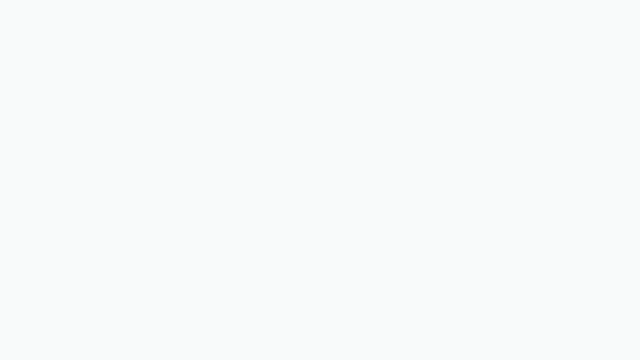
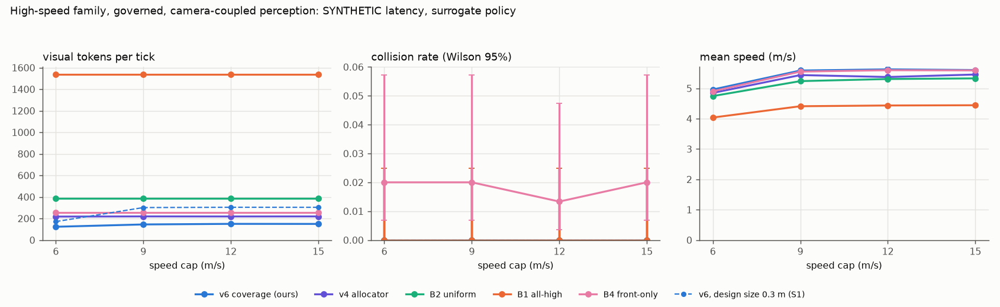
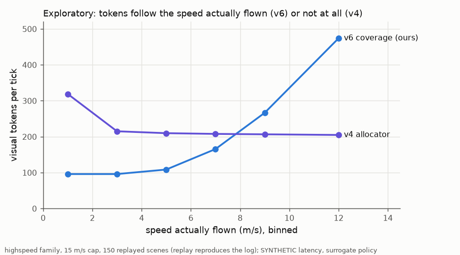
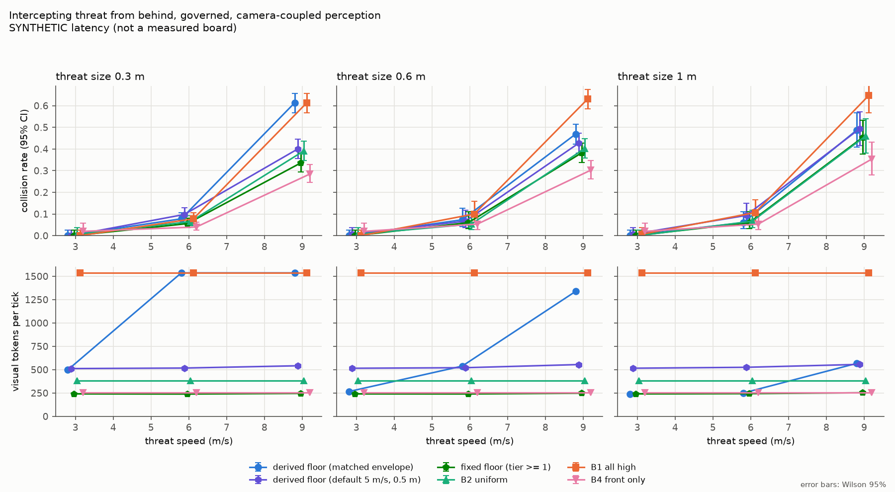
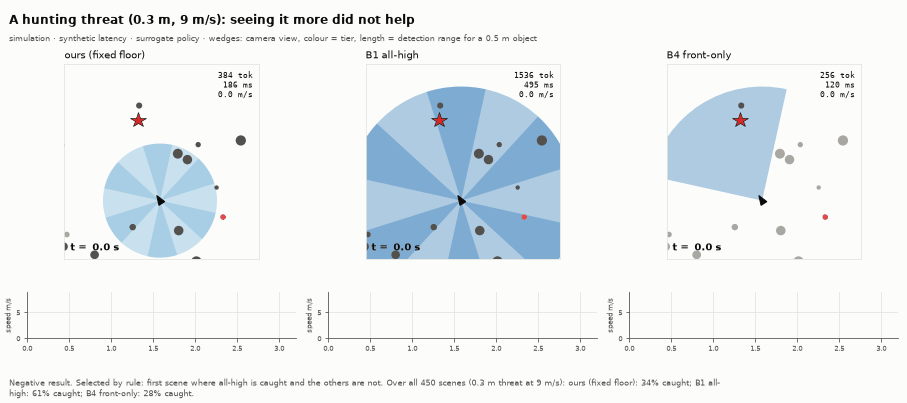
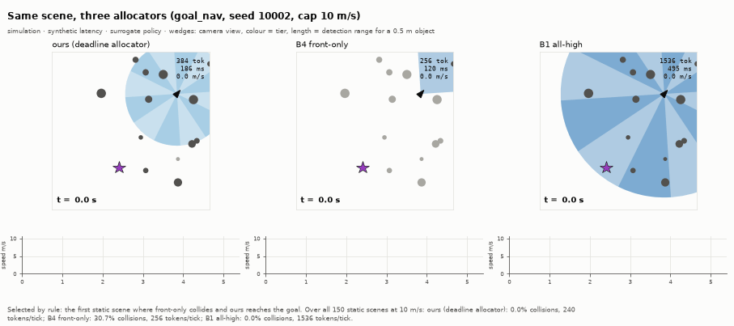
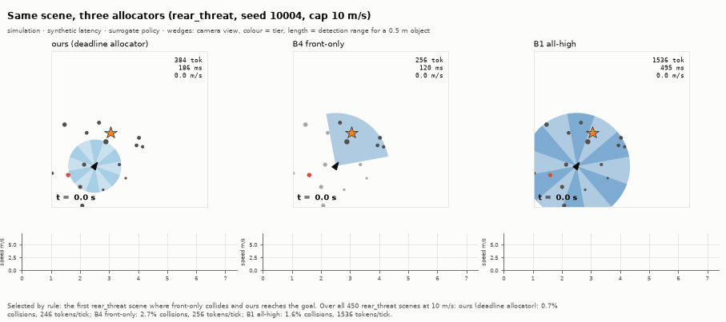
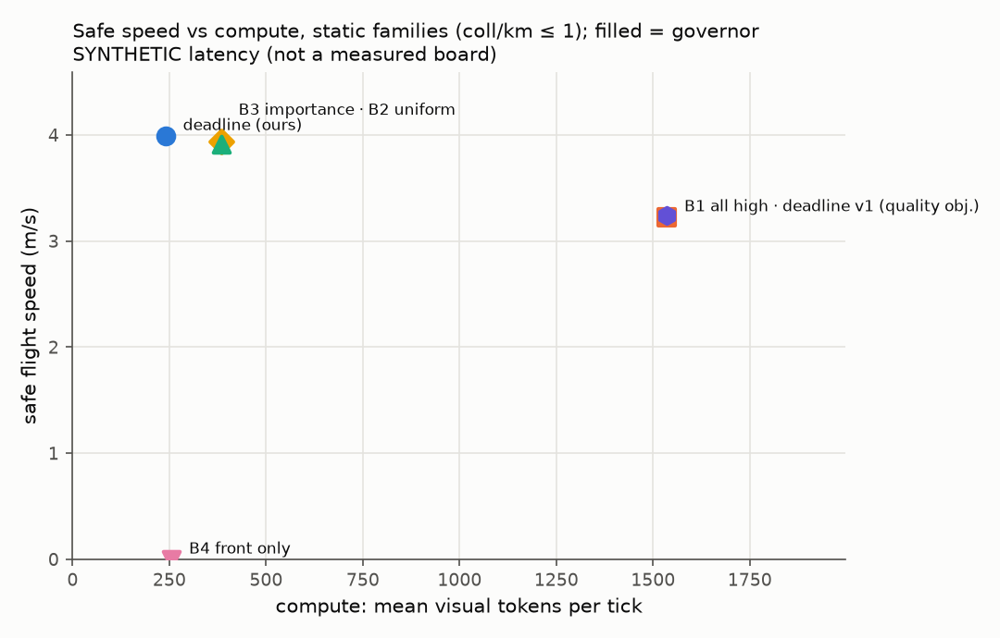
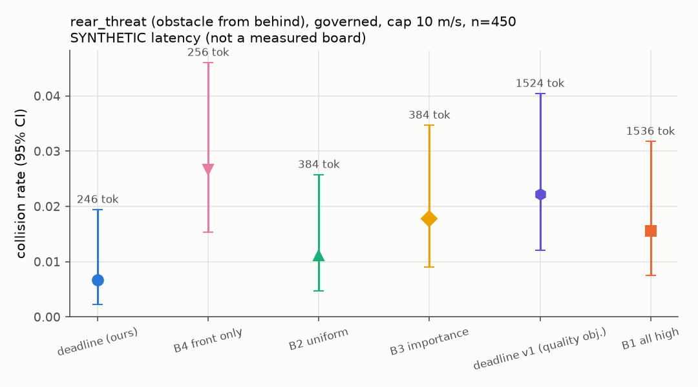

# DeadlineVLA

Omnidirectional drone VLA under a physical latency deadline. Six cameras cover 360°. Every control tick,
the allocator picks the cheapest split of visual tokens across the cameras that still sees enough: sharp in
the direction of travel (or toward anything closing in), low elsewhere. The governor then turns that
allocation's latency, the drone's speed and its clearance into the fastest speed it may safely fly, using
the stopping-deadline physics. Full design: [docs/design.md](docs/design.md).



*Every number in this animation is computed live by the project's allocator and governor (synthetic latency
table of the light run). Made with Manim CE: `scripts/manim_explainer.py`.*

```
clearance d ─┐
speed v ─────┼─> L_max(v,d) ─> allocate tokens over 6 views ─> VLA (async chunks) ─> govern speed ─> drone
latency table┘        (deadline.py)      (allocator.py)          (executor.py)      (governor.py)
```

## Status

| Part | State |
|---|---|
| Deadline, governor, latency model, exact allocator, clearance (oracle + depth) | Implemented and unit-tested, including the design doc's worked examples |
| Light simulator (numpy multirotor, 6 ray-cast cameras, 3 scene families), A* expert | Runs here; expert solves all three families collision-free |
| Recording (LeRobot when installed, LeRobot-shaped npz otherwise), budget-randomised training, offline eval | Runs here with the `mock` policy |
| Pilot loop, async/sync chunk executor, baselines B1–B4, metrics, report, CI gates, CLI | Runs here end to end |
| Isaac Lab 3.0 env, SmolVLA and GR00T N1.7 adapters, TensorRT runtime | Written against the upstream APIs, **never executed** (no GPU/Jetson here). Validating them is milestone M0 |

Everything run so far used a **synthetic** Jetson latency model (`serve.board=synthetic_orin_nx`), and the
policies were stand-ins (`mock`, `surrogate`), not a VLA. Reports say so in a banner.

## Install

```bash
python -m venv .venv
.venv/Scripts/pip install -e .[dev]        # light path: numpy, pyyaml, matplotlib, pytest, ruff
# real backends:  pip install -e .[lerobot]  (SmolVLA),  .[trt] (TensorRT export)
# Isaac Lab 3.0 and Isaac-GR00T: install from NVIDIA's instructions
```

## Run

One command reproduces a full light-path run (about 15 min on a laptop CPU):

```bash
deadlinevla all --config configs/light_surrogate.yaml        # -> runs/light_surrogate/report/report.md
```

Stages can run one at a time; each reads the previous one's outputs from `manifest.json`:

```bash
deadlinevla env-check --config configs/light.yaml   # measures a_brake, checks render rate, go/no-go
deadlinevla record    --config configs/light.yaml   # expert demos, all six views at the top tier
deadlinevla train     --config configs/light.yaml   # budget-randomised fine-tuning + offline eval
deadlinevla export    --config configs/light.yaml   # per-tier TensorRT engines (or a note for simulated)
deadlinevla profile   --config configs/light.yaml   # latency table over all 4096 allocations + linear fit
deadlinevla eval      --config configs/light.yaml   # methods x governor x speed caps x scenes
deadlinevla report    --config configs/light.yaml   # figures, report.md, gates (exit 1 if a gate fails)
```

Animations (GIFs land in `docs/media/`):

```bash
deadlinevla animate --config configs/light_surrogate.yaml --run-dir runs/light_surrogate   # episode replays
pip install -e .[viz]                                                                       # Manim CE
manim -ql -r 640,360 --fps 10 scripts/manim_explainer.py DeadlineExplainer                  # explainer (MP4)
python -m deadlinevla.viz.encode media/videos/manim_explainer/360p10/DeadlineExplainer.mp4 docs/media/explainer.gif
```

Any field can be overridden: `deadlinevla eval --config configs/light.yaml drone.margin=0.8 "eval.speed_caps=[4, 8]"`.
Each run directory gets `config.resolved.yaml`.

| Config | What it is |
|---|---|
| `configs/default.yaml` | The real setup: Isaac Lab, SmolVLA, TensorRT on a Jetson Orin NX |
| `configs/light.yaml` | Laptop CPU: numpy sim, `mock` learned policy, simulated synthetic board |
| `configs/light_surrogate.yaml` | As light, with the perception-limited `surrogate` policy |

The **surrogate** policy reads ground truth, but only what the allocation lets it see: an obstacle is
detected if it is inside an active camera's field of view and within that tier's detection range
(`perception.py`, shared with the governor). It lets the deadline module be studied before a real VLA exists. The
**mock** policy is a small numpy MLP that exercises the training contract (variable views, view/tier
codes, per-sample allocations); it is a plumbing test, not a pilot.

## v6: coverage allocation (requirements in metres), pre-registered

The v4 allocator weighted cameras by a ratio of speeds, which is scale-free, so its allocation could not
depend on speed. v6 deletes the weights: every direction, and every detected contact, must be seen by some
camera far enough to cancel its closing speed, m + τ(r)·c + c²/2a, and the allocator takes the lowest-latency
allocation that does (design.md, "4–5 (v6)"). The spec and five predictions were committed (`006411b`)
before any v6 code or run. Full scoring: [docs/results_v6.md](docs/results_v6.md).

| Prediction | Verdict |
|---|---|
| P1: on the v4 families, fewer tokens than v4 with equal safety and success | **held**: 117 vs 240 tokens/tick, 0% collisions and 100% success for both (150 paired scenes) |
| P2a: tokens rise with the speed cap (highspeed family) | **failed**: 123 → 145 → 150 → 149 |
| P2b: fewer collisions than v4 at 15 m/s | **failed**: 0% vs 0% (nothing collided) |
| P2c: more tokens than v4 at 15 m/s | **failed**: 149 vs 219 |
| P3: not worse than v4 on rear_threat | **held**: 0.2% vs 0.7% collisions (450 paired scenes) |

Why P2 failed: the high-speed family did not produce high speeds. Even at a 15 m/s cap the drone flew above
9 m/s on only ~5% of ticks, so the caps rarely bound and nothing collided. It was not re-tuned and re-run
(that needs a new pre-registered amendment). Exploratory, tick level: v6's tokens do climb with the speed
actually flown (96 below 4 m/s, 166 at 6–8, 267 at 8–10, 474 above 10 m/s, front camera at high in every
tick above 10 m/s), while v4 stays flat at ~210.





## Threat grid, v5: the derived floor does not pay off yet (negative result)

`deadlinevla threat-grid --config configs/light_surrogate.yaml` (15 min). A threat now **hunts** the drone:
every tick it re-aims at the true intercept (smallest positive root of
(|v_d|² − s_o²) t² + 2(Δ·v_d) t + |Δ|² = 0), for one pass. The grid crosses threat size (0.3/0.6/1.0 m) with
threat speed (3/6/9 m/s); the small-fast corner has 450 paired scenes and the other cells 150. All runs are
governed, camera-coupled, with an 8 m/s speed cap. The **derived coverage floor** requires every camera
to see far enough to survive the worst credible threat from its side, d_det(r_j) ≥ m + τ(r)·c_j^max + (c_j^max)²/2a with
c_j^max = own motion + o_max. It runs two ways: with the cell's true threat as its envelope ("matched"), and with
the default 5 m/s, 0.5 m envelope.





*One replayed scene from the 0.3 m / 9 m/s cell, picked by a fixed rule (the first scene where all-high is
caught and the others are not), with the cell's totals in the footer. The replay re-flies the whole cell and
must reproduce the grid's collision rates exactly before it is drawn.*

- **The prediction failed.** At 3 and 6 m/s every variant is within noise of the fixed floor (≤ 10% collisions).
  At 9 m/s, **more perception means more collisions**: all-high 61–65% and matched-derived (which goes all-high)
  61% at s = 0.3 m, versus fixed floor 34% and front-only 28% (p ≈ 1e-5 to 1e-28, paired McNemar).
- **Why, measured.** (1) Latency: on a fast board all-high drops from 62% to 48% collisions. Tokens cost
  reaction time even against a threat. (2) Reaction: even with fast inference, all-high (48%) is far worse than
  front-only (29%), which never sees the hunter. The surrogate steers around the hunter's predicted position,
  and the governor flees radially. Against a faster pursuer that re-aims every tick, both are worse than
  ignoring it. Removing the escape manoeuvre (own-motion governor) makes all-high worse still (72%), so the
  escape is not the cause; the reaction policy is.
- **So detection range is not what limits survival here.** Seeing a threat earlier only helps if something can
  turn the extra time into a miss, e.g. a lateral dodge against a threat with a finite turn rate. Neither the
  surrogate nor the governor can do that, and an ideal re-aiming hunter with no turn limit cannot be dodged.
- The derived floor with the default envelope costs ~520 tokens per tick everywhere (vs 240 for the fixed floor)
  for no measurable benefit. **The fixed floor remains the default allocator for now**; `budget.floor: derived`
  is implemented, tested and kept for the next iteration.

## Light-path results, v4 (synthetic board, surrogate policy, camera-coupled governor)

Per cell: 150 static scenes (50 each of goal_nav, sparse_nav, slalom) plus 450 rear_threat scenes (threats at
up to 10 m/s), every method on identical scenes, governor on. In v4 the governor sees obstacles **only
through the cameras at their current tier** (detection range f_px(r)·s/p_min), the same perception model the
policy uses; `perception.governor: oracle` is the upper-bound ablation. Reproduce with
`deadlinevla all --config configs/light_surrogate.yaml`; compare the modes with
`deadlinevla compare --run-dir runs/light_surrogate --other runs/light_surrogate_oracle`.

**Headline: the efficiency survives coupling.** Governed, 10 m/s cap, paired against B2 uniform:

| | tokens/tick | success | collisions | speed vs B2, paired 95% CI |
|---|---|---|---|---|
| static, deadline (ours) | 244 (−36%) | 1.000 | 0.000 | +0.075 m/s [+0.058, +0.091] |
| static, B2 uniform | 384 | 1.000 | 0.000 | (reference, 4.28 m/s) |
| static, B4 front-only | 256 (−33%) | 0.693 | **0.307** (p = 3e-14 vs B2) | +0.19 m/s |
| rear_threat, deadline (ours) | 244 (−36%) | 0.989 | 0.007 | +0.067 m/s [+0.051, +0.084] |
| rear_threat, B2 uniform | 384 | 0.984 | 0.011 (p = 0.69 vs ours) | (reference, 4.53 m/s) |
| rear_threat, B4 front-only | 256 | 0.973 | 0.027 | +0.22 m/s |

**Camera-coupled vs oracle governor**, paired on the same scenes:

- **Ours: no measurable cost.** Static: identical (0 collisions, speed +0.000 [−0.008, +0.007]). rear_threat:
  0.7% vs 0.2% collisions (p = 0.5).
- **Front-only collapses.** Static collisions 0% → 31% (p = 3e-14); rear_threat 0.2% → 2.7% (p = 0.001).
  Once safety depends on the cameras, the 360° floor (every view at least low) is what keeps ours safe, and
  front-only's savings stop being free.
- **Why ours lost nothing:** scene obstacles are 0.6–1.6 m and the threat 1.0 m, so even a low-tier camera
  detects them at about 5–13 m. That is enough here. A quick check with small threats (s = 0.3 m: low tier
  sees them at 2.4 m) still gave ours 0/150 collisions, partly because the threat generator often misses the
  drone. A harder threat generator is needed before the "raise the rear tier" trade-off can show up.
- Ours still has a closing threat that no camera has detected on 18–33% of ticks, without harm in these scenes.

Caveats that still hold: the surrogate defines how tokens turn into perception (the efficiency number is a
hypothesis until M4), and all latency is from an invented board.





*Replays of real evaluation episodes, same scene for all three allocators. Wedges are camera views, coloured
by tier, with length equal to the detection range for a 0.5 m object; dark obstacles are the ones the
cameras currently detect. Scenes are chosen by a fixed rule (the first scene where front-only collides and
ours reaches the goal) and every replay is checked against `episodes.jsonl` before it is drawn. The footers
give the totals over all scenes, which are the evidence; a single replay is an illustration.*




### What changed from v3, and why

| Change | Evidence |
|---|---|
| One perception model (`perception.py`) for policy and governor: an obstacle exists only once a camera at its tier detects it (d_det = f_px(r)·s/p_min); oracle governor kept as an ablation | v3's governor saw through a free, perfect 360° sensor, so rear_threat could not reward the allocator |
| `unseen` metric; relative violations judged against ground truth | Threats the cameras missed must count against the method |
| `scenes.threat_radius` for small-threat variants | Large obstacles are detected early even at low tier |

### v3 results, oracle governor (kept for the record)

36% fewer tokens than B2 with equal success and safety, +0.078 m/s [+0.061, +0.096] on static scenes. The
relative governor cut rear_threat collisions for every method versus the own-motion governor (ours 4.0% →
0.2%, p = 1.5e-5; all-high 21% → 1.6%), but it did so for every allocation, front-only included, because it
saw through ground truth. That confound is what v4 removes.

### What changed from v2, and why

| Change | Evidence |
|---|---|
| Relative deadline per contact (`budget.relative`): L_max,i = (d_i − m − c_i²/2a)/c_i with closing speed c_i; reduces to the original for a static obstacle ahead | In v2, every governed collision was in rear_threat: own-motion reasoning never sees a threat from behind |
| Closing-speed camera weights | In a static world they equal the old weights; a threat from behind raises the rear weight early |
| Escape governor: each threat constrains the commanded closing speed; ahead → slow down, otherwise → push away along −r̂; inside the margin, slide but don't approach | A threat from behind can't be braked away from; v2's scaling-only governor had no response to it |
| Threat = on a collision course **or** inside the 30° cone ahead of velocity or command | Course-only threats let a grazed slalom obstacle become a collision course at 1.8 m and 5 m/s after one heading change (13–19 of 50 slalom runs collided). The cone restores v2's safety ahead |
| Surrogate passes obstacles outside the governor's margin | Otherwise every planned pass looks like a collision course (goal_nav speed fell to 1.3 m/s) |
| rear_threat at threat_speed 5 and 450 scenes; paired bootstrap and McNemar; headline section; `deadlinevla compare` | Two-proportion power analysis: ~434 scenes to tell 10% from 5%; speed needs a paired CI before claiming "fastest" |

### What changed from v1 to v2, and why

| Change | Evidence |
|---|---|
| Allocator objective is now *speed* (`budget.objective: speed`): the cheapest allocation meeting a weighted perception floor Q_min, with every view at least low | v1 filled any slack with ~1,300 tokens; with the governor on, latency costs speed (a = 8.4, D = 5 m: v* 7.85 → 6.99 m/s from L = 0.17 → 0.30 s). v1 kept as `deadline_v1` |
| 360° floor kept as a hard constraint in v2 | Without it, the weighted Q_min switched rear views off and paid with a sharper front view (`[3,1,0,0,0,1]`) |
| Governor blind time L + dt + τ_track, with τ_track measured by `env-check` (0.09 s) | Violation-cause log: 85–90% of governed violations were `dynamics_lag`, where v* fell ~0.4 m/s per tick but the velocity controller closed only ~63% of the gap |
| Governor clearance = min(command, velocity) while moving, command only at hover | A turn sweeps both directions; at hover the drone must still be able to back away |
| Per-tick violation causes, Wilson intervals, moving-ticks-only violation rate | Needed to tell bugs from physics |
| B3 uses per-camera obstacle proximity; eval warns if B3 ≈ B2 on > 95% of ticks | B3 was identical to B2 in every cell |
| `sparse_nav` family (quarter clutter); 50 scenes per family; `rear_threat` reported separately from the static families | Governor always bound in clutter; 6 scenes per cell was too few; rear-threat failures hid the static-family result |
| `sim.render: false` for the surrogate, parallel sweep (`eval.workers`) | 12,000 episodes went from hours to minutes |

## Implementation notes (where the code goes beyond or interprets the design doc)

- **Braking.** `measure_braking` returns the conservative `min_v v²/(2 s(v))`, so `v²/(2a)` bounds every
  measured stop including controller lag (light sim: a ≈ 8.4 m/s²).
- **Governor.** The deadline uses clearance along the current velocity (doc step 1). The governor uses
  min(command, velocity) clearance while moving and command clearance at hover, so a drone inside the
  margin can be commanded away. Its blind time is L + dt + τ_track (see the v2 table above).
- **Latency in simulation.** Rollouts sample latency from the board (synthetic, or the measured Jetson
  table replayed as a lognormal with its p50/p95, clipped at max), never from the desktop. This is the
  "injected delay in sim" answer to the hardware-in-the-loop risk.
- **Async splicing.** If latency exceeds the chunk horizon, the chunk's last action is kept rather than
  nothing.
- **Violation rate** counts moving ticks only (v ≥ hover speed), since while hovering L_max is infinite. It uses the latency of the inference whose chunk is actually being flown.
- **Linear latency fit.** `c` and `e(r)` are only separable with per-stage timings (`encode`, `prefill`);
  from totals alone the fit reports an effective per-view cost per tier. The synthetic board has a
  quadratic attention term, so its fit falls back to the table, as the doc anticipates.
- **TensorRT.** Vision encoders are compiled per tier (the allocation-dependent cost); backbone prefill
  and the action head run in fp16 PyTorch for now. Full-TRT backbone/head is an M3 task.
- **SmolVLA plumbing.** The adapter wraps `prepare_images`/`embed_image` on the loaded instance only;
  `fixed_slots=True` is the doc's fallback (six slots, masked off views, no compute saving).

## Layout

```
src/deadlinevla/
  config.py manifest.py perception.py cli.py
  sim/     scenes.py drone_env.py light_env.py isaac_env.py expert.py
  data/    record.py dataset.py
  budget/  deadline.py governor.py relative.py latency_model.py allocator.py clearance.py
  policy/  base.py views.py mock.py surrogate.py smolvla.py gr00t.py
  train/   sft.py
  serve/   runtime.py executor.py pilot.py
  eval/    baselines.py rollout.py sweep.py grid.py metrics.py stats.py report.py
  ops/     gates.py
  viz/     replay.py gifs.py encode.py   (episode replays, GIF encoding)
tests/     103 tests incl. an end-to-end CLI run (pytest, ~30 s)
```

## Next steps (milestone M0, go / no-go)

The laptop simulator is **frozen at `a2754eb`**; hypotheses and success criteria for the real stack are in
[docs/preregistration.md](docs/preregistration.md) (draft: sign it before any confirmatory run). The M0
runbook, with commands and go/no-go criteria, is [docs/m0.md](docs/m0.md):

1. Isaac Lab 3.0 renders six cameras at the control rate (on A100: the Newton/Warp kit-less renderer).
2. SmolVLA takes six views with mixed and dropped tiers: `scripts/m0_smolvla_views.py`.
3. The fine-tuning path runs: `train.alloc_sampler=constant`, then `mixed`.
4. **A Jetson Orin NX or AGX Orin. Start this first: it has the longest lead time, and without it the 36%
   stays synthetic.**

## Licenses

Code: MIT. SmolVLA and LeRobot are open source; GR00T N1.7 weights are under the NVIDIA Open Model
License. Sim-to-real is out of scope for v1: nothing here has flown.
