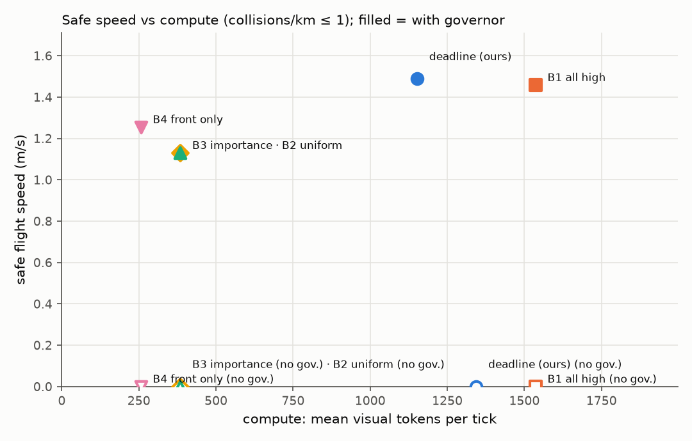
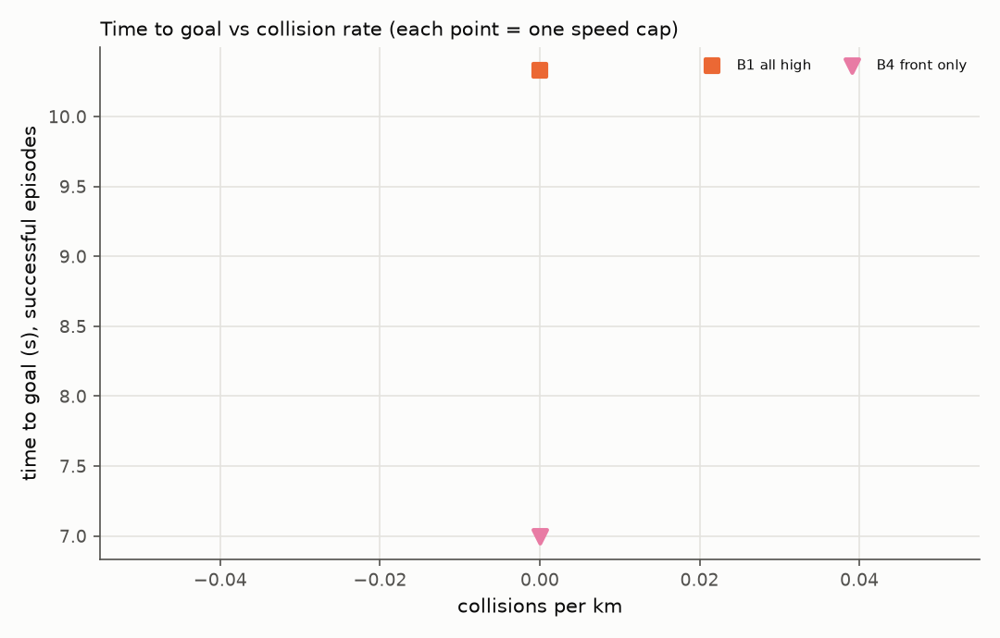

# DeadlineVLA evaluation report

> Latency comes from a SYNTHETIC board model, not a measured Jetson table.
> Policy is the 'mock' stand-in, not a VLA.

## Safe speed per method

| method | governor | safe speed (m/s) | at cap | tokens/tick |
|---|---|---|---|---|
| all_high | False | 0 | - | 1.54e+03 |
| all_high | True | 1.46 | 9 | 1.54e+03 |
| deadline | False | 0 | - | 1.34e+03 |
| deadline | True | 1.49 | 6 | 1.15e+03 |
| front_only | False | 0 | - | 256 |
| front_only | True | 1.26 | 6 | 256 |
| importance | False | 0 | - | 384 |
| importance | True | 1.13 | 9 | 384 |
| uniform_fixed | False | 0 | - | 384 |
| uniform_fixed | True | 1.13 | 9 | 384 |

## All cells (all families)

| method | governor | speed_cap | success_rate | collisions_per_km | time_to_goal | mean_speed | tokens_per_tick | violation_rate | mean_latency | stall_rate |
|---|---|---|---|---|---|---|---|---|---|---|
| all_high | True | 3 | 0 | 0 | - | 1.07 | 1.54e+03 | 0.147 | 0.466 | 0.808 |
| all_high | True | 6 | 0 | 0 | - | 1.31 | 1.54e+03 | 0.143 | 0.464 | 0.807 |
| all_high | True | 9 | 0.333 | 0 | 10.3 | 1.46 | 1.54e+03 | 0.194 | 0.459 | 0.806 |
| all_high | False | 3 | 0 | 81.7 | - | 2.46 | 1.54e+03 | 0.163 | 0.459 | 0.813 |
| all_high | False | 6 | 0 | 41.3 | - | 3.78 | 1.54e+03 | 0.207 | 0.462 | 0.824 |
| all_high | False | 9 | 0 | 41.3 | - | 3.78 | 1.54e+03 | 0.207 | 0.463 | 0.824 |
| deadline | True | 3 | 0 | 0 | - | 1.35 | 1.27e+03 | 0.115 | 0.273 | 0.648 |
| deadline | True | 6 | 0 | 0 | - | 1.49 | 1.15e+03 | 0.176 | 0.23 | 0.573 |
| deadline | True | 9 | 0 | 0 | - | 1.48 | 1.22e+03 | 0.153 | 0.252 | 0.604 |
| deadline | False | 3 | 0 | 76 | - | 2.49 | 1.36e+03 | 0.165 | 0.317 | 0.72 |
| deadline | False | 6 | 0 | 63.9 | - | 3.68 | 1.32e+03 | 0.186 | 0.299 | 0.707 |
| deadline | False | 9 | 0 | 41.3 | - | 3.85 | 1.34e+03 | 0.173 | 0.309 | 0.692 |
| front_only | True | 3 | 0 | 7.99 | - | 1.39 | 256 | 0.0491 | 0.109 | 0.0123 |
| front_only | True | 6 | 0.167 | 0 | 7 | 1.26 | 256 | 0.0868 | 0.108 | 0.0115 |
| front_only | True | 9 | 0 | 0 | - | 0.995 | 256 | 0.0769 | 0.108 | 0.00915 |
| front_only | False | 3 | 0 | 31.5 | - | 2.77 | 256 | 0.044 | 0.109 | 0.0352 |
| front_only | False | 6 | 0 | 54.9 | - | 4.29 | 256 | 0.204 | 0.109 | 0.0719 |
| front_only | False | 9 | 0 | 54.7 | - | 4.3 | 256 | 0.232 | 0.108 | 0.0714 |
| importance | True | 3 | 0 | 10.8 | - | 0.872 | 384 | 0.0453 | 0.169 | 0.0113 |
| importance | True | 6 | 0 | 0 | - | 1.13 | 384 | 0.0391 | 0.168 | 0.0147 |
| importance | True | 9 | 0 | 0 | - | 1.13 | 384 | 0.0392 | 0.167 | 0.0147 |
| importance | False | 3 | 0 | 73.7 | - | 2.62 | 384 | 0.0976 | 0.167 | 0.0585 |
| importance | False | 6 | 0 | 43.3 | - | 4.28 | 384 | 0.0875 | 0.17 | 0.075 |
| importance | False | 9 | 0 | 43 | - | 4.33 | 384 | 0.0881 | 0.167 | 0.0755 |
| uniform_fixed | True | 3 | 0 | 10.8 | - | 0.872 | 384 | 0.0453 | 0.169 | 0.0113 |
| uniform_fixed | True | 6 | 0 | 0 | - | 1.13 | 384 | 0.0391 | 0.168 | 0.0147 |
| uniform_fixed | True | 9 | 0 | 0 | - | 1.13 | 384 | 0.0392 | 0.167 | 0.0147 |
| uniform_fixed | False | 3 | 0 | 73.7 | - | 2.62 | 384 | 0.0976 | 0.167 | 0.0585 |
| uniform_fixed | False | 6 | 0 | 43.3 | - | 4.28 | 384 | 0.0875 | 0.17 | 0.075 |
| uniform_fixed | False | 9 | 0 | 43 | - | 4.33 | 384 | 0.0881 | 0.167 | 0.0755 |

## Family: goal_nav

| method | governor | speed_cap | success_rate | collisions_per_km | time_to_goal | mean_speed | tokens_per_tick | violation_rate | mean_latency | stall_rate |
|---|---|---|---|---|---|---|---|---|---|---|
| all_high | True | 3 | 0 | 0 | - | 1.38 | 1.54e+03 | 0.183 | 0.458 | 0.802 |
| all_high | True | 6 | 0 | 0 | - | 2.88 | 1.54e+03 | 0.197 | 0.462 | 0.808 |
| all_high | True | 9 | 0.5 | 0 | 11.2 | 2.37 | 1.54e+03 | 0.242 | 0.464 | 0.809 |
| all_high | False | 3 | 0 | 29.8 | - | 2.65 | 1.54e+03 | 0.0635 | 0.461 | 0.81 |
| all_high | False | 6 | 0 | 29.7 | - | 3.99 | 1.54e+03 | 0.169 | 0.457 | 0.819 |
| all_high | False | 9 | 0 | 29.6 | - | 4.01 | 1.54e+03 | 0.169 | 0.462 | 0.819 |
| deadline | True | 3 | 0 | 0 | - | 2.2 | 1.27e+03 | 0.109 | 0.272 | 0.649 |
| deadline | True | 6 | 0 | 0 | - | 3.02 | 1.17e+03 | 0.18 | 0.247 | 0.587 |
| deadline | True | 9 | 0 | 0 | - | 3.14 | 1.21e+03 | 0.199 | 0.256 | 0.617 |
| deadline | False | 3 | 0 | 29.7 | - | 2.65 | 1.47e+03 | 0.0556 | 0.397 | 0.786 |
| deadline | False | 6 | 0 | 36.9 | - | 3.85 | 1.37e+03 | 0.159 | 0.343 | 0.71 |
| deadline | False | 9 | 0 | 29.1 | - | 4.03 | 1.39e+03 | 0.119 | 0.346 | 0.714 |
| front_only | True | 3 | 0 | 0 | - | 2.86 | 256 | 0 | 0.108 | 0.0221 |
| front_only | True | 6 | 0 | 0 | - | 4.29 | 256 | 0.126 | 0.108 | 0.0336 |
| front_only | True | 9 | 0 | 0 | - | 4.35 | 256 | 0.182 | 0.109 | 0.0455 |
| front_only | False | 3 | 0 | 0 | - | 2.86 | 256 | 0 | 0.108 | 0.0221 |
| front_only | False | 6 | 0 | 30.5 | - | 4.59 | 256 | 0.157 | 0.108 | 0.0571 |
| front_only | False | 9 | 0 | 30.4 | - | 4.61 | 256 | 0.186 | 0.109 | 0.0571 |
| importance | True | 3 | 0 | 0 | - | 1.77 | 384 | 0.0755 | 0.169 | 0.0104 |
| importance | True | 6 | 0 | 0 | - | 3.66 | 384 | 0.113 | 0.17 | 0.0267 |
| importance | True | 9 | 0 | 0 | - | 3.7 | 384 | 0.114 | 0.167 | 0.0268 |
| importance | False | 3 | 0 | 35.2 | - | 2.75 | 384 | 0.0485 | 0.167 | 0.0388 |
| importance | False | 6 | 0 | 33.2 | - | 4.39 | 384 | 0.0735 | 0.168 | 0.0588 |
| importance | False | 9 | 0 | 32.7 | - | 4.46 | 384 | 0.0735 | 0.168 | 0.0588 |
| uniform_fixed | True | 3 | 0 | 0 | - | 1.77 | 384 | 0.0755 | 0.169 | 0.0104 |
| uniform_fixed | True | 6 | 0 | 0 | - | 3.66 | 384 | 0.113 | 0.17 | 0.0267 |
| uniform_fixed | True | 9 | 0 | 0 | - | 3.7 | 384 | 0.114 | 0.167 | 0.0268 |
| uniform_fixed | False | 3 | 0 | 35.2 | - | 2.75 | 384 | 0.0485 | 0.167 | 0.0388 |
| uniform_fixed | False | 6 | 0 | 33.2 | - | 4.39 | 384 | 0.0735 | 0.168 | 0.0588 |
| uniform_fixed | False | 9 | 0 | 32.7 | - | 4.46 | 384 | 0.0735 | 0.168 | 0.0588 |

## Family: rear_threat

| method | governor | speed_cap | success_rate | collisions_per_km | time_to_goal | mean_speed | tokens_per_tick | violation_rate | mean_latency | stall_rate |
|---|---|---|---|---|---|---|---|---|---|---|
| all_high | True | 3 | 0 | 0 | - | 1.86 | 1.54e+03 | 0.197 | 0.469 | 0.811 |
| all_high | True | 6 | 0 | 0 | - | 2.46 | 1.54e+03 | 0.217 | 0.466 | 0.809 |
| all_high | True | 9 | 0.5 | 0 | 9.5 | 2.08 | 1.54e+03 | 0.269 | 0.456 | 0.806 |
| all_high | False | 3 | 0 | 93 | - | 2.49 | 1.54e+03 | 0.186 | 0.456 | 0.814 |
| all_high | False | 6 | 0 | 0 | - | 4.18 | 1.54e+03 | 0.195 | 0.469 | 0.818 |
| all_high | False | 9 | 0 | 0 | - | 4.17 | 1.54e+03 | 0.195 | 0.463 | 0.818 |
| deadline | True | 3 | 0 | 0 | - | 2.46 | 1.33e+03 | 0.122 | 0.315 | 0.693 |
| deadline | True | 6 | 0 | 0 | - | 4.1 | 1.43e+03 | 0.0897 | 0.435 | 0.782 |
| deadline | True | 9 | 0 | 0 | - | 2.94 | 1.36e+03 | 0.171 | 0.34 | 0.674 |
| deadline | False | 3 | 0 | 94.8 | - | 2.47 | 1.4e+03 | 0.167 | 0.345 | 0.726 |
| deadline | False | 6 | 0 | 34 | - | 4.15 | 1.35e+03 | 0.143 | 0.327 | 0.729 |
| deadline | False | 9 | 0 | 0 | - | 4.27 | 1.39e+03 | 0.162 | 0.346 | 0.689 |
| front_only | True | 3 | 0 | 30.9 | - | 2.77 | 256 | 0.0172 | 0.111 | 0.0345 |
| front_only | True | 6 | 0.5 | 0 | 7 | 1.09 | 256 | 0.0757 | 0.109 | 0.00811 |
| front_only | True | 9 | 0 | 0 | - | 1.28 | 256 | 0.0864 | 0.107 | 0.00741 |
| front_only | False | 3 | 0 | 30.8 | - | 2.77 | 256 | 0.0172 | 0.111 | 0.0345 |
| front_only | False | 6 | 0 | 34.2 | - | 4.52 | 256 | 0.141 | 0.111 | 0.0625 |
| front_only | False | 9 | 0 | 34.1 | - | 4.54 | 256 | 0.172 | 0.106 | 0.0625 |
| importance | True | 3 | 0 | 50.6 | - | 2.58 | 384 | 0.0789 | 0.17 | 0.0526 |
| importance | True | 6 | 0 | 0 | - | 4.7 | 384 | 0 | 0.164 | 0.058 |
| importance | True | 9 | 0 | 0 | - | 4.74 | 384 | 0 | 0.17 | 0.0588 |
| importance | False | 3 | 0 | 50.9 | - | 2.64 | 384 | 0.0548 | 0.166 | 0.0548 |
| importance | False | 6 | 0 | 0 | - | 4.7 | 384 | 0 | 0.17 | 0.058 |
| importance | False | 9 | 0 | 0 | - | 4.76 | 384 | 0 | 0.165 | 0.0588 |
| uniform_fixed | True | 3 | 0 | 50.6 | - | 2.58 | 384 | 0.0789 | 0.17 | 0.0526 |
| uniform_fixed | True | 6 | 0 | 0 | - | 4.7 | 384 | 0 | 0.164 | 0.058 |
| uniform_fixed | True | 9 | 0 | 0 | - | 4.74 | 384 | 0 | 0.17 | 0.0588 |
| uniform_fixed | False | 3 | 0 | 50.9 | - | 2.64 | 384 | 0.0548 | 0.166 | 0.0548 |
| uniform_fixed | False | 6 | 0 | 0 | - | 4.7 | 384 | 0 | 0.17 | 0.058 |
| uniform_fixed | False | 9 | 0 | 0 | - | 4.76 | 384 | 0 | 0.165 | 0.0588 |

## Family: slalom

| method | governor | speed_cap | success_rate | collisions_per_km | time_to_goal | mean_speed | tokens_per_tick | violation_rate | mean_latency | stall_rate |
|---|---|---|---|---|---|---|---|---|---|---|
| all_high | True | 3 | 0 | 0 | - | 0.188 | 1.54e+03 | 0.0817 | 0.47 | 0.808 |
| all_high | True | 6 | 0 | 0 | - | 0.187 | 1.54e+03 | 0.0867 | 0.463 | 0.805 |
| all_high | True | 9 | 0 | 0 | - | 0.676 | 1.54e+03 | 0.126 | 0.459 | 0.805 |
| all_high | False | 3 | 0 | 326 | - | 1.71 | 1.54e+03 | 0.471 | 0.461 | 0.824 |
| all_high | False | 6 | 0 | 329 | - | 2.05 | 1.54e+03 | 0.357 | 0.456 | 0.857 |
| all_high | False | 9 | 0 | 329 | - | 2.05 | 1.54e+03 | 0.357 | 0.468 | 0.857 |
| deadline | True | 3 | 0 | 0 | - | 0.335 | 1.24e+03 | 0.113 | 0.254 | 0.622 |
| deadline | True | 6 | 0 | 0 | - | 0.666 | 1.11e+03 | 0.187 | 0.21 | 0.542 |
| deadline | True | 9 | 0 | 0 | - | 0.496 | 1.18e+03 | 0.132 | 0.231 | 0.578 |
| deadline | False | 3 | 0 | 181 | - | 2.13 | 1.03e+03 | 0.431 | 0.182 | 0.549 |
| deadline | False | 6 | 0 | 328 | - | 2.06 | 1.1e+03 | 0.357 | 0.191 | 0.643 |
| deadline | False | 9 | 0 | 328 | - | 2.13 | 1.09e+03 | 0.37 | 0.181 | 0.63 |
| front_only | True | 3 | 0 | 0 | - | 0.677 | 256 | 0.07 | 0.109 | 0.005 |
| front_only | True | 6 | 0 | 0 | - | 0.61 | 256 | 0.0857 | 0.108 | 0.00857 |
| front_only | True | 9 | 0 | 0 | - | 0.311 | 256 | 0.055 | 0.109 | 0.005 |
| front_only | False | 3 | 0 | 185 | - | 2.41 | 256 | 0.295 | 0.109 | 0.0909 |
| front_only | False | 6 | 0 | 185 | - | 3.2 | 256 | 0.424 | 0.109 | 0.121 |
| front_only | False | 9 | 0 | 184 | - | 3.2 | 256 | 0.441 | 0.109 | 0.118 |
| importance | True | 3 | 0 | 0 | - | 0.0832 | 384 | 0.0217 | 0.169 | 0.00667 |
| importance | True | 6 | 0 | 0 | - | 0.0836 | 384 | 0.025 | 0.169 | 0.00667 |
| importance | True | 9 | 0 | 0 | - | 0.0837 | 384 | 0.025 | 0.167 | 0.00667 |
| importance | False | 3 | 0 | 323 | - | 2.11 | 384 | 0.379 | 0.171 | 0.138 |
| importance | False | 6 | 0 | 324 | - | 2.68 | 384 | 0.391 | 0.173 | 0.174 |
| importance | False | 9 | 0 | 323 | - | 2.68 | 384 | 0.391 | 0.167 | 0.174 |
| uniform_fixed | True | 3 | 0 | 0 | - | 0.0832 | 384 | 0.0217 | 0.169 | 0.00667 |
| uniform_fixed | True | 6 | 0 | 0 | - | 0.0836 | 384 | 0.025 | 0.169 | 0.00667 |
| uniform_fixed | True | 9 | 0 | 0 | - | 0.0837 | 384 | 0.025 | 0.167 | 0.00667 |
| uniform_fixed | False | 3 | 0 | 323 | - | 2.11 | 384 | 0.379 | 0.171 | 0.138 |
| uniform_fixed | False | 6 | 0 | 324 | - | 2.68 | 384 | 0.391 | 0.173 | 0.174 |
| uniform_fixed | False | 9 | 0 | 323 | - | 2.68 | 384 | 0.391 | 0.167 | 0.174 |
