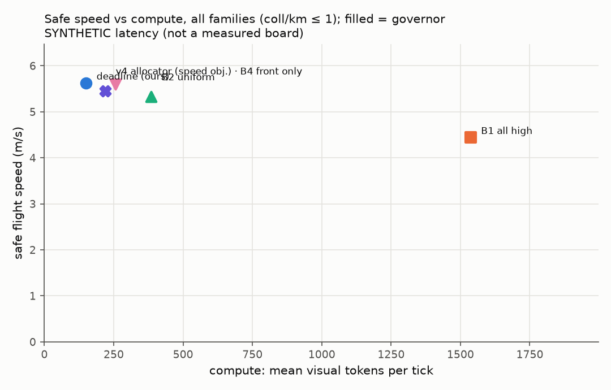
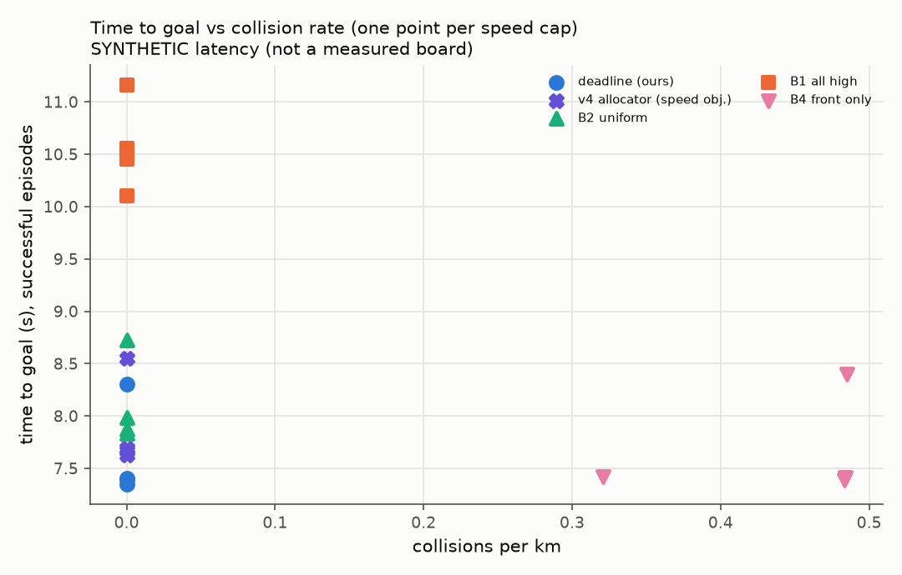

# DeadlineVLA evaluation report

> Latency comes from a SYNTHETIC board model, not a measured Jetson table.
> Policy is the 'surrogate' stand-in, not a VLA.

## Headline: tokens for equal safety and speed

Governed, speed cap 15 m/s, each method paired scene-by-scene against B2 `uniform_fixed`. Speed difference: mean per-scene difference with a 95% paired-bootstrap interval. Event rates: McNemar exact p on the discordant pairs.

**Static families (highspeed)**

| method | n | tokens/tick (vs B2) | speed m/s | Δspeed vs B2 [95% CI] | success | collision | p (collision) |
|---|---|---|---|---|---|---|---|
| all_high | 150 | 1536 (+300%) | 4.55 | -0.837 [-0.917, -0.755] | 0.693 | 0.000 | 1 |
| deadline | 150 | 149 (-61%) | 5.66 | +0.281 [+0.237, +0.319] | 1.000 | 0.000 | 1 |
| deadline_v4 | 150 | 219 (-43%) | 5.56 | +0.173 [+0.132, +0.209] | 1.000 | 0.000 | 1 |
| front_only | 150 | 256 (-33%) | 5.64 | +0.255 [+0.209, +0.299] | 0.980 | 0.020 | 0.25 |
| uniform_fixed | 150 | 384 (+0%) | 5.38 | +0.000 [+0.000, +0.000] | 1.000 | 0.000 | 1 |

> `deadline` vs B2 on static scenes: 61% fewer tokens per tick, success 1.000 vs 1.000, collisions 0.000 vs 0.000, speed +0.281 m/s [+0.237, +0.319].

Rates show the Wilson 95% interval in brackets.

## Safe speed per method

| method | governor | safe speed (m/s) | at cap | tokens/tick |
|---|---|---|---|---|
| all_high | True | 4.44 | 15 | 1.54e+03 |
| deadline | True | 5.62 | 12 | 150 |
| deadline_v4 | True | 5.45 | 15 | 219 |
| front_only | True | 5.6 | 12 | 256 |
| uniform_fixed | True | 5.33 | 15 | 384 |

## Deadline violations and their causes (all caps pooled)

Rates are per moving tick: `doc` uses clearance along the velocity and the latency of the flown inference; `cmd` uses clearance along the command (what the governor judged); `age` uses the real information age; `rel` is the v3 relative deadline (any contact closing too fast for its clearance, over all ticks, judged against ground truth); `unseen` is the share of ticks with a closing threat no camera detected at its tier. Causes are fractions of the `doc` violations.

| method | governor | doc | cmd | age | rel | unseen | ungoverned | clearance_jump | direction_mismatch | dynamics_lag | latency_tail | latency_switch | staleness | other |
|---|---|---|---|---|---|---|---|---|---|---|---|---|---|---|
| all_high | True | 0.103 | 0.0987 | 0.301 | 0.0118 | 0.0206 | 0 | 0.00979 | 0.125 | 0.865 | 0.000908 | 0 | 0 | 0 |
| deadline_v4 | True | 0.124 | 0.118 | 0.329 | 0.0132 | 0.496 | 0 | 0.00736 | 0.0935 | 0.899 | 0 | 0 | 0 | 0 |
| deadline | True | 0.117 | 0.114 | 0.294 | 0.0102 | 0.588 | 0 | 0.00172 | 0.0768 | 0.922 | 0 | 0 | 0 | 0 |
| front_only | True | 0.126 | 0.119 | 0.318 | 0.0151 | 0.0851 | 0 | 0.00341 | 0.082 | 0.915 | 0 | 0 | 0 | 0 |
| uniform_fixed | True | 0.124 | 0.119 | 0.284 | 0.0104 | 0.503 | 0 | 0.00547 | 0.0766 | 0.918 | 0 | 0 | 0 | 0 |

## All cells (all families)

| method | governor | speed_cap | episodes | success_rate | collision_rate | collisions_per_km | time_to_goal | mean_speed | tokens_per_tick | violation_rate | mean_latency | mean_age |
|---|---|---|---|---|---|---|---|---|---|---|---|---|
| all_high | True | 6 | 150 | 0.85 [0.79, 0.90] | 0.00 [0.00, 0.02] | 0 | 11.2 | 4.04 | 1.54e+03 | 0.101 | 0.463 | 0.717 |
| all_high | True | 9 | 150 | 0.77 [0.70, 0.83] | 0.00 [0.00, 0.02] | 0 | 10.1 | 4.41 | 1.54e+03 | 0.108 | 0.462 | 0.715 |
| all_high | True | 12 | 150 | 0.73 [0.66, 0.80] | 0.00 [0.00, 0.02] | 0 | 10.5 | 4.43 | 1.54e+03 | 0.103 | 0.462 | 0.717 |
| all_high | True | 15 | 150 | 0.69 [0.62, 0.76] | 0.00 [0.00, 0.02] | 0 | 10.6 | 4.44 | 1.54e+03 | 0.1 | 0.462 | 0.717 |
| deadline | True | 6 | 150 | 1.00 [0.98, 1.00] | 0.00 [0.00, 0.02] | 0 | 8.3 | 4.96 | 123 | 0.0885 | 0.0993 | 0.177 |
| deadline | True | 9 | 150 | 1.00 [0.98, 1.00] | 0.00 [0.00, 0.02] | 0 | 7.4 | 5.59 | 145 | 0.122 | 0.103 | 0.182 |
| deadline | True | 12 | 150 | 1.00 [0.98, 1.00] | 0.00 [0.00, 0.02] | 0 | 7.35 | 5.62 | 150 | 0.132 | 0.103 | 0.182 |
| deadline | True | 15 | 150 | 1.00 [0.98, 1.00] | 0.00 [0.00, 0.02] | 0 | 7.41 | 5.6 | 149 | 0.13 | 0.103 | 0.183 |
| deadline_v4 | True | 6 | 150 | 1.00 [0.98, 1.00] | 0.00 [0.00, 0.02] | 0 | 8.55 | 4.85 | 217 | 0.0917 | 0.125 | 0.25 |
| deadline_v4 | True | 9 | 150 | 1.00 [0.98, 1.00] | 0.00 [0.00, 0.02] | 0 | 7.67 | 5.44 | 219 | 0.127 | 0.125 | 0.251 |
| deadline_v4 | True | 12 | 150 | 0.99 [0.96, 1.00] | 0.00 [0.00, 0.02] | 0 | 7.63 | 5.37 | 219 | 0.141 | 0.125 | 0.25 |
| deadline_v4 | True | 15 | 150 | 1.00 [0.98, 1.00] | 0.00 [0.00, 0.02] | 0 | 7.69 | 5.45 | 219 | 0.14 | 0.125 | 0.251 |
| front_only | True | 6 | 150 | 0.98 [0.94, 0.99] | 0.02 [0.01, 0.06] | 0.485 | 8.4 | 4.9 | 256 | 0.0972 | 0.108 | 0.236 |
| front_only | True | 9 | 150 | 0.98 [0.94, 0.99] | 0.02 [0.01, 0.06] | 0.484 | 7.41 | 5.55 | 256 | 0.134 | 0.108 | 0.235 |
| front_only | True | 12 | 150 | 0.99 [0.95, 1.00] | 0.01 [0.00, 0.05] | 0.321 | 7.42 | 5.6 | 256 | 0.136 | 0.108 | 0.233 |
| front_only | True | 15 | 150 | 0.98 [0.94, 0.99] | 0.02 [0.01, 0.06] | 0.484 | 7.39 | 5.59 | 256 | 0.14 | 0.108 | 0.234 |
| uniform_fixed | True | 6 | 150 | 1.00 [0.98, 1.00] | 0.00 [0.00, 0.02] | 0 | 8.73 | 4.74 | 384 | 0.0968 | 0.168 | 0.254 |
| uniform_fixed | True | 9 | 150 | 1.00 [0.98, 1.00] | 0.00 [0.00, 0.02] | 0 | 7.99 | 5.24 | 384 | 0.129 | 0.168 | 0.254 |
| uniform_fixed | True | 12 | 150 | 1.00 [0.98, 1.00] | 0.00 [0.00, 0.02] | 0 | 7.88 | 5.31 | 384 | 0.137 | 0.168 | 0.254 |
| uniform_fixed | True | 15 | 150 | 1.00 [0.98, 1.00] | 0.00 [0.00, 0.02] | 0 | 7.83 | 5.33 | 384 | 0.138 | 0.168 | 0.254 |

## Family: highspeed

| method | governor | speed_cap | episodes | success_rate | collision_rate | collisions_per_km | time_to_goal | mean_speed | tokens_per_tick | violation_rate | mean_latency | mean_age |
|---|---|---|---|---|---|---|---|---|---|---|---|---|
| all_high | True | 6 | 150 | 0.85 [0.79, 0.90] | 0.00 [0.00, 0.02] | 0 | 11.2 | 4.04 | 1.54e+03 | 0.101 | 0.463 | 0.717 |
| all_high | True | 9 | 150 | 0.77 [0.70, 0.83] | 0.00 [0.00, 0.02] | 0 | 10.1 | 4.41 | 1.54e+03 | 0.108 | 0.462 | 0.715 |
| all_high | True | 12 | 150 | 0.73 [0.66, 0.80] | 0.00 [0.00, 0.02] | 0 | 10.5 | 4.43 | 1.54e+03 | 0.103 | 0.462 | 0.717 |
| all_high | True | 15 | 150 | 0.69 [0.62, 0.76] | 0.00 [0.00, 0.02] | 0 | 10.6 | 4.44 | 1.54e+03 | 0.1 | 0.462 | 0.717 |
| deadline | True | 6 | 150 | 1.00 [0.98, 1.00] | 0.00 [0.00, 0.02] | 0 | 8.3 | 4.96 | 123 | 0.0885 | 0.0993 | 0.177 |
| deadline | True | 9 | 150 | 1.00 [0.98, 1.00] | 0.00 [0.00, 0.02] | 0 | 7.4 | 5.59 | 145 | 0.122 | 0.103 | 0.182 |
| deadline | True | 12 | 150 | 1.00 [0.98, 1.00] | 0.00 [0.00, 0.02] | 0 | 7.35 | 5.62 | 150 | 0.132 | 0.103 | 0.182 |
| deadline | True | 15 | 150 | 1.00 [0.98, 1.00] | 0.00 [0.00, 0.02] | 0 | 7.41 | 5.6 | 149 | 0.13 | 0.103 | 0.183 |
| deadline_v4 | True | 6 | 150 | 1.00 [0.98, 1.00] | 0.00 [0.00, 0.02] | 0 | 8.55 | 4.85 | 217 | 0.0917 | 0.125 | 0.25 |
| deadline_v4 | True | 9 | 150 | 1.00 [0.98, 1.00] | 0.00 [0.00, 0.02] | 0 | 7.67 | 5.44 | 219 | 0.127 | 0.125 | 0.251 |
| deadline_v4 | True | 12 | 150 | 0.99 [0.96, 1.00] | 0.00 [0.00, 0.02] | 0 | 7.63 | 5.37 | 219 | 0.141 | 0.125 | 0.25 |
| deadline_v4 | True | 15 | 150 | 1.00 [0.98, 1.00] | 0.00 [0.00, 0.02] | 0 | 7.69 | 5.45 | 219 | 0.14 | 0.125 | 0.251 |
| front_only | True | 6 | 150 | 0.98 [0.94, 0.99] | 0.02 [0.01, 0.06] | 0.485 | 8.4 | 4.9 | 256 | 0.0972 | 0.108 | 0.236 |
| front_only | True | 9 | 150 | 0.98 [0.94, 0.99] | 0.02 [0.01, 0.06] | 0.484 | 7.41 | 5.55 | 256 | 0.134 | 0.108 | 0.235 |
| front_only | True | 12 | 150 | 0.99 [0.95, 1.00] | 0.01 [0.00, 0.05] | 0.321 | 7.42 | 5.6 | 256 | 0.136 | 0.108 | 0.233 |
| front_only | True | 15 | 150 | 0.98 [0.94, 0.99] | 0.02 [0.01, 0.06] | 0.484 | 7.39 | 5.59 | 256 | 0.14 | 0.108 | 0.234 |
| uniform_fixed | True | 6 | 150 | 1.00 [0.98, 1.00] | 0.00 [0.00, 0.02] | 0 | 8.73 | 4.74 | 384 | 0.0968 | 0.168 | 0.254 |
| uniform_fixed | True | 9 | 150 | 1.00 [0.98, 1.00] | 0.00 [0.00, 0.02] | 0 | 7.99 | 5.24 | 384 | 0.129 | 0.168 | 0.254 |
| uniform_fixed | True | 12 | 150 | 1.00 [0.98, 1.00] | 0.00 [0.00, 0.02] | 0 | 7.88 | 5.31 | 384 | 0.137 | 0.168 | 0.254 |
| uniform_fixed | True | 15 | 150 | 1.00 [0.98, 1.00] | 0.00 [0.00, 0.02] | 0 | 7.83 | 5.33 | 384 | 0.138 | 0.168 | 0.254 |
