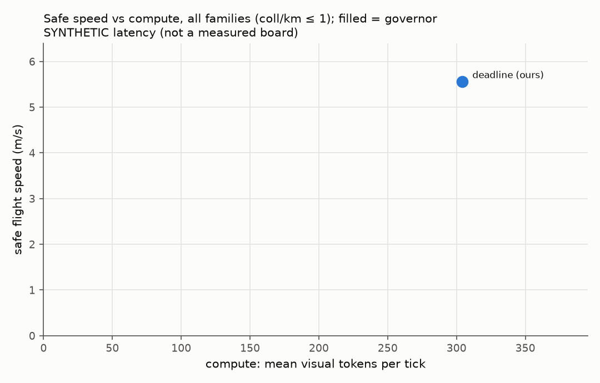
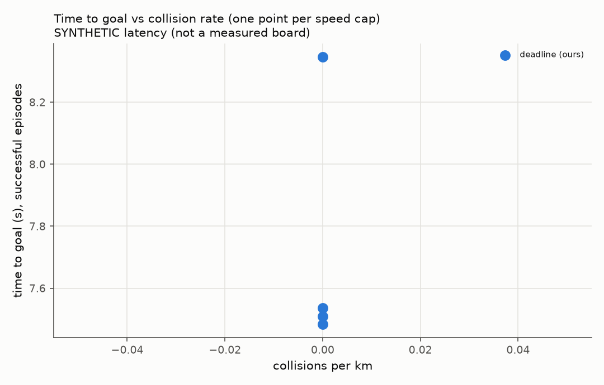

# DeadlineVLA evaluation report

> Latency comes from a SYNTHETIC board model, not a measured Jetson table.
> Policy is the 'surrogate' stand-in, not a VLA.

Rates show the Wilson 95% interval in brackets.

## Safe speed per method

| method | governor | safe speed (m/s) | at cap | tokens/tick |
|---|---|---|---|---|
| deadline | True | 5.56 | 12 | 304 |

## Deadline violations and their causes (all caps pooled)

Rates are per moving tick: `doc` uses clearance along the velocity and the latency of the flown inference; `cmd` uses clearance along the command (what the governor judged); `age` uses the real information age; `rel` is the v3 relative deadline (any contact closing too fast for its clearance, over all ticks, judged against ground truth); `unseen` is the share of ticks with a closing threat no camera detected at its tier. Causes are fractions of the `doc` violations.

| method | governor | doc | cmd | age | rel | unseen | ungoverned | clearance_jump | direction_mismatch | dynamics_lag | latency_tail | latency_switch | staleness | other |
|---|---|---|---|---|---|---|---|---|---|---|---|---|---|---|
| deadline | True | 0.133 | 0.128 | 0.31 | 0.0133 | 0.43 | 0 | 0.00281 | 0.0755 | 0.922 | 0 | 0 | 0 | 0 |

## All cells (all families)

| method | governor | speed_cap | episodes | success_rate | collision_rate | collisions_per_km | time_to_goal | mean_speed | tokens_per_tick | violation_rate | mean_latency | mean_age |
|---|---|---|---|---|---|---|---|---|---|---|---|---|
| deadline | True | 6 | 150 | 1.00 [0.98, 1.00] | 0.00 [0.00, 0.02] | 0 | 8.35 | 4.95 | 171 | 0.0952 | 0.11 | 0.221 |
| deadline | True | 9 | 150 | 1.00 [0.98, 1.00] | 0.00 [0.00, 0.02] | 0 | 7.54 | 5.52 | 301 | 0.147 | 0.131 | 0.244 |
| deadline | True | 12 | 150 | 1.00 [0.98, 1.00] | 0.00 [0.00, 0.02] | 0 | 7.48 | 5.56 | 304 | 0.146 | 0.131 | 0.244 |
| deadline | True | 15 | 150 | 1.00 [0.98, 1.00] | 0.00 [0.00, 0.02] | 0 | 7.51 | 5.56 | 304 | 0.15 | 0.131 | 0.245 |

## Family: highspeed

| method | governor | speed_cap | episodes | success_rate | collision_rate | collisions_per_km | time_to_goal | mean_speed | tokens_per_tick | violation_rate | mean_latency | mean_age |
|---|---|---|---|---|---|---|---|---|---|---|---|---|
| deadline | True | 6 | 150 | 1.00 [0.98, 1.00] | 0.00 [0.00, 0.02] | 0 | 8.35 | 4.95 | 171 | 0.0952 | 0.11 | 0.221 |
| deadline | True | 9 | 150 | 1.00 [0.98, 1.00] | 0.00 [0.00, 0.02] | 0 | 7.54 | 5.52 | 301 | 0.147 | 0.131 | 0.244 |
| deadline | True | 12 | 150 | 1.00 [0.98, 1.00] | 0.00 [0.00, 0.02] | 0 | 7.48 | 5.56 | 304 | 0.146 | 0.131 | 0.244 |
| deadline | True | 15 | 150 | 1.00 [0.98, 1.00] | 0.00 [0.00, 0.02] | 0 | 7.51 | 5.56 | 304 | 0.15 | 0.131 | 0.245 |
