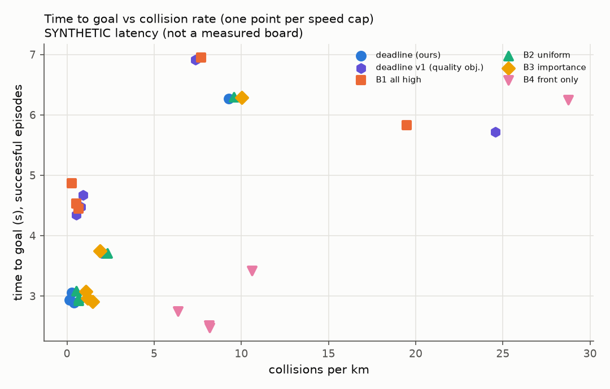

# DeadlineVLA evaluation report

> Latency comes from a SYNTHETIC board model, not a measured Jetson table.
> Policy is the 'surrogate' stand-in, not a VLA.

## Headline: tokens for equal safety and speed

Governed, speed cap 10 m/s, each method paired scene-by-scene against B2 `uniform_fixed`. Speed difference: mean per-scene difference with a 95% paired-bootstrap interval. Event rates: McNemar exact p on the discordant pairs.

**Static families (goal_nav, slalom, sparse_nav)**

| method | n | tokens/tick (vs B2) | speed m/s | Δspeed vs B2 [95% CI] | success | collision | p (collision) |
|---|---|---|---|---|---|---|---|
| all_high | 150 | 1536 (+300%) | 3.51 | -0.769 [-0.834, -0.700] | 0.880 | 0.000 | 1 |
| deadline | 150 | 244 (-36%) | 4.35 | +0.075 [+0.058, +0.091] | 1.000 | 0.000 | 1 |
| deadline_v1 | 150 | 1528 (+298%) | 3.50 | -0.780 [-0.844, -0.712] | 0.887 | 0.000 | 1 |
| front_only | 150 | 256 (-33%) | 4.46 | +0.188 [+0.090, +0.287] | 0.693 | 0.307 | 2.84e-14 |
| importance | 150 | 384 (+0%) | 4.29 | +0.018 [+0.002, +0.035] | 0.980 | 0.020 | 0.25 |
| uniform_fixed | 150 | 384 (+0%) | 4.28 | +0.000 [+0.000, +0.000] | 1.000 | 0.000 | 1 |

> `deadline` vs B2 on static scenes: 36% fewer tokens per tick, success 1.000 vs 1.000, collisions 0.000 vs 0.000, speed +0.075 m/s [+0.058, +0.091].

**rear_threat**

| method | n | tokens/tick (vs B2) | speed m/s | Δspeed vs B2 [95% CI] | success | collision | p (collision) |
|---|---|---|---|---|---|---|---|
| all_high | 450 | 1536 (+300%) | 3.88 | -0.658 [-0.703, -0.613] | 0.882 | 0.016 | 0.774 |
| deadline | 450 | 244 (-36%) | 4.60 | +0.067 [+0.051, +0.084] | 0.989 | 0.007 | 0.688 |
| deadline_v1 | 450 | 1528 (+298%) | 3.88 | -0.652 [-0.695, -0.609] | 0.882 | 0.022 | 0.302 |
| front_only | 450 | 256 (-33%) | 4.75 | +0.216 [+0.181, +0.251] | 0.973 | 0.027 | 0.0654 |
| importance | 450 | 384 (+0%) | 4.55 | +0.012 [-0.004, +0.027] | 0.976 | 0.018 | 0.25 |
| uniform_fixed | 450 | 384 (+0%) | 4.53 | +0.000 [+0.000, +0.000] | 0.984 | 0.011 | 1 |

Rates show the Wilson 95% interval in brackets.

## Safe speed per method

| method | governor | safe speed (m/s) | at cap | tokens/tick |
|---|---|---|---|---|
| all_high | True | 3.23 | 10 | 1.54e+03 |
| deadline | True | 3.99 | 10 | 240 |
| deadline_v1 | True | 3.24 | 8 | 1.54e+03 |
| front_only | True | 0 | - | 256 |
| importance | True | 3.94 | 8 | 384 |
| uniform_fixed | True | 3.91 | 10 | 384 |

## Deadline violations and their causes (all caps pooled)

Rates are per moving tick: `doc` uses clearance along the velocity and the latency of the flown inference; `cmd` uses clearance along the command (what the governor judged); `age` uses the real information age; `rel` is the v3 relative deadline (any contact closing too fast for its clearance, over all ticks, judged against ground truth); `unseen` is the share of ticks with a closing threat no camera detected at its tier. Causes are fractions of the `doc` violations.

| method | governor | doc | cmd | age | rel | unseen | ungoverned | clearance_jump | direction_mismatch | dynamics_lag | latency_tail | latency_switch | staleness | other |
|---|---|---|---|---|---|---|---|---|---|---|---|---|---|---|
| all_high | True | 0.101 | 0.103 | 0.274 | 0.0374 | 0.000376 | 0 | 0.0428 | 0.189 | 0.766 | 0.00217 | 0 | 0 | 0 |
| deadline_v1 | True | 0.0992 | 0.0994 | 0.27 | 0.0381 | 0.00454 | 0 | 0.0392 | 0.191 | 0.767 | 0.00174 | 0.00144 | 0 | 0 |
| deadline | True | 0.0561 | 0.0512 | 0.126 | 0.0208 | 0.205 | 0 | 0.0206 | 0.262 | 0.718 | 0 | 0 | 0 | 0 |
| front_only | True | 0.0818 | 0.068 | 0.145 | 0.0624 | 0.422 | 0 | 0.0311 | 0.214 | 0.755 | 0 | 0 | 0 | 0 |
| importance | True | 0.0632 | 0.06 | 0.124 | 0.0241 | 0.195 | 0 | 0.0261 | 0.228 | 0.746 | 0 | 0 | 0 | 0 |
| uniform_fixed | True | 0.0588 | 0.0578 | 0.116 | 0.0204 | 0.161 | 0 | 0.0224 | 0.217 | 0.761 | 0 | 0 | 0 | 0 |

## All cells (all families)

| method | governor | speed_cap | episodes | success_rate | collision_rate | collisions_per_km | time_to_goal | mean_speed | tokens_per_tick | violation_rate | mean_latency | mean_age |
|---|---|---|---|---|---|---|---|---|---|---|---|---|
| all_high | True | 2 | 600 | 0.91 [0.88, 0.93] | 0.09 [0.07, 0.11] | 7.7 | 6.95 | 1.72 | 1.54e+03 | 0.0486 | 0.463 | 0.716 |
| all_high | True | 4 | 600 | 0.64 [0.60, 0.68] | 0.32 [0.28, 0.36] | 19.5 | 5.83 | 2.81 | 1.54e+03 | 0.0962 | 0.462 | 0.716 |
| all_high | True | 6 | 600 | 0.90 [0.87, 0.92] | 0.01 [0.00, 0.02] | 0.281 | 4.87 | 3.44 | 1.54e+03 | 0.114 | 0.462 | 0.716 |
| all_high | True | 8 | 600 | 0.87 [0.84, 0.90] | 0.01 [0.01, 0.03] | 0.658 | 4.45 | 3.57 | 1.54e+03 | 0.12 | 0.462 | 0.715 |
| all_high | True | 10 | 600 | 0.88 [0.85, 0.91] | 0.01 [0.01, 0.02] | 0.528 | 4.53 | 3.54 | 1.54e+03 | 0.128 | 0.462 | 0.716 |
| deadline | True | 2 | 600 | 0.90 [0.87, 0.92] | 0.10 [0.08, 0.13] | 9.27 | 6.26 | 1.86 | 217 | 0.000746 | 0.124 | 0.247 |
| deadline | True | 4 | 600 | 0.97 [0.96, 0.98] | 0.03 [0.02, 0.04] | 2.04 | 3.71 | 3.27 | 249 | 0.0372 | 0.133 | 0.252 |
| deadline | True | 6 | 600 | 0.99 [0.99, 1.00] | 0.00 [0.00, 0.01] | 0.267 | 3.05 | 4.01 | 244 | 0.0889 | 0.132 | 0.252 |
| deadline | True | 8 | 600 | 0.99 [0.99, 1.00] | 0.00 [0.00, 0.01] | 0.131 | 2.93 | 4.19 | 244 | 0.108 | 0.131 | 0.251 |
| deadline | True | 10 | 600 | 0.99 [0.98, 1.00] | 0.01 [0.00, 0.01] | 0.394 | 2.89 | 4.23 | 244 | 0.109 | 0.131 | 0.251 |
| deadline_v1 | True | 2 | 600 | 0.91 [0.88, 0.93] | 0.09 [0.07, 0.11] | 7.38 | 6.91 | 1.72 | 1.52e+03 | 0.0441 | 0.451 | 0.706 |
| deadline_v1 | True | 4 | 600 | 0.58 [0.54, 0.62] | 0.38 [0.34, 0.42] | 24.6 | 5.72 | 2.81 | 1.5e+03 | 0.0942 | 0.429 | 0.691 |
| deadline_v1 | True | 6 | 600 | 0.89 [0.86, 0.91] | 0.02 [0.01, 0.04] | 0.929 | 4.67 | 3.47 | 1.53e+03 | 0.109 | 0.458 | 0.713 |
| deadline_v1 | True | 8 | 600 | 0.88 [0.85, 0.90] | 0.01 [0.01, 0.02] | 0.524 | 4.35 | 3.55 | 1.53e+03 | 0.122 | 0.456 | 0.711 |
| deadline_v1 | True | 10 | 600 | 0.88 [0.86, 0.91] | 0.02 [0.01, 0.03] | 0.78 | 4.48 | 3.55 | 1.53e+03 | 0.13 | 0.455 | 0.711 |
| front_only | True | 2 | 600 | 0.72 [0.68, 0.75] | 0.28 [0.25, 0.32] | 28.8 | 6.25 | 1.84 | 256 | 0.0278 | 0.108 | 0.235 |
| front_only | True | 4 | 600 | 0.88 [0.85, 0.90] | 0.12 [0.10, 0.15] | 10.6 | 3.42 | 3.33 | 256 | 0.0417 | 0.108 | 0.234 |
| front_only | True | 6 | 600 | 0.93 [0.90, 0.94] | 0.07 [0.06, 0.10] | 6.36 | 2.75 | 4.15 | 256 | 0.112 | 0.108 | 0.235 |
| front_only | True | 8 | 600 | 0.90 [0.88, 0.92] | 0.10 [0.08, 0.12] | 8.13 | 2.51 | 4.42 | 256 | 0.146 | 0.108 | 0.234 |
| front_only | True | 10 | 600 | 0.90 [0.88, 0.92] | 0.10 [0.08, 0.12] | 8.19 | 2.48 | 4.45 | 256 | 0.151 | 0.108 | 0.234 |
| importance | True | 2 | 600 | 0.89 [0.86, 0.91] | 0.11 [0.09, 0.14] | 10 | 6.29 | 1.85 | 384 | 0.00312 | 0.164 | 0.254 |
| importance | True | 4 | 600 | 0.98 [0.96, 0.99] | 0.02 [0.01, 0.04] | 1.9 | 3.75 | 3.25 | 384 | 0.047 | 0.164 | 0.254 |
| importance | True | 6 | 600 | 0.98 [0.97, 0.99] | 0.01 [0.01, 0.03] | 1.07 | 3.08 | 3.94 | 384 | 0.0999 | 0.164 | 0.255 |
| importance | True | 8 | 600 | 0.98 [0.97, 0.99] | 0.01 [0.01, 0.03] | 1.19 | 2.96 | 4.17 | 384 | 0.114 | 0.164 | 0.254 |
| importance | True | 10 | 600 | 0.98 [0.96, 0.99] | 0.02 [0.01, 0.03] | 1.46 | 2.9 | 4.18 | 384 | 0.119 | 0.164 | 0.254 |
| uniform_fixed | True | 2 | 600 | 0.90 [0.87, 0.92] | 0.10 [0.08, 0.13] | 9.56 | 6.29 | 1.86 | 384 | 0.00197 | 0.168 | 0.254 |
| uniform_fixed | True | 4 | 600 | 0.97 [0.96, 0.98] | 0.03 [0.02, 0.04] | 2.32 | 3.71 | 3.26 | 384 | 0.0453 | 0.168 | 0.254 |
| uniform_fixed | True | 6 | 600 | 0.99 [0.98, 1.00] | 0.01 [0.00, 0.02] | 0.534 | 3.08 | 3.92 | 384 | 0.0928 | 0.168 | 0.255 |
| uniform_fixed | True | 8 | 600 | 0.99 [0.98, 0.99] | 0.01 [0.00, 0.02] | 0.664 | 2.96 | 4.15 | 384 | 0.106 | 0.168 | 0.254 |
| uniform_fixed | True | 10 | 600 | 0.99 [0.98, 0.99] | 0.01 [0.00, 0.02] | 0.662 | 2.93 | 4.16 | 384 | 0.11 | 0.168 | 0.254 |

## Family: goal_nav

| method | governor | speed_cap | episodes | success_rate | collision_rate | collisions_per_km | time_to_goal | mean_speed | tokens_per_tick | violation_rate | mean_latency | mean_age |
|---|---|---|---|---|---|---|---|---|---|---|---|---|
| all_high | True | 2 | 50 | 0.98 [0.90, 1.00] | 0.00 [0.00, 0.07] | 0 | 6.33 | 1.7 | 1.54e+03 | 0.0372 | 0.462 | 0.715 |
| all_high | True | 4 | 50 | 0.98 [0.90, 1.00] | 0.00 [0.00, 0.07] | 0 | 4.56 | 2.55 | 1.54e+03 | 0.144 | 0.465 | 0.72 |
| all_high | True | 6 | 50 | 0.96 [0.87, 0.99] | 0.00 [0.00, 0.07] | 0 | 5.71 | 3.12 | 1.54e+03 | 0.157 | 0.464 | 0.716 |
| all_high | True | 8 | 50 | 0.90 [0.79, 0.96] | 0.00 [0.00, 0.07] | 0 | 4.26 | 3.26 | 1.54e+03 | 0.16 | 0.459 | 0.712 |
| all_high | True | 10 | 50 | 0.90 [0.79, 0.96] | 0.00 [0.00, 0.07] | 0 | 4.87 | 3.31 | 1.54e+03 | 0.157 | 0.462 | 0.718 |
| deadline | True | 2 | 50 | 1.00 [0.93, 1.00] | 0.00 [0.00, 0.07] | 0 | 5.83 | 1.87 | 234 | 0 | 0.129 | 0.251 |
| deadline | True | 4 | 50 | 1.00 [0.93, 1.00] | 0.00 [0.00, 0.07] | 0 | 3.86 | 3.09 | 241 | 0.057 | 0.132 | 0.252 |
| deadline | True | 6 | 50 | 1.00 [0.93, 1.00] | 0.00 [0.00, 0.07] | 0 | 3.24 | 3.72 | 245 | 0.106 | 0.132 | 0.252 |
| deadline | True | 8 | 50 | 1.00 [0.93, 1.00] | 0.00 [0.00, 0.07] | 0 | 2.99 | 4.01 | 246 | 0.114 | 0.131 | 0.252 |
| deadline | True | 10 | 50 | 1.00 [0.93, 1.00] | 0.00 [0.00, 0.07] | 0 | 2.96 | 4.02 | 246 | 0.123 | 0.132 | 0.251 |
| deadline_v1 | True | 2 | 50 | 0.98 [0.90, 1.00] | 0.00 [0.00, 0.07] | 0 | 6.33 | 1.7 | 1.54e+03 | 0.0372 | 0.462 | 0.715 |
| deadline_v1 | True | 4 | 50 | 0.98 [0.90, 1.00] | 0.00 [0.00, 0.07] | 0 | 4.56 | 2.55 | 1.54e+03 | 0.144 | 0.465 | 0.72 |
| deadline_v1 | True | 6 | 50 | 0.96 [0.87, 0.99] | 0.00 [0.00, 0.07] | 0 | 5.71 | 3.12 | 1.54e+03 | 0.157 | 0.464 | 0.716 |
| deadline_v1 | True | 8 | 50 | 0.90 [0.79, 0.96] | 0.00 [0.00, 0.07] | 0 | 4.25 | 3.26 | 1.54e+03 | 0.161 | 0.459 | 0.711 |
| deadline_v1 | True | 10 | 50 | 0.90 [0.79, 0.96] | 0.00 [0.00, 0.07] | 0 | 4.86 | 3.31 | 1.54e+03 | 0.157 | 0.462 | 0.718 |
| front_only | True | 2 | 50 | 0.76 [0.63, 0.86] | 0.22 [0.13, 0.35] | 21.4 | 5.61 | 1.81 | 256 | 0.0695 | 0.108 | 0.235 |
| front_only | True | 4 | 50 | 0.70 [0.56, 0.81] | 0.30 [0.19, 0.44] | 32.3 | 3.15 | 3.24 | 256 | 0.109 | 0.109 | 0.236 |
| front_only | True | 6 | 50 | 0.70 [0.56, 0.81] | 0.30 [0.19, 0.44] | 32.2 | 2.48 | 4.1 | 256 | 0.171 | 0.109 | 0.235 |
| front_only | True | 8 | 50 | 0.68 [0.54, 0.79] | 0.32 [0.21, 0.46] | 34.7 | 2.23 | 4.5 | 256 | 0.216 | 0.108 | 0.232 |
| front_only | True | 10 | 50 | 0.70 [0.56, 0.81] | 0.30 [0.19, 0.44] | 32.1 | 2.25 | 4.55 | 256 | 0.21 | 0.108 | 0.236 |
| importance | True | 2 | 50 | 1.00 [0.93, 1.00] | 0.00 [0.00, 0.07] | 0 | 5.83 | 1.87 | 384 | 0.000359 | 0.166 | 0.254 |
| importance | True | 4 | 50 | 1.00 [0.93, 1.00] | 0.00 [0.00, 0.07] | 0 | 3.5 | 3.18 | 384 | 0.0613 | 0.168 | 0.257 |
| importance | True | 6 | 50 | 1.00 [0.93, 1.00] | 0.00 [0.00, 0.07] | 0 | 3.09 | 3.7 | 384 | 0.103 | 0.168 | 0.255 |
| importance | True | 8 | 50 | 1.00 [0.93, 1.00] | 0.00 [0.00, 0.07] | 0 | 2.84 | 3.98 | 384 | 0.121 | 0.166 | 0.253 |
| importance | True | 10 | 50 | 1.00 [0.93, 1.00] | 0.00 [0.00, 0.07] | 0 | 2.91 | 3.92 | 384 | 0.124 | 0.167 | 0.254 |
| uniform_fixed | True | 2 | 50 | 1.00 [0.93, 1.00] | 0.00 [0.00, 0.07] | 0 | 5.83 | 1.87 | 384 | 0.000359 | 0.168 | 0.254 |
| uniform_fixed | True | 4 | 50 | 1.00 [0.93, 1.00] | 0.00 [0.00, 0.07] | 0 | 3.5 | 3.18 | 384 | 0.062 | 0.169 | 0.257 |
| uniform_fixed | True | 6 | 50 | 1.00 [0.93, 1.00] | 0.00 [0.00, 0.07] | 0 | 3.19 | 3.61 | 384 | 0.102 | 0.169 | 0.255 |
| uniform_fixed | True | 8 | 50 | 1.00 [0.93, 1.00] | 0.00 [0.00, 0.07] | 0 | 2.94 | 3.88 | 384 | 0.124 | 0.167 | 0.253 |
| uniform_fixed | True | 10 | 50 | 1.00 [0.93, 1.00] | 0.00 [0.00, 0.07] | 0 | 2.92 | 3.91 | 384 | 0.123 | 0.168 | 0.254 |

## Family: rear_threat

| method | governor | speed_cap | episodes | success_rate | collision_rate | collisions_per_km | time_to_goal | mean_speed | tokens_per_tick | violation_rate | mean_latency | mean_age |
|---|---|---|---|---|---|---|---|---|---|---|---|---|
| all_high | True | 2 | 450 | 0.88 [0.85, 0.91] | 0.12 [0.09, 0.15] | 11.3 | 6.47 | 1.72 | 1.54e+03 | 0.0492 | 0.462 | 0.716 |
| all_high | True | 4 | 450 | 0.53 [0.48, 0.57] | 0.43 [0.38, 0.47] | 26.7 | 5.58 | 2.91 | 1.54e+03 | 0.0852 | 0.462 | 0.716 |
| all_high | True | 6 | 450 | 0.89 [0.86, 0.91] | 0.01 [0.00, 0.02] | 0.375 | 4.37 | 3.6 | 1.54e+03 | 0.105 | 0.462 | 0.716 |
| all_high | True | 8 | 450 | 0.87 [0.83, 0.89] | 0.02 [0.01, 0.04] | 0.911 | 4.05 | 3.73 | 1.54e+03 | 0.115 | 0.462 | 0.716 |
| all_high | True | 10 | 450 | 0.88 [0.85, 0.91] | 0.02 [0.01, 0.03] | 0.745 | 4.1 | 3.69 | 1.54e+03 | 0.125 | 0.462 | 0.716 |
| deadline | True | 2 | 450 | 0.86 [0.83, 0.89] | 0.14 [0.11, 0.17] | 13.4 | 5.95 | 1.84 | 212 | 0.00107 | 0.123 | 0.245 |
| deadline | True | 4 | 450 | 0.97 [0.95, 0.98] | 0.03 [0.02, 0.05] | 2.91 | 3.45 | 3.29 | 255 | 0.0303 | 0.134 | 0.252 |
| deadline | True | 6 | 450 | 0.99 [0.98, 1.00] | 0.00 [0.00, 0.02] | 0.389 | 2.72 | 4.11 | 247 | 0.0728 | 0.132 | 0.252 |
| deadline | True | 8 | 450 | 0.99 [0.98, 1.00] | 0.00 [0.00, 0.01] | 0.189 | 2.61 | 4.3 | 246 | 0.095 | 0.132 | 0.251 |
| deadline | True | 10 | 450 | 0.99 [0.97, 1.00] | 0.01 [0.00, 0.02] | 0.571 | 2.56 | 4.35 | 246 | 0.0961 | 0.132 | 0.251 |
| deadline_v1 | True | 2 | 450 | 0.88 [0.85, 0.91] | 0.11 [0.09, 0.15] | 10.8 | 6.43 | 1.72 | 1.52e+03 | 0.0439 | 0.446 | 0.701 |
| deadline_v1 | True | 4 | 450 | 0.46 [0.41, 0.50] | 0.51 [0.46, 0.55] | 34.9 | 5.39 | 2.91 | 1.48e+03 | 0.0828 | 0.415 | 0.679 |
| deadline_v1 | True | 6 | 450 | 0.88 [0.84, 0.90] | 0.03 [0.02, 0.05] | 1.26 | 4.1 | 3.64 | 1.53e+03 | 0.0985 | 0.456 | 0.711 |
| deadline_v1 | True | 8 | 450 | 0.88 [0.84, 0.90] | 0.02 [0.01, 0.03] | 0.742 | 3.92 | 3.69 | 1.53e+03 | 0.118 | 0.454 | 0.709 |
| deadline_v1 | True | 10 | 450 | 0.88 [0.85, 0.91] | 0.02 [0.01, 0.04] | 1.09 | 4.02 | 3.72 | 1.52e+03 | 0.125 | 0.452 | 0.709 |
| front_only | True | 2 | 450 | 0.66 [0.61, 0.70] | 0.34 [0.30, 0.39] | 39.6 | 5.87 | 1.83 | 256 | 0.0313 | 0.108 | 0.235 |
| front_only | True | 4 | 450 | 0.88 [0.85, 0.91] | 0.12 [0.09, 0.15] | 11.3 | 3.14 | 3.34 | 256 | 0.0322 | 0.108 | 0.234 |
| front_only | True | 6 | 450 | 0.98 [0.96, 0.99] | 0.02 [0.01, 0.04] | 2.02 | 2.53 | 4.25 | 256 | 0.0746 | 0.108 | 0.236 |
| front_only | True | 8 | 450 | 0.98 [0.96, 0.99] | 0.02 [0.01, 0.04] | 2.22 | 2.35 | 4.57 | 256 | 0.103 | 0.108 | 0.234 |
| front_only | True | 10 | 450 | 0.97 [0.95, 0.98] | 0.03 [0.02, 0.05] | 2.42 | 2.32 | 4.61 | 256 | 0.11 | 0.108 | 0.234 |
| importance | True | 2 | 450 | 0.85 [0.82, 0.88] | 0.15 [0.12, 0.18] | 14.4 | 5.98 | 1.83 | 384 | 0.00444 | 0.165 | 0.254 |
| importance | True | 4 | 450 | 0.97 [0.95, 0.98] | 0.03 [0.02, 0.05] | 2.69 | 3.52 | 3.25 | 384 | 0.04 | 0.165 | 0.254 |
| importance | True | 6 | 450 | 0.98 [0.96, 0.99] | 0.02 [0.01, 0.03] | 1.55 | 2.75 | 4.02 | 384 | 0.0861 | 0.166 | 0.255 |
| importance | True | 8 | 450 | 0.98 [0.97, 0.99] | 0.02 [0.01, 0.03] | 1.34 | 2.67 | 4.29 | 384 | 0.103 | 0.166 | 0.254 |
| importance | True | 10 | 450 | 0.98 [0.96, 0.99] | 0.02 [0.01, 0.03] | 1.53 | 2.6 | 4.3 | 384 | 0.107 | 0.165 | 0.254 |
| uniform_fixed | True | 2 | 450 | 0.86 [0.82, 0.89] | 0.14 [0.11, 0.18] | 13.8 | 5.99 | 1.84 | 384 | 0.00278 | 0.168 | 0.254 |
| uniform_fixed | True | 4 | 450 | 0.96 [0.94, 0.98] | 0.04 [0.02, 0.06] | 3.29 | 3.48 | 3.26 | 384 | 0.0377 | 0.168 | 0.254 |
| uniform_fixed | True | 6 | 450 | 0.99 [0.97, 0.99] | 0.01 [0.00, 0.02] | 0.768 | 2.76 | 4.01 | 384 | 0.082 | 0.168 | 0.255 |
| uniform_fixed | True | 8 | 450 | 0.98 [0.97, 0.99] | 0.01 [0.00, 0.03] | 0.956 | 2.65 | 4.28 | 384 | 0.0985 | 0.168 | 0.254 |
| uniform_fixed | True | 10 | 450 | 0.98 [0.97, 0.99] | 0.01 [0.00, 0.03] | 0.95 | 2.62 | 4.27 | 384 | 0.103 | 0.168 | 0.254 |

## Family: slalom

| method | governor | speed_cap | episodes | success_rate | collision_rate | collisions_per_km | time_to_goal | mean_speed | tokens_per_tick | violation_rate | mean_latency | mean_age |
|---|---|---|---|---|---|---|---|---|---|---|---|---|
| all_high | True | 2 | 50 | 1.00 [0.93, 1.00] | 0.00 [0.00, 0.07] | 0 | 12.1 | 1.74 | 1.54e+03 | 0.0732 | 0.463 | 0.718 |
| all_high | True | 4 | 50 | 0.94 [0.84, 0.98] | 0.00 [0.00, 0.07] | 0 | 10.6 | 2.45 | 1.54e+03 | 0.136 | 0.461 | 0.713 |
| all_high | True | 6 | 50 | 0.86 [0.74, 0.93] | 0.00 [0.00, 0.07] | 0 | 10.5 | 2.74 | 1.54e+03 | 0.149 | 0.462 | 0.718 |
| all_high | True | 8 | 50 | 0.82 [0.69, 0.90] | 0.00 [0.00, 0.07] | 0 | 10.4 | 2.94 | 1.54e+03 | 0.135 | 0.461 | 0.713 |
| all_high | True | 10 | 50 | 0.82 [0.69, 0.90] | 0.00 [0.00, 0.07] | 0 | 10.4 | 2.92 | 1.54e+03 | 0.133 | 0.461 | 0.715 |
| deadline | True | 2 | 50 | 1.00 [0.93, 1.00] | 0.00 [0.00, 0.07] | 0 | 9.55 | 1.92 | 231 | 0 | 0.128 | 0.251 |
| deadline | True | 4 | 50 | 1.00 [0.93, 1.00] | 0.00 [0.00, 0.07] | 0 | 6.37 | 3.27 | 235 | 0.0707 | 0.129 | 0.251 |
| deadline | True | 6 | 50 | 1.00 [0.93, 1.00] | 0.00 [0.00, 0.07] | 0 | 6.45 | 3.6 | 236 | 0.16 | 0.129 | 0.251 |
| deadline | True | 8 | 50 | 1.00 [0.93, 1.00] | 0.00 [0.00, 0.07] | 0 | 6.45 | 3.65 | 237 | 0.171 | 0.13 | 0.251 |
| deadline | True | 10 | 50 | 1.00 [0.93, 1.00] | 0.00 [0.00, 0.07] | 0 | 6.43 | 3.66 | 237 | 0.167 | 0.13 | 0.252 |
| deadline_v1 | True | 2 | 50 | 1.00 [0.93, 1.00] | 0.00 [0.00, 0.07] | 0 | 12 | 1.74 | 1.54e+03 | 0.0675 | 0.465 | 0.721 |
| deadline_v1 | True | 4 | 50 | 0.92 [0.81, 0.97] | 0.00 [0.00, 0.07] | 0 | 10.6 | 2.48 | 1.54e+03 | 0.129 | 0.461 | 0.712 |
| deadline_v1 | True | 6 | 50 | 0.86 [0.74, 0.93] | 0.00 [0.00, 0.07] | 0 | 10.4 | 2.81 | 1.54e+03 | 0.145 | 0.462 | 0.719 |
| deadline_v1 | True | 8 | 50 | 0.78 [0.65, 0.87] | 0.00 [0.00, 0.07] | 0 | 10.7 | 3 | 1.54e+03 | 0.127 | 0.461 | 0.715 |
| deadline_v1 | True | 10 | 50 | 0.84 [0.71, 0.92] | 0.00 [0.00, 0.07] | 0 | 10.4 | 2.84 | 1.54e+03 | 0.146 | 0.462 | 0.714 |
| front_only | True | 2 | 50 | 1.00 [0.93, 1.00] | 0.00 [0.00, 0.07] | 0 | 9.43 | 1.92 | 256 | 0 | 0.108 | 0.235 |
| front_only | True | 4 | 50 | 1.00 [0.93, 1.00] | 0.00 [0.00, 0.07] | 0 | 6.03 | 3.32 | 256 | 0.0644 | 0.108 | 0.232 |
| front_only | True | 6 | 50 | 0.66 [0.52, 0.78] | 0.34 [0.22, 0.48] | 15.2 | 6.36 | 3.68 | 256 | 0.25 | 0.108 | 0.234 |
| front_only | True | 8 | 50 | 0.44 [0.31, 0.58] | 0.56 [0.42, 0.69] | 23.9 | 7.02 | 3.68 | 256 | 0.288 | 0.108 | 0.233 |
| front_only | True | 10 | 50 | 0.44 [0.31, 0.58] | 0.56 [0.42, 0.69] | 24.8 | 6.82 | 3.66 | 256 | 0.29 | 0.108 | 0.235 |
| importance | True | 2 | 50 | 1.00 [0.93, 1.00] | 0.00 [0.00, 0.07] | 0 | 9.55 | 1.92 | 384 | 0 | 0.155 | 0.253 |
| importance | True | 4 | 50 | 1.00 [0.93, 1.00] | 0.00 [0.00, 0.07] | 0 | 6.51 | 3.22 | 384 | 0.0888 | 0.155 | 0.254 |
| importance | True | 6 | 50 | 1.00 [0.93, 1.00] | 0.00 [0.00, 0.07] | 0 | 6.52 | 3.58 | 384 | 0.174 | 0.156 | 0.253 |
| importance | True | 8 | 50 | 0.96 [0.87, 0.99] | 0.04 [0.01, 0.13] | 1.7 | 6.47 | 3.62 | 384 | 0.178 | 0.156 | 0.254 |
| importance | True | 10 | 50 | 0.94 [0.84, 0.98] | 0.06 [0.02, 0.16] | 2.56 | 6.44 | 3.62 | 384 | 0.18 | 0.156 | 0.254 |
| uniform_fixed | True | 2 | 50 | 1.00 [0.93, 1.00] | 0.00 [0.00, 0.07] | 0 | 9.55 | 1.92 | 384 | 0 | 0.167 | 0.254 |
| uniform_fixed | True | 4 | 50 | 1.00 [0.93, 1.00] | 0.00 [0.00, 0.07] | 0 | 6.44 | 3.21 | 384 | 0.088 | 0.168 | 0.254 |
| uniform_fixed | True | 6 | 50 | 1.00 [0.93, 1.00] | 0.00 [0.00, 0.07] | 0 | 6.4 | 3.53 | 384 | 0.15 | 0.168 | 0.254 |
| uniform_fixed | True | 8 | 50 | 1.00 [0.93, 1.00] | 0.00 [0.00, 0.07] | 0 | 6.43 | 3.57 | 384 | 0.148 | 0.168 | 0.254 |
| uniform_fixed | True | 10 | 50 | 1.00 [0.93, 1.00] | 0.00 [0.00, 0.07] | 0 | 6.4 | 3.57 | 384 | 0.15 | 0.168 | 0.254 |

## Family: sparse_nav

| method | governor | speed_cap | episodes | success_rate | collision_rate | collisions_per_km | time_to_goal | mean_speed | tokens_per_tick | violation_rate | mean_latency | mean_age |
|---|---|---|---|---|---|---|---|---|---|---|---|---|
| all_high | True | 2 | 50 | 1.00 [0.93, 1.00] | 0.00 [0.00, 0.07] | 0 | 6.17 | 1.77 | 1.54e+03 | 0.00535 | 0.463 | 0.717 |
| all_high | True | 4 | 50 | 1.00 [0.93, 1.00] | 0.00 [0.00, 0.07] | 0 | 3.71 | 3.01 | 1.54e+03 | 0.0383 | 0.466 | 0.722 |
| all_high | True | 6 | 50 | 0.96 [0.87, 0.99] | 0.00 [0.00, 0.07] | 0 | 3.13 | 3.8 | 1.54e+03 | 0.0644 | 0.465 | 0.718 |
| all_high | True | 8 | 50 | 0.94 [0.84, 0.98] | 0.00 [0.00, 0.07] | 0 | 2.75 | 4.11 | 1.54e+03 | 0.0791 | 0.462 | 0.711 |
| all_high | True | 10 | 50 | 0.92 [0.81, 0.97] | 0.00 [0.00, 0.07] | 0 | 2.65 | 4.16 | 1.54e+03 | 0.0931 | 0.46 | 0.713 |
| deadline | True | 2 | 50 | 1.00 [0.93, 1.00] | 0.00 [0.00, 0.07] | 0 | 5.84 | 1.87 | 225 | 0 | 0.127 | 0.251 |
| deadline | True | 4 | 50 | 1.00 [0.93, 1.00] | 0.00 [0.00, 0.07] | 0 | 3.22 | 3.37 | 234 | 0.0108 | 0.129 | 0.251 |
| deadline | True | 6 | 50 | 1.00 [0.93, 1.00] | 0.00 [0.00, 0.07] | 0 | 2.5 | 4.37 | 240 | 0.0294 | 0.13 | 0.253 |
| deadline | True | 8 | 50 | 1.00 [0.93, 1.00] | 0.00 [0.00, 0.07] | 0 | 2.26 | 4.82 | 242 | 0.0399 | 0.131 | 0.252 |
| deadline | True | 10 | 50 | 1.00 [0.93, 1.00] | 0.00 [0.00, 0.07] | 0 | 2.23 | 4.89 | 243 | 0.0437 | 0.131 | 0.251 |
| deadline_v1 | True | 2 | 50 | 1.00 [0.93, 1.00] | 0.00 [0.00, 0.07] | 0 | 6.17 | 1.77 | 1.54e+03 | 0.00535 | 0.463 | 0.717 |
| deadline_v1 | True | 4 | 50 | 1.00 [0.93, 1.00] | 0.00 [0.00, 0.07] | 0 | 3.71 | 3.01 | 1.54e+03 | 0.0383 | 0.466 | 0.722 |
| deadline_v1 | True | 6 | 50 | 0.96 [0.87, 0.99] | 0.00 [0.00, 0.07] | 0 | 3.13 | 3.8 | 1.54e+03 | 0.0644 | 0.465 | 0.718 |
| deadline_v1 | True | 8 | 50 | 0.94 [0.84, 0.98] | 0.00 [0.00, 0.07] | 0 | 2.75 | 4.11 | 1.54e+03 | 0.0791 | 0.462 | 0.711 |
| deadline_v1 | True | 10 | 50 | 0.92 [0.81, 0.97] | 0.00 [0.00, 0.07] | 0 | 2.65 | 4.16 | 1.54e+03 | 0.0931 | 0.46 | 0.713 |
| front_only | True | 2 | 50 | 0.94 [0.84, 0.98] | 0.06 [0.02, 0.16] | 5.71 | 5.77 | 1.87 | 256 | 0.00751 | 0.109 | 0.236 |
| front_only | True | 4 | 50 | 0.94 [0.84, 0.98] | 0.06 [0.02, 0.16] | 5.68 | 3.17 | 3.38 | 256 | 0.0206 | 0.109 | 0.236 |
| front_only | True | 6 | 50 | 0.94 [0.84, 0.98] | 0.06 [0.02, 0.16] | 5.64 | 2.44 | 4.4 | 256 | 0.0397 | 0.109 | 0.237 |
| front_only | True | 8 | 50 | 0.94 [0.84, 0.98] | 0.06 [0.02, 0.16] | 5.62 | 2.18 | 4.91 | 256 | 0.0533 | 0.108 | 0.236 |
| front_only | True | 10 | 50 | 0.94 [0.84, 0.98] | 0.06 [0.02, 0.16] | 5.61 | 2.13 | 5.02 | 256 | 0.0678 | 0.108 | 0.236 |
| importance | True | 2 | 50 | 1.00 [0.93, 1.00] | 0.00 [0.00, 0.07] | 0 | 5.84 | 1.87 | 384 | 0 | 0.165 | 0.255 |
| importance | True | 4 | 50 | 1.00 [0.93, 1.00] | 0.00 [0.00, 0.07] | 0 | 3.24 | 3.36 | 384 | 0.0128 | 0.165 | 0.254 |
| importance | True | 6 | 50 | 1.00 [0.93, 1.00] | 0.00 [0.00, 0.07] | 0 | 2.51 | 4.34 | 384 | 0.031 | 0.165 | 0.254 |
| importance | True | 8 | 50 | 1.00 [0.93, 1.00] | 0.00 [0.00, 0.07] | 0 | 2.28 | 4.78 | 384 | 0.0366 | 0.165 | 0.255 |
| importance | True | 10 | 50 | 1.00 [0.93, 1.00] | 0.00 [0.00, 0.07] | 0 | 2.25 | 4.85 | 384 | 0.0464 | 0.165 | 0.255 |
| uniform_fixed | True | 2 | 50 | 1.00 [0.93, 1.00] | 0.00 [0.00, 0.07] | 0 | 5.84 | 1.87 | 384 | 0 | 0.169 | 0.255 |
| uniform_fixed | True | 4 | 50 | 1.00 [0.93, 1.00] | 0.00 [0.00, 0.07] | 0 | 3.23 | 3.36 | 384 | 0.0121 | 0.168 | 0.254 |
| uniform_fixed | True | 6 | 50 | 1.00 [0.93, 1.00] | 0.00 [0.00, 0.07] | 0 | 2.51 | 4.34 | 384 | 0.0345 | 0.168 | 0.255 |
| uniform_fixed | True | 8 | 50 | 1.00 [0.93, 1.00] | 0.00 [0.00, 0.07] | 0 | 2.28 | 4.78 | 384 | 0.0385 | 0.168 | 0.255 |
| uniform_fixed | True | 10 | 50 | 1.00 [0.93, 1.00] | 0.00 [0.00, 0.07] | 0 | 2.25 | 4.86 | 384 | 0.0453 | 0.168 | 0.255 |

## Family: static

| method | governor | speed_cap | episodes | success_rate | collision_rate | collisions_per_km | time_to_goal | mean_speed | tokens_per_tick | violation_rate | mean_latency | mean_age |
|---|---|---|---|---|---|---|---|---|---|---|---|---|
| all_high | True | 2 | 150 | 0.99 [0.96, 1.00] | 0.00 [0.00, 0.02] | 0 | 8.21 | 1.74 | 1.54e+03 | 0.0473 | 0.463 | 0.717 |
| all_high | True | 4 | 150 | 0.97 [0.93, 0.99] | 0.00 [0.00, 0.02] | 0 | 6.23 | 2.58 | 1.54e+03 | 0.122 | 0.463 | 0.716 |
| all_high | True | 6 | 150 | 0.93 [0.87, 0.96] | 0.00 [0.00, 0.02] | 0 | 6.3 | 3.04 | 1.54e+03 | 0.137 | 0.463 | 0.717 |
| all_high | True | 8 | 150 | 0.89 [0.83, 0.93] | 0.00 [0.00, 0.02] | 0 | 5.63 | 3.21 | 1.54e+03 | 0.133 | 0.461 | 0.713 |
| all_high | True | 10 | 150 | 0.88 [0.82, 0.92] | 0.00 [0.00, 0.02] | 0 | 5.81 | 3.23 | 1.54e+03 | 0.133 | 0.461 | 0.716 |
| deadline | True | 2 | 150 | 1.00 [0.98, 1.00] | 0.00 [0.00, 0.02] | 0 | 7.07 | 1.89 | 230 | 0 | 0.128 | 0.251 |
| deadline | True | 4 | 150 | 1.00 [0.98, 1.00] | 0.00 [0.00, 0.02] | 0 | 4.48 | 3.24 | 237 | 0.0528 | 0.13 | 0.251 |
| deadline | True | 6 | 150 | 1.00 [0.98, 1.00] | 0.00 [0.00, 0.02] | 0 | 4.06 | 3.79 | 239 | 0.12 | 0.13 | 0.252 |
| deadline | True | 8 | 150 | 1.00 [0.98, 1.00] | 0.00 [0.00, 0.02] | 0 | 3.9 | 3.97 | 240 | 0.133 | 0.13 | 0.251 |
| deadline | True | 10 | 150 | 1.00 [0.98, 1.00] | 0.00 [0.00, 0.02] | 0 | 3.87 | 3.99 | 240 | 0.134 | 0.13 | 0.251 |
| deadline_v1 | True | 2 | 150 | 0.99 [0.96, 1.00] | 0.00 [0.00, 0.02] | 0 | 8.19 | 1.74 | 1.54e+03 | 0.0445 | 0.464 | 0.718 |
| deadline_v1 | True | 4 | 150 | 0.97 [0.92, 0.99] | 0.00 [0.00, 0.02] | 0 | 6.19 | 2.59 | 1.54e+03 | 0.117 | 0.463 | 0.715 |
| deadline_v1 | True | 6 | 150 | 0.93 [0.87, 0.96] | 0.00 [0.00, 0.02] | 0 | 6.28 | 3.08 | 1.54e+03 | 0.135 | 0.463 | 0.718 |
| deadline_v1 | True | 8 | 150 | 0.87 [0.81, 0.92] | 0.00 [0.00, 0.02] | 0 | 5.64 | 3.24 | 1.54e+03 | 0.128 | 0.461 | 0.713 |
| deadline_v1 | True | 10 | 150 | 0.89 [0.83, 0.93] | 0.00 [0.00, 0.02] | 0 | 5.85 | 3.19 | 1.54e+03 | 0.141 | 0.462 | 0.715 |
| front_only | True | 2 | 150 | 0.90 [0.84, 0.94] | 0.09 [0.06, 0.15] | 7.18 | 7.08 | 1.87 | 256 | 0.0208 | 0.108 | 0.235 |
| front_only | True | 4 | 150 | 0.88 [0.82, 0.92] | 0.12 [0.08, 0.18] | 8.99 | 4.24 | 3.32 | 256 | 0.0636 | 0.109 | 0.234 |
| front_only | True | 6 | 150 | 0.77 [0.69, 0.83] | 0.23 [0.17, 0.31] | 16.5 | 3.58 | 3.93 | 256 | 0.189 | 0.108 | 0.235 |
| front_only | True | 8 | 150 | 0.69 [0.61, 0.76] | 0.31 [0.24, 0.39] | 21.7 | 3.23 | 4.09 | 256 | 0.23 | 0.108 | 0.233 |
| front_only | True | 10 | 150 | 0.69 [0.62, 0.76] | 0.31 [0.24, 0.38] | 21.6 | 3.16 | 4.11 | 256 | 0.232 | 0.108 | 0.236 |
| importance | True | 2 | 150 | 1.00 [0.98, 1.00] | 0.00 [0.00, 0.02] | 0 | 7.07 | 1.89 | 384 | 9.79e-05 | 0.161 | 0.254 |
| importance | True | 4 | 150 | 1.00 [0.98, 1.00] | 0.00 [0.00, 0.02] | 0 | 4.41 | 3.24 | 384 | 0.0635 | 0.161 | 0.255 |
| importance | True | 6 | 150 | 1.00 [0.98, 1.00] | 0.00 [0.00, 0.02] | 0 | 4.04 | 3.77 | 384 | 0.128 | 0.161 | 0.254 |
| importance | True | 8 | 150 | 0.99 [0.95, 1.00] | 0.01 [0.00, 0.05] | 0.865 | 3.83 | 3.94 | 384 | 0.138 | 0.16 | 0.254 |
| importance | True | 10 | 150 | 0.98 [0.94, 0.99] | 0.02 [0.01, 0.06] | 1.3 | 3.82 | 3.94 | 384 | 0.142 | 0.16 | 0.254 |
| uniform_fixed | True | 2 | 150 | 1.00 [0.98, 1.00] | 0.00 [0.00, 0.02] | 0 | 7.07 | 1.89 | 384 | 9.78e-05 | 0.168 | 0.254 |
| uniform_fixed | True | 4 | 150 | 1.00 [0.98, 1.00] | 0.00 [0.00, 0.02] | 0 | 4.39 | 3.24 | 384 | 0.063 | 0.168 | 0.255 |
| uniform_fixed | True | 6 | 150 | 1.00 [0.98, 1.00] | 0.00 [0.00, 0.02] | 0 | 4.03 | 3.72 | 384 | 0.115 | 0.168 | 0.254 |
| uniform_fixed | True | 8 | 150 | 1.00 [0.98, 1.00] | 0.00 [0.00, 0.02] | 0 | 3.88 | 3.89 | 384 | 0.122 | 0.168 | 0.254 |
| uniform_fixed | True | 10 | 150 | 1.00 [0.98, 1.00] | 0.00 [0.00, 0.02] | 0 | 3.85 | 3.91 | 384 | 0.124 | 0.168 | 0.254 |
