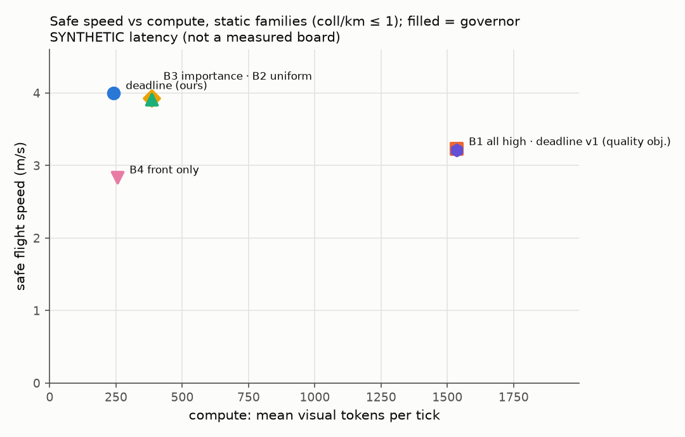
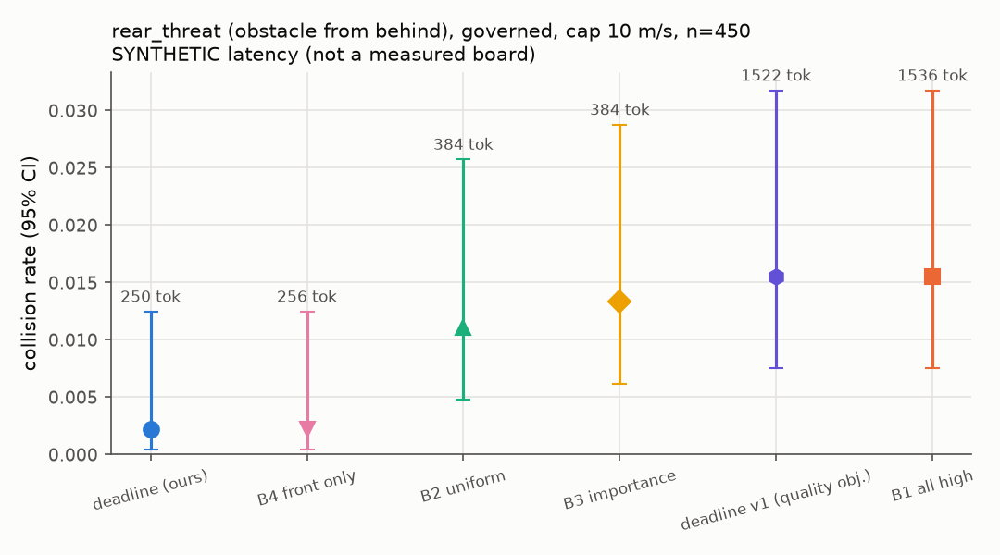
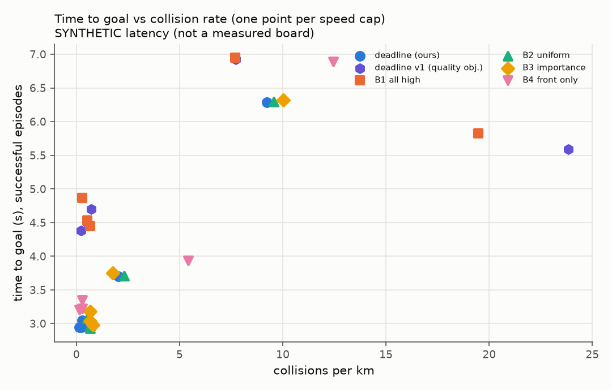

# DeadlineVLA evaluation report

> Latency comes from a SYNTHETIC board model, not a measured Jetson table.
> Policy is the 'surrogate' stand-in, not a VLA.

## Headline: tokens for equal safety and speed

Governed, speed cap 10 m/s, each method paired scene-by-scene against B2 `uniform_fixed`. Speed difference: mean per-scene difference with a 95% paired-bootstrap interval. Event rates: McNemar exact p on the discordant pairs.

**Static families (goal_nav, slalom, sparse_nav)**

| method | n | tokens/tick (vs B2) | speed m/s | Δspeed vs B2 [95% CI] | success | collision | p (collision) |
|---|---|---|---|---|---|---|---|
| all_high | 150 | 1536 (+300%) | 3.51 | -0.769 [-0.834, -0.700] | 0.880 | 0.000 | 1 |
| deadline | 150 | 247 (-36%) | 4.35 | +0.074 [+0.058, +0.092] | 1.000 | 0.000 | 1 |
| deadline_v1 | 150 | 1526 (+298%) | 3.50 | -0.773 [-0.838, -0.703] | 0.887 | 0.000 | 1 |
| front_only | 150 | 256 (-33%) | 3.93 | -0.345 [-0.521, -0.181] | 0.987 | 0.000 | 1 |
| importance | 150 | 384 (+0%) | 4.29 | +0.015 [+0.006, +0.024] | 1.000 | 0.000 | 1 |
| uniform_fixed | 150 | 384 (+0%) | 4.28 | +0.000 [+0.000, +0.000] | 1.000 | 0.000 | 1 |

> `deadline` vs B2 on static scenes: 36% fewer tokens per tick, success 1.000 vs 1.000, collisions 0.000 vs 0.000, speed +0.074 m/s [+0.058, +0.092].

**rear_threat**

| method | n | tokens/tick (vs B2) | speed m/s | Δspeed vs B2 [95% CI] | success | collision | p (collision) |
|---|---|---|---|---|---|---|---|
| all_high | 450 | 1536 (+300%) | 3.88 | -0.658 [-0.703, -0.613] | 0.882 | 0.016 | 0.774 |
| deadline | 450 | 247 (-36%) | 4.61 | +0.073 [+0.060, +0.087] | 0.996 | 0.002 | 0.125 |
| deadline_v1 | 450 | 1526 (+298%) | 3.90 | -0.638 [-0.681, -0.595] | 0.887 | 0.016 | 0.774 |
| front_only | 450 | 256 (-33%) | 4.55 | +0.018 [-0.028, +0.062] | 0.991 | 0.002 | 0.125 |
| importance | 450 | 384 (+0%) | 4.51 | -0.022 [-0.049, -0.003] | 0.976 | 0.013 | 1 |
| uniform_fixed | 450 | 384 (+0%) | 4.53 | +0.000 [+0.000, +0.000] | 0.984 | 0.011 | 1 |

Rates show the Wilson 95% interval in brackets.

## Safe speed per method

| method | governor | safe speed (m/s) | at cap | tokens/tick |
|---|---|---|---|---|
| all_high | True | 3.23 | 10 | 1.54e+03 |
| deadline | True | 4 | 10 | 242 |
| deadline_v1 | True | 3.22 | 10 | 1.54e+03 |
| front_only | True | 2.84 | 10 | 256 |
| importance | True | 3.93 | 10 | 384 |
| uniform_fixed | True | 3.91 | 10 | 384 |

## Deadline violations and their causes (all caps pooled)

Rates are per moving tick: `doc` uses clearance along the velocity and the latency of the flown inference; `cmd` uses clearance along the command (what the governor judged); `age` uses the real information age; `rel` is the v3 relative deadline (any contact closing too fast for its clearance, over all ticks, judged against ground truth); `unseen` is the share of ticks with a closing threat no camera detected at its tier. Causes are fractions of the `doc` violations.

| method | governor | doc | cmd | age | rel | unseen | ungoverned | clearance_jump | direction_mismatch | dynamics_lag | latency_tail | latency_switch | staleness | other |
|---|---|---|---|---|---|---|---|---|---|---|---|---|---|---|
| all_high | True | 0.101 | 0.103 | 0.274 | 0.0374 | 0 | 0 | 0.0428 | 0.189 | 0.766 | 0.00217 | 0 | 0 | 0 |
| deadline_v1 | True | 0.101 | 0.101 | 0.272 | 0.0384 | 0 | 0 | 0.0404 | 0.189 | 0.767 | 0.00213 | 0.00148 | 0 | 0 |
| deadline | True | 0.0561 | 0.0516 | 0.126 | 0.0208 | 0 | 0 | 0.0213 | 0.258 | 0.721 | 0 | 0 | 0 | 0 |
| front_only | True | 0.0615 | 0.0644 | 0.136 | 0.0737 | 0 | 0 | 0.0398 | 0.198 | 0.763 | 0 | 0 | 0 | 0 |
| importance | True | 0.0613 | 0.0597 | 0.124 | 0.0253 | 0 | 0 | 0.029 | 0.229 | 0.742 | 0 | 0 | 0 | 0 |
| uniform_fixed | True | 0.0588 | 0.0578 | 0.116 | 0.0204 | 0 | 0 | 0.0224 | 0.217 | 0.761 | 0 | 0 | 0 | 0 |

## All cells (all families)

| method | governor | speed_cap | episodes | success_rate | collision_rate | collisions_per_km | time_to_goal | mean_speed | tokens_per_tick | violation_rate | mean_latency | mean_age |
|---|---|---|---|---|---|---|---|---|---|---|---|---|
| all_high | True | 2 | 600 | 0.91 [0.88, 0.93] | 0.09 [0.07, 0.11] | 7.7 | 6.95 | 1.72 | 1.54e+03 | 0.0486 | 0.463 | 0.716 |
| all_high | True | 4 | 600 | 0.64 [0.60, 0.68] | 0.32 [0.28, 0.36] | 19.5 | 5.83 | 2.81 | 1.54e+03 | 0.0962 | 0.462 | 0.716 |
| all_high | True | 6 | 600 | 0.90 [0.87, 0.92] | 0.01 [0.00, 0.02] | 0.281 | 4.87 | 3.44 | 1.54e+03 | 0.114 | 0.462 | 0.716 |
| all_high | True | 8 | 600 | 0.87 [0.84, 0.90] | 0.01 [0.01, 0.03] | 0.658 | 4.45 | 3.57 | 1.54e+03 | 0.12 | 0.462 | 0.715 |
| all_high | True | 10 | 600 | 0.88 [0.85, 0.91] | 0.01 [0.01, 0.02] | 0.528 | 4.53 | 3.54 | 1.54e+03 | 0.128 | 0.462 | 0.716 |
| deadline | True | 2 | 600 | 0.90 [0.87, 0.92] | 0.10 [0.08, 0.13] | 9.24 | 6.28 | 1.86 | 217 | 0.00101 | 0.124 | 0.246 |
| deadline | True | 4 | 600 | 0.97 [0.96, 0.98] | 0.03 [0.02, 0.04] | 2.04 | 3.7 | 3.27 | 252 | 0.0368 | 0.133 | 0.252 |
| deadline | True | 6 | 600 | 0.99 [0.99, 1.00] | 0.00 [0.00, 0.01] | 0.267 | 3.05 | 4.02 | 248 | 0.0875 | 0.132 | 0.252 |
| deadline | True | 8 | 600 | 0.99 [0.99, 1.00] | 0.00 [0.00, 0.01] | 0.263 | 2.95 | 4.22 | 247 | 0.108 | 0.132 | 0.251 |
| deadline | True | 10 | 600 | 1.00 [0.99, 1.00] | 0.00 [0.00, 0.01] | 0.131 | 2.94 | 4.24 | 247 | 0.112 | 0.132 | 0.252 |
| deadline_v1 | True | 2 | 600 | 0.91 [0.88, 0.93] | 0.09 [0.07, 0.11] | 7.72 | 6.93 | 1.72 | 1.51e+03 | 0.0453 | 0.434 | 0.703 |
| deadline_v1 | True | 4 | 600 | 0.61 [0.57, 0.65] | 0.36 [0.32, 0.40] | 23.8 | 5.59 | 2.8 | 1.45e+03 | 0.0976 | 0.385 | 0.682 |
| deadline_v1 | True | 6 | 600 | 0.90 [0.87, 0.92] | 0.02 [0.01, 0.03] | 0.712 | 4.7 | 3.46 | 1.53e+03 | 0.111 | 0.454 | 0.711 |
| deadline_v1 | True | 8 | 600 | 0.89 [0.86, 0.91] | 0.01 [0.00, 0.01] | 0.225 | 4.38 | 3.55 | 1.53e+03 | 0.126 | 0.453 | 0.709 |
| deadline_v1 | True | 10 | 600 | 0.89 [0.86, 0.91] | 0.01 [0.01, 0.02] | 0.534 | 4.5 | 3.56 | 1.53e+03 | 0.126 | 0.453 | 0.711 |
| front_only | True | 2 | 600 | 0.86 [0.83, 0.88] | 0.13 [0.11, 0.16] | 12.4 | 6.89 | 1.64 | 256 | 0.0141 | 0.108 | 0.235 |
| front_only | True | 4 | 600 | 0.93 [0.91, 0.95] | 0.06 [0.05, 0.09] | 5.4 | 3.93 | 2.85 | 256 | 0.0387 | 0.108 | 0.234 |
| front_only | True | 6 | 600 | 0.99 [0.98, 0.99] | 0.00 [0.00, 0.01] | 0.272 | 3.35 | 3.41 | 256 | 0.0892 | 0.108 | 0.236 |
| front_only | True | 8 | 600 | 0.99 [0.98, 0.99] | 0.00 [0.00, 0.01] | 0.27 | 3.22 | 3.57 | 256 | 0.107 | 0.108 | 0.234 |
| front_only | True | 10 | 600 | 0.99 [0.98, 1.00] | 0.00 [0.00, 0.01] | 0.135 | 3.2 | 3.6 | 256 | 0.112 | 0.108 | 0.235 |
| importance | True | 2 | 600 | 0.89 [0.86, 0.91] | 0.11 [0.09, 0.14] | 10 | 6.32 | 1.84 | 384 | 0.00333 | 0.164 | 0.254 |
| importance | True | 4 | 600 | 0.98 [0.96, 0.99] | 0.02 [0.01, 0.04] | 1.76 | 3.75 | 3.24 | 384 | 0.0451 | 0.164 | 0.254 |
| importance | True | 6 | 600 | 0.99 [0.98, 1.00] | 0.01 [0.00, 0.02] | 0.667 | 3.18 | 3.86 | 384 | 0.0961 | 0.164 | 0.254 |
| importance | True | 8 | 600 | 0.99 [0.98, 0.99] | 0.01 [0.00, 0.02] | 0.656 | 3.04 | 4.05 | 384 | 0.111 | 0.164 | 0.254 |
| importance | True | 10 | 600 | 0.98 [0.97, 0.99] | 0.01 [0.00, 0.02] | 0.79 | 2.98 | 4.05 | 384 | 0.114 | 0.163 | 0.254 |
| uniform_fixed | True | 2 | 600 | 0.90 [0.87, 0.92] | 0.10 [0.08, 0.13] | 9.56 | 6.29 | 1.86 | 384 | 0.00197 | 0.168 | 0.254 |
| uniform_fixed | True | 4 | 600 | 0.97 [0.96, 0.98] | 0.03 [0.02, 0.04] | 2.32 | 3.71 | 3.26 | 384 | 0.0453 | 0.168 | 0.254 |
| uniform_fixed | True | 6 | 600 | 0.99 [0.98, 1.00] | 0.01 [0.00, 0.02] | 0.534 | 3.08 | 3.92 | 384 | 0.0928 | 0.168 | 0.255 |
| uniform_fixed | True | 8 | 600 | 0.99 [0.98, 0.99] | 0.01 [0.00, 0.02] | 0.664 | 2.96 | 4.15 | 384 | 0.106 | 0.168 | 0.254 |
| uniform_fixed | True | 10 | 600 | 0.99 [0.98, 0.99] | 0.01 [0.00, 0.02] | 0.662 | 2.93 | 4.16 | 384 | 0.11 | 0.168 | 0.254 |

## Family: goal_nav

| method | governor | speed_cap | episodes | success_rate | collision_rate | collisions_per_km | time_to_goal | mean_speed | tokens_per_tick | violation_rate | mean_latency | mean_age |
|---|---|---|---|---|---|---|---|---|---|---|---|---|
| all_high | True | 2 | 50 | 0.98 [0.90, 1.00] | 0.00 [0.00, 0.07] | 0 | 6.33 | 1.7 | 1.54e+03 | 0.0372 | 0.462 | 0.715 |
| all_high | True | 4 | 50 | 0.98 [0.90, 1.00] | 0.00 [0.00, 0.07] | 0 | 4.56 | 2.55 | 1.54e+03 | 0.144 | 0.465 | 0.72 |
| all_high | True | 6 | 50 | 0.96 [0.87, 0.99] | 0.00 [0.00, 0.07] | 0 | 5.71 | 3.12 | 1.54e+03 | 0.157 | 0.464 | 0.716 |
| all_high | True | 8 | 50 | 0.90 [0.79, 0.96] | 0.00 [0.00, 0.07] | 0 | 4.26 | 3.26 | 1.54e+03 | 0.16 | 0.459 | 0.712 |
| all_high | True | 10 | 50 | 0.90 [0.79, 0.96] | 0.00 [0.00, 0.07] | 0 | 4.87 | 3.31 | 1.54e+03 | 0.157 | 0.462 | 0.718 |
| deadline | True | 2 | 50 | 1.00 [0.93, 1.00] | 0.00 [0.00, 0.07] | 0 | 5.83 | 1.87 | 235 | 0 | 0.129 | 0.251 |
| deadline | True | 4 | 50 | 1.00 [0.93, 1.00] | 0.00 [0.00, 0.07] | 0 | 3.84 | 3.07 | 242 | 0.0549 | 0.132 | 0.252 |
| deadline | True | 6 | 50 | 1.00 [0.93, 1.00] | 0.00 [0.00, 0.07] | 0 | 3.03 | 3.87 | 246 | 0.0962 | 0.133 | 0.252 |
| deadline | True | 8 | 50 | 1.00 [0.93, 1.00] | 0.00 [0.00, 0.07] | 0 | 2.93 | 4.06 | 247 | 0.12 | 0.132 | 0.251 |
| deadline | True | 10 | 50 | 1.00 [0.93, 1.00] | 0.00 [0.00, 0.07] | 0 | 2.89 | 4.08 | 247 | 0.125 | 0.132 | 0.251 |
| deadline_v1 | True | 2 | 50 | 0.98 [0.90, 1.00] | 0.00 [0.00, 0.07] | 0 | 6.33 | 1.7 | 1.54e+03 | 0.0372 | 0.462 | 0.715 |
| deadline_v1 | True | 4 | 50 | 0.98 [0.90, 1.00] | 0.00 [0.00, 0.07] | 0 | 4.56 | 2.55 | 1.54e+03 | 0.144 | 0.465 | 0.72 |
| deadline_v1 | True | 6 | 50 | 0.96 [0.87, 0.99] | 0.00 [0.00, 0.07] | 0 | 5.71 | 3.12 | 1.54e+03 | 0.157 | 0.464 | 0.716 |
| deadline_v1 | True | 8 | 50 | 0.90 [0.79, 0.96] | 0.00 [0.00, 0.07] | 0 | 4.25 | 3.26 | 1.54e+03 | 0.161 | 0.459 | 0.711 |
| deadline_v1 | True | 10 | 50 | 0.90 [0.79, 0.96] | 0.00 [0.00, 0.07] | 0 | 4.86 | 3.31 | 1.54e+03 | 0.157 | 0.462 | 0.718 |
| front_only | True | 2 | 50 | 0.94 [0.84, 0.98] | 0.00 [0.00, 0.07] | 0 | 8.74 | 1.1 | 256 | 0.0225 | 0.108 | 0.235 |
| front_only | True | 4 | 50 | 0.96 [0.87, 0.99] | 0.00 [0.00, 0.07] | 0 | 6.62 | 1.49 | 256 | 0.0583 | 0.109 | 0.235 |
| front_only | True | 6 | 50 | 0.96 [0.87, 0.99] | 0.00 [0.00, 0.07] | 0 | 5.79 | 1.69 | 256 | 0.086 | 0.109 | 0.235 |
| front_only | True | 8 | 50 | 0.96 [0.87, 0.99] | 0.00 [0.00, 0.07] | 0 | 5.96 | 1.66 | 256 | 0.0996 | 0.108 | 0.234 |
| front_only | True | 10 | 50 | 0.96 [0.87, 0.99] | 0.00 [0.00, 0.07] | 0 | 5.85 | 1.67 | 256 | 0.106 | 0.108 | 0.236 |
| importance | True | 2 | 50 | 1.00 [0.93, 1.00] | 0.00 [0.00, 0.07] | 0 | 5.83 | 1.87 | 384 | 0.000359 | 0.166 | 0.254 |
| importance | True | 4 | 50 | 1.00 [0.93, 1.00] | 0.00 [0.00, 0.07] | 0 | 3.5 | 3.18 | 384 | 0.0613 | 0.168 | 0.257 |
| importance | True | 6 | 50 | 1.00 [0.93, 1.00] | 0.00 [0.00, 0.07] | 0 | 3.19 | 3.62 | 384 | 0.103 | 0.168 | 0.255 |
| importance | True | 8 | 50 | 0.98 [0.90, 1.00] | 0.00 [0.00, 0.07] | 0 | 2.74 | 3.59 | 384 | 0.126 | 0.166 | 0.253 |
| importance | True | 10 | 50 | 1.00 [0.93, 1.00] | 0.00 [0.00, 0.07] | 0 | 2.92 | 3.91 | 384 | 0.125 | 0.167 | 0.254 |
| uniform_fixed | True | 2 | 50 | 1.00 [0.93, 1.00] | 0.00 [0.00, 0.07] | 0 | 5.83 | 1.87 | 384 | 0.000359 | 0.168 | 0.254 |
| uniform_fixed | True | 4 | 50 | 1.00 [0.93, 1.00] | 0.00 [0.00, 0.07] | 0 | 3.5 | 3.18 | 384 | 0.062 | 0.169 | 0.257 |
| uniform_fixed | True | 6 | 50 | 1.00 [0.93, 1.00] | 0.00 [0.00, 0.07] | 0 | 3.19 | 3.61 | 384 | 0.102 | 0.169 | 0.255 |
| uniform_fixed | True | 8 | 50 | 1.00 [0.93, 1.00] | 0.00 [0.00, 0.07] | 0 | 2.94 | 3.88 | 384 | 0.124 | 0.167 | 0.253 |
| uniform_fixed | True | 10 | 50 | 1.00 [0.93, 1.00] | 0.00 [0.00, 0.07] | 0 | 2.92 | 3.91 | 384 | 0.123 | 0.168 | 0.254 |

## Family: rear_threat

| method | governor | speed_cap | episodes | success_rate | collision_rate | collisions_per_km | time_to_goal | mean_speed | tokens_per_tick | violation_rate | mean_latency | mean_age |
|---|---|---|---|---|---|---|---|---|---|---|---|---|
| all_high | True | 2 | 450 | 0.88 [0.85, 0.91] | 0.12 [0.09, 0.15] | 11.3 | 6.47 | 1.72 | 1.54e+03 | 0.0492 | 0.462 | 0.716 |
| all_high | True | 4 | 450 | 0.53 [0.48, 0.57] | 0.43 [0.38, 0.47] | 26.7 | 5.58 | 2.91 | 1.54e+03 | 0.0852 | 0.462 | 0.716 |
| all_high | True | 6 | 450 | 0.89 [0.86, 0.91] | 0.01 [0.00, 0.02] | 0.375 | 4.37 | 3.6 | 1.54e+03 | 0.105 | 0.462 | 0.716 |
| all_high | True | 8 | 450 | 0.87 [0.83, 0.89] | 0.02 [0.01, 0.04] | 0.911 | 4.05 | 3.73 | 1.54e+03 | 0.115 | 0.462 | 0.716 |
| all_high | True | 10 | 450 | 0.88 [0.85, 0.91] | 0.02 [0.01, 0.03] | 0.745 | 4.1 | 3.69 | 1.54e+03 | 0.125 | 0.462 | 0.716 |
| deadline | True | 2 | 450 | 0.86 [0.83, 0.89] | 0.14 [0.11, 0.17] | 13.3 | 5.98 | 1.84 | 211 | 0.00145 | 0.123 | 0.244 |
| deadline | True | 4 | 450 | 0.97 [0.95, 0.98] | 0.03 [0.02, 0.05] | 2.92 | 3.43 | 3.29 | 258 | 0.0305 | 0.135 | 0.252 |
| deadline | True | 6 | 450 | 0.99 [0.98, 1.00] | 0.00 [0.00, 0.02] | 0.387 | 2.73 | 4.1 | 251 | 0.0718 | 0.133 | 0.252 |
| deadline | True | 8 | 450 | 0.99 [0.98, 1.00] | 0.00 [0.00, 0.02] | 0.381 | 2.64 | 4.33 | 250 | 0.0948 | 0.133 | 0.251 |
| deadline | True | 10 | 450 | 1.00 [0.98, 1.00] | 0.00 [0.00, 0.01] | 0.189 | 2.64 | 4.36 | 250 | 0.0997 | 0.133 | 0.252 |
| deadline_v1 | True | 2 | 450 | 0.88 [0.85, 0.91] | 0.12 [0.09, 0.15] | 11.3 | 6.43 | 1.72 | 1.5e+03 | 0.0443 | 0.421 | 0.696 |
| deadline_v1 | True | 4 | 450 | 0.49 [0.44, 0.53] | 0.48 [0.43, 0.52] | 33.8 | 5.19 | 2.9 | 1.41e+03 | 0.086 | 0.356 | 0.665 |
| deadline_v1 | True | 6 | 450 | 0.88 [0.85, 0.91] | 0.02 [0.01, 0.04] | 0.972 | 4.14 | 3.62 | 1.52e+03 | 0.102 | 0.45 | 0.709 |
| deadline_v1 | True | 8 | 450 | 0.89 [0.86, 0.91] | 0.01 [0.00, 0.02] | 0.308 | 3.98 | 3.71 | 1.52e+03 | 0.119 | 0.449 | 0.707 |
| deadline_v1 | True | 10 | 450 | 0.89 [0.85, 0.91] | 0.02 [0.01, 0.03] | 0.75 | 4.06 | 3.73 | 1.52e+03 | 0.121 | 0.45 | 0.708 |
| front_only | True | 2 | 450 | 0.82 [0.78, 0.85] | 0.18 [0.15, 0.22] | 18.1 | 6.26 | 1.72 | 256 | 0.017 | 0.108 | 0.234 |
| front_only | True | 4 | 450 | 0.91 [0.88, 0.93] | 0.08 [0.06, 0.11] | 7.77 | 3.34 | 3.11 | 256 | 0.0328 | 0.108 | 0.234 |
| front_only | True | 6 | 450 | 0.99 [0.97, 1.00] | 0.00 [0.00, 0.02] | 0.396 | 2.77 | 3.8 | 256 | 0.0745 | 0.108 | 0.236 |
| front_only | True | 8 | 450 | 0.99 [0.97, 1.00] | 0.00 [0.00, 0.02] | 0.393 | 2.6 | 4.07 | 256 | 0.0928 | 0.108 | 0.234 |
| front_only | True | 10 | 450 | 0.99 [0.98, 1.00] | 0.00 [0.00, 0.01] | 0.196 | 2.58 | 4.11 | 256 | 0.101 | 0.108 | 0.234 |
| importance | True | 2 | 450 | 0.85 [0.82, 0.88] | 0.15 [0.12, 0.18] | 14.5 | 6.03 | 1.82 | 384 | 0.00474 | 0.165 | 0.254 |
| importance | True | 4 | 450 | 0.97 [0.95, 0.98] | 0.03 [0.02, 0.05] | 2.5 | 3.52 | 3.24 | 384 | 0.0376 | 0.165 | 0.254 |
| importance | True | 6 | 450 | 0.99 [0.97, 1.00] | 0.01 [0.00, 0.03] | 0.963 | 2.88 | 3.92 | 384 | 0.0809 | 0.165 | 0.255 |
| importance | True | 8 | 450 | 0.99 [0.97, 0.99] | 0.01 [0.00, 0.03] | 0.948 | 2.76 | 4.16 | 384 | 0.0975 | 0.165 | 0.254 |
| importance | True | 10 | 450 | 0.98 [0.96, 0.99] | 0.01 [0.01, 0.03] | 1.14 | 2.66 | 4.1 | 384 | 0.0997 | 0.165 | 0.254 |
| uniform_fixed | True | 2 | 450 | 0.86 [0.82, 0.89] | 0.14 [0.11, 0.18] | 13.8 | 5.99 | 1.84 | 384 | 0.00278 | 0.168 | 0.254 |
| uniform_fixed | True | 4 | 450 | 0.96 [0.94, 0.98] | 0.04 [0.02, 0.06] | 3.29 | 3.48 | 3.26 | 384 | 0.0377 | 0.168 | 0.254 |
| uniform_fixed | True | 6 | 450 | 0.99 [0.97, 0.99] | 0.01 [0.00, 0.02] | 0.768 | 2.76 | 4.01 | 384 | 0.082 | 0.168 | 0.255 |
| uniform_fixed | True | 8 | 450 | 0.98 [0.97, 0.99] | 0.01 [0.00, 0.03] | 0.956 | 2.65 | 4.28 | 384 | 0.0985 | 0.168 | 0.254 |
| uniform_fixed | True | 10 | 450 | 0.98 [0.97, 0.99] | 0.01 [0.00, 0.03] | 0.95 | 2.62 | 4.27 | 384 | 0.103 | 0.168 | 0.254 |

## Family: slalom

| method | governor | speed_cap | episodes | success_rate | collision_rate | collisions_per_km | time_to_goal | mean_speed | tokens_per_tick | violation_rate | mean_latency | mean_age |
|---|---|---|---|---|---|---|---|---|---|---|---|---|
| all_high | True | 2 | 50 | 1.00 [0.93, 1.00] | 0.00 [0.00, 0.07] | 0 | 12.1 | 1.74 | 1.54e+03 | 0.0732 | 0.463 | 0.718 |
| all_high | True | 4 | 50 | 0.94 [0.84, 0.98] | 0.00 [0.00, 0.07] | 0 | 10.6 | 2.45 | 1.54e+03 | 0.136 | 0.461 | 0.713 |
| all_high | True | 6 | 50 | 0.86 [0.74, 0.93] | 0.00 [0.00, 0.07] | 0 | 10.5 | 2.74 | 1.54e+03 | 0.149 | 0.462 | 0.718 |
| all_high | True | 8 | 50 | 0.82 [0.69, 0.90] | 0.00 [0.00, 0.07] | 0 | 10.4 | 2.94 | 1.54e+03 | 0.135 | 0.461 | 0.713 |
| all_high | True | 10 | 50 | 0.82 [0.69, 0.90] | 0.00 [0.00, 0.07] | 0 | 10.4 | 2.92 | 1.54e+03 | 0.133 | 0.461 | 0.715 |
| deadline | True | 2 | 50 | 1.00 [0.93, 1.00] | 0.00 [0.00, 0.07] | 0 | 9.55 | 1.92 | 233 | 0 | 0.128 | 0.251 |
| deadline | True | 4 | 50 | 1.00 [0.93, 1.00] | 0.00 [0.00, 0.07] | 0 | 6.4 | 3.27 | 237 | 0.0687 | 0.129 | 0.251 |
| deadline | True | 6 | 50 | 1.00 [0.93, 1.00] | 0.00 [0.00, 0.07] | 0 | 6.44 | 3.61 | 238 | 0.162 | 0.13 | 0.251 |
| deadline | True | 8 | 50 | 1.00 [0.93, 1.00] | 0.00 [0.00, 0.07] | 0 | 6.44 | 3.66 | 239 | 0.17 | 0.13 | 0.251 |
| deadline | True | 10 | 50 | 1.00 [0.93, 1.00] | 0.00 [0.00, 0.07] | 0 | 6.45 | 3.65 | 239 | 0.168 | 0.13 | 0.252 |
| deadline_v1 | True | 2 | 50 | 1.00 [0.93, 1.00] | 0.00 [0.00, 0.07] | 0 | 12.2 | 1.73 | 1.54e+03 | 0.0736 | 0.465 | 0.721 |
| deadline_v1 | True | 4 | 50 | 0.94 [0.84, 0.98] | 0.00 [0.00, 0.07] | 0 | 10.6 | 2.44 | 1.54e+03 | 0.135 | 0.46 | 0.712 |
| deadline_v1 | True | 6 | 50 | 0.86 [0.74, 0.93] | 0.00 [0.00, 0.07] | 0 | 10.5 | 2.85 | 1.54e+03 | 0.14 | 0.462 | 0.717 |
| deadline_v1 | True | 8 | 50 | 0.80 [0.67, 0.89] | 0.00 [0.00, 0.07] | 0 | 10.5 | 2.85 | 1.54e+03 | 0.151 | 0.461 | 0.713 |
| deadline_v1 | True | 10 | 50 | 0.84 [0.71, 0.92] | 0.00 [0.00, 0.07] | 0 | 10.4 | 2.89 | 1.54e+03 | 0.137 | 0.461 | 0.716 |
| front_only | True | 2 | 50 | 1.00 [0.93, 1.00] | 0.00 [0.00, 0.07] | 0 | 9.8 | 1.85 | 256 | 0 | 0.108 | 0.234 |
| front_only | True | 4 | 50 | 1.00 [0.93, 1.00] | 0.00 [0.00, 0.07] | 0 | 6.13 | 3.3 | 256 | 0.0663 | 0.109 | 0.235 |
| front_only | True | 6 | 50 | 1.00 [0.93, 1.00] | 0.00 [0.00, 0.07] | 0 | 6.34 | 3.63 | 256 | 0.17 | 0.108 | 0.235 |
| front_only | True | 8 | 50 | 1.00 [0.93, 1.00] | 0.00 [0.00, 0.07] | 0 | 6.45 | 3.68 | 256 | 0.187 | 0.108 | 0.235 |
| front_only | True | 10 | 50 | 1.00 [0.93, 1.00] | 0.00 [0.00, 0.07] | 0 | 6.44 | 3.69 | 256 | 0.18 | 0.108 | 0.237 |
| importance | True | 2 | 50 | 1.00 [0.93, 1.00] | 0.00 [0.00, 0.07] | 0 | 9.56 | 1.92 | 384 | 0 | 0.155 | 0.253 |
| importance | True | 4 | 50 | 1.00 [0.93, 1.00] | 0.00 [0.00, 0.07] | 0 | 6.51 | 3.22 | 384 | 0.0869 | 0.155 | 0.253 |
| importance | True | 6 | 50 | 1.00 [0.93, 1.00] | 0.00 [0.00, 0.07] | 0 | 6.49 | 3.57 | 384 | 0.171 | 0.155 | 0.254 |
| importance | True | 8 | 50 | 1.00 [0.93, 1.00] | 0.00 [0.00, 0.07] | 0 | 6.5 | 3.61 | 384 | 0.175 | 0.156 | 0.253 |
| importance | True | 10 | 50 | 1.00 [0.93, 1.00] | 0.00 [0.00, 0.07] | 0 | 6.53 | 3.61 | 384 | 0.179 | 0.156 | 0.254 |
| uniform_fixed | True | 2 | 50 | 1.00 [0.93, 1.00] | 0.00 [0.00, 0.07] | 0 | 9.55 | 1.92 | 384 | 0 | 0.167 | 0.254 |
| uniform_fixed | True | 4 | 50 | 1.00 [0.93, 1.00] | 0.00 [0.00, 0.07] | 0 | 6.44 | 3.21 | 384 | 0.088 | 0.168 | 0.254 |
| uniform_fixed | True | 6 | 50 | 1.00 [0.93, 1.00] | 0.00 [0.00, 0.07] | 0 | 6.4 | 3.53 | 384 | 0.15 | 0.168 | 0.254 |
| uniform_fixed | True | 8 | 50 | 1.00 [0.93, 1.00] | 0.00 [0.00, 0.07] | 0 | 6.43 | 3.57 | 384 | 0.148 | 0.168 | 0.254 |
| uniform_fixed | True | 10 | 50 | 1.00 [0.93, 1.00] | 0.00 [0.00, 0.07] | 0 | 6.4 | 3.57 | 384 | 0.15 | 0.168 | 0.254 |

## Family: sparse_nav

| method | governor | speed_cap | episodes | success_rate | collision_rate | collisions_per_km | time_to_goal | mean_speed | tokens_per_tick | violation_rate | mean_latency | mean_age |
|---|---|---|---|---|---|---|---|---|---|---|---|---|
| all_high | True | 2 | 50 | 1.00 [0.93, 1.00] | 0.00 [0.00, 0.07] | 0 | 6.17 | 1.77 | 1.54e+03 | 0.00535 | 0.463 | 0.717 |
| all_high | True | 4 | 50 | 1.00 [0.93, 1.00] | 0.00 [0.00, 0.07] | 0 | 3.71 | 3.01 | 1.54e+03 | 0.0383 | 0.466 | 0.722 |
| all_high | True | 6 | 50 | 0.96 [0.87, 0.99] | 0.00 [0.00, 0.07] | 0 | 3.13 | 3.8 | 1.54e+03 | 0.0644 | 0.465 | 0.718 |
| all_high | True | 8 | 50 | 0.94 [0.84, 0.98] | 0.00 [0.00, 0.07] | 0 | 2.75 | 4.11 | 1.54e+03 | 0.0791 | 0.462 | 0.711 |
| all_high | True | 10 | 50 | 0.92 [0.81, 0.97] | 0.00 [0.00, 0.07] | 0 | 2.65 | 4.16 | 1.54e+03 | 0.0931 | 0.46 | 0.713 |
| deadline | True | 2 | 50 | 1.00 [0.93, 1.00] | 0.00 [0.00, 0.07] | 0 | 5.84 | 1.87 | 226 | 0 | 0.127 | 0.251 |
| deadline | True | 4 | 50 | 1.00 [0.93, 1.00] | 0.00 [0.00, 0.07] | 0 | 3.22 | 3.37 | 235 | 0.00946 | 0.129 | 0.251 |
| deadline | True | 6 | 50 | 1.00 [0.93, 1.00] | 0.00 [0.00, 0.07] | 0 | 2.5 | 4.37 | 240 | 0.0267 | 0.131 | 0.252 |
| deadline | True | 8 | 50 | 1.00 [0.93, 1.00] | 0.00 [0.00, 0.07] | 0 | 2.27 | 4.81 | 243 | 0.0399 | 0.131 | 0.252 |
| deadline | True | 10 | 50 | 1.00 [0.93, 1.00] | 0.00 [0.00, 0.07] | 0 | 2.23 | 4.9 | 244 | 0.0457 | 0.131 | 0.251 |
| deadline_v1 | True | 2 | 50 | 1.00 [0.93, 1.00] | 0.00 [0.00, 0.07] | 0 | 6.17 | 1.77 | 1.54e+03 | 0.00535 | 0.463 | 0.717 |
| deadline_v1 | True | 4 | 50 | 1.00 [0.93, 1.00] | 0.00 [0.00, 0.07] | 0 | 3.71 | 3.01 | 1.54e+03 | 0.0383 | 0.466 | 0.722 |
| deadline_v1 | True | 6 | 50 | 0.96 [0.87, 0.99] | 0.00 [0.00, 0.07] | 0 | 3.13 | 3.8 | 1.54e+03 | 0.0644 | 0.465 | 0.718 |
| deadline_v1 | True | 8 | 50 | 0.94 [0.84, 0.98] | 0.00 [0.00, 0.07] | 0 | 2.75 | 4.11 | 1.54e+03 | 0.0791 | 0.462 | 0.711 |
| deadline_v1 | True | 10 | 50 | 0.92 [0.81, 0.97] | 0.00 [0.00, 0.07] | 0 | 2.65 | 4.16 | 1.54e+03 | 0.0931 | 0.46 | 0.713 |
| front_only | True | 2 | 50 | 1.00 [0.93, 1.00] | 0.00 [0.00, 0.07] | 0 | 6.87 | 1.59 | 256 | 0.00456 | 0.109 | 0.236 |
| front_only | True | 4 | 50 | 1.00 [0.93, 1.00] | 0.00 [0.00, 0.07] | 0 | 4 | 2.73 | 256 | 0.0135 | 0.108 | 0.233 |
| front_only | True | 6 | 50 | 1.00 [0.93, 1.00] | 0.00 [0.00, 0.07] | 0 | 3.17 | 3.45 | 256 | 0.0244 | 0.108 | 0.238 |
| front_only | True | 8 | 50 | 1.00 [0.93, 1.00] | 0.00 [0.00, 0.07] | 0 | 2.97 | 3.68 | 256 | 0.0324 | 0.108 | 0.236 |
| front_only | True | 10 | 50 | 1.00 [0.93, 1.00] | 0.00 [0.00, 0.07] | 0 | 3 | 3.66 | 256 | 0.0389 | 0.108 | 0.233 |
| importance | True | 2 | 50 | 1.00 [0.93, 1.00] | 0.00 [0.00, 0.07] | 0 | 5.84 | 1.87 | 384 | 0 | 0.165 | 0.255 |
| importance | True | 4 | 50 | 1.00 [0.93, 1.00] | 0.00 [0.00, 0.07] | 0 | 3.24 | 3.36 | 384 | 0.0128 | 0.165 | 0.254 |
| importance | True | 6 | 50 | 1.00 [0.93, 1.00] | 0.00 [0.00, 0.07] | 0 | 2.51 | 4.35 | 384 | 0.0345 | 0.165 | 0.255 |
| importance | True | 8 | 50 | 1.00 [0.93, 1.00] | 0.00 [0.00, 0.07] | 0 | 2.28 | 4.78 | 384 | 0.0356 | 0.165 | 0.255 |
| importance | True | 10 | 50 | 1.00 [0.93, 1.00] | 0.00 [0.00, 0.07] | 0 | 2.25 | 4.86 | 384 | 0.0484 | 0.165 | 0.255 |
| uniform_fixed | True | 2 | 50 | 1.00 [0.93, 1.00] | 0.00 [0.00, 0.07] | 0 | 5.84 | 1.87 | 384 | 0 | 0.169 | 0.255 |
| uniform_fixed | True | 4 | 50 | 1.00 [0.93, 1.00] | 0.00 [0.00, 0.07] | 0 | 3.23 | 3.36 | 384 | 0.0121 | 0.168 | 0.254 |
| uniform_fixed | True | 6 | 50 | 1.00 [0.93, 1.00] | 0.00 [0.00, 0.07] | 0 | 2.51 | 4.34 | 384 | 0.0345 | 0.168 | 0.255 |
| uniform_fixed | True | 8 | 50 | 1.00 [0.93, 1.00] | 0.00 [0.00, 0.07] | 0 | 2.28 | 4.78 | 384 | 0.0385 | 0.168 | 0.255 |
| uniform_fixed | True | 10 | 50 | 1.00 [0.93, 1.00] | 0.00 [0.00, 0.07] | 0 | 2.25 | 4.86 | 384 | 0.0453 | 0.168 | 0.255 |

## Family: static

| method | governor | speed_cap | episodes | success_rate | collision_rate | collisions_per_km | time_to_goal | mean_speed | tokens_per_tick | violation_rate | mean_latency | mean_age |
|---|---|---|---|---|---|---|---|---|---|---|---|---|
| all_high | True | 2 | 150 | 0.99 [0.96, 1.00] | 0.00 [0.00, 0.02] | 0 | 8.21 | 1.74 | 1.54e+03 | 0.0473 | 0.463 | 0.717 |
| all_high | True | 4 | 150 | 0.97 [0.93, 0.99] | 0.00 [0.00, 0.02] | 0 | 6.23 | 2.58 | 1.54e+03 | 0.122 | 0.463 | 0.716 |
| all_high | True | 6 | 150 | 0.93 [0.87, 0.96] | 0.00 [0.00, 0.02] | 0 | 6.3 | 3.04 | 1.54e+03 | 0.137 | 0.463 | 0.717 |
| all_high | True | 8 | 150 | 0.89 [0.83, 0.93] | 0.00 [0.00, 0.02] | 0 | 5.63 | 3.21 | 1.54e+03 | 0.133 | 0.461 | 0.713 |
| all_high | True | 10 | 150 | 0.88 [0.82, 0.92] | 0.00 [0.00, 0.02] | 0 | 5.81 | 3.23 | 1.54e+03 | 0.133 | 0.461 | 0.716 |
| deadline | True | 2 | 150 | 1.00 [0.98, 1.00] | 0.00 [0.00, 0.02] | 0 | 7.07 | 1.89 | 231 | 0 | 0.128 | 0.251 |
| deadline | True | 4 | 150 | 1.00 [0.98, 1.00] | 0.00 [0.00, 0.02] | 0 | 4.49 | 3.23 | 238 | 0.051 | 0.13 | 0.251 |
| deadline | True | 6 | 150 | 1.00 [0.98, 1.00] | 0.00 [0.00, 0.02] | 0 | 3.99 | 3.83 | 241 | 0.119 | 0.131 | 0.251 |
| deadline | True | 8 | 150 | 1.00 [0.98, 1.00] | 0.00 [0.00, 0.02] | 0 | 3.88 | 3.99 | 242 | 0.133 | 0.131 | 0.251 |
| deadline | True | 10 | 150 | 1.00 [0.98, 1.00] | 0.00 [0.00, 0.02] | 0 | 3.86 | 4 | 242 | 0.135 | 0.131 | 0.252 |
| deadline_v1 | True | 2 | 150 | 0.99 [0.96, 1.00] | 0.00 [0.00, 0.02] | 0 | 8.24 | 1.73 | 1.54e+03 | 0.0476 | 0.464 | 0.718 |
| deadline_v1 | True | 4 | 150 | 0.97 [0.93, 0.99] | 0.00 [0.00, 0.02] | 0 | 6.21 | 2.57 | 1.54e+03 | 0.121 | 0.462 | 0.715 |
| deadline_v1 | True | 6 | 150 | 0.93 [0.87, 0.96] | 0.00 [0.00, 0.02] | 0 | 6.3 | 3.09 | 1.54e+03 | 0.132 | 0.463 | 0.717 |
| deadline_v1 | True | 8 | 150 | 0.88 [0.82, 0.92] | 0.00 [0.00, 0.02] | 0 | 5.6 | 3.17 | 1.54e+03 | 0.142 | 0.461 | 0.712 |
| deadline_v1 | True | 10 | 150 | 0.89 [0.83, 0.93] | 0.00 [0.00, 0.02] | 0 | 5.84 | 3.22 | 1.54e+03 | 0.136 | 0.461 | 0.716 |
| front_only | True | 2 | 150 | 0.98 [0.94, 0.99] | 0.00 [0.00, 0.02] | 0 | 8.47 | 1.5 | 256 | 0.00775 | 0.109 | 0.235 |
| front_only | True | 4 | 150 | 0.99 [0.95, 1.00] | 0.00 [0.00, 0.02] | 0 | 5.57 | 2.4 | 256 | 0.0512 | 0.109 | 0.234 |
| front_only | True | 6 | 150 | 0.99 [0.95, 1.00] | 0.00 [0.00, 0.02] | 0 | 5.09 | 2.79 | 256 | 0.117 | 0.108 | 0.236 |
| front_only | True | 8 | 150 | 0.99 [0.95, 1.00] | 0.00 [0.00, 0.02] | 0 | 5.12 | 2.83 | 256 | 0.133 | 0.108 | 0.235 |
| front_only | True | 10 | 150 | 0.99 [0.95, 1.00] | 0.00 [0.00, 0.02] | 0 | 5.09 | 2.84 | 256 | 0.133 | 0.108 | 0.236 |
| importance | True | 2 | 150 | 1.00 [0.98, 1.00] | 0.00 [0.00, 0.02] | 0 | 7.07 | 1.89 | 384 | 9.78e-05 | 0.161 | 0.254 |
| importance | True | 4 | 150 | 1.00 [0.98, 1.00] | 0.00 [0.00, 0.02] | 0 | 4.41 | 3.24 | 384 | 0.0626 | 0.161 | 0.254 |
| importance | True | 6 | 150 | 1.00 [0.98, 1.00] | 0.00 [0.00, 0.02] | 0 | 4.06 | 3.74 | 384 | 0.127 | 0.161 | 0.254 |
| importance | True | 8 | 150 | 0.99 [0.96, 1.00] | 0.00 [0.00, 0.02] | 0 | 3.85 | 3.83 | 384 | 0.137 | 0.16 | 0.254 |
| importance | True | 10 | 150 | 1.00 [0.98, 1.00] | 0.00 [0.00, 0.02] | 0 | 3.9 | 3.93 | 384 | 0.142 | 0.161 | 0.254 |
| uniform_fixed | True | 2 | 150 | 1.00 [0.98, 1.00] | 0.00 [0.00, 0.02] | 0 | 7.07 | 1.89 | 384 | 9.78e-05 | 0.168 | 0.254 |
| uniform_fixed | True | 4 | 150 | 1.00 [0.98, 1.00] | 0.00 [0.00, 0.02] | 0 | 4.39 | 3.24 | 384 | 0.063 | 0.168 | 0.255 |
| uniform_fixed | True | 6 | 150 | 1.00 [0.98, 1.00] | 0.00 [0.00, 0.02] | 0 | 4.03 | 3.72 | 384 | 0.115 | 0.168 | 0.254 |
| uniform_fixed | True | 8 | 150 | 1.00 [0.98, 1.00] | 0.00 [0.00, 0.02] | 0 | 3.88 | 3.89 | 384 | 0.122 | 0.168 | 0.254 |
| uniform_fixed | True | 10 | 150 | 1.00 [0.98, 1.00] | 0.00 [0.00, 0.02] | 0 | 3.85 | 3.91 | 384 | 0.124 | 0.168 | 0.254 |
