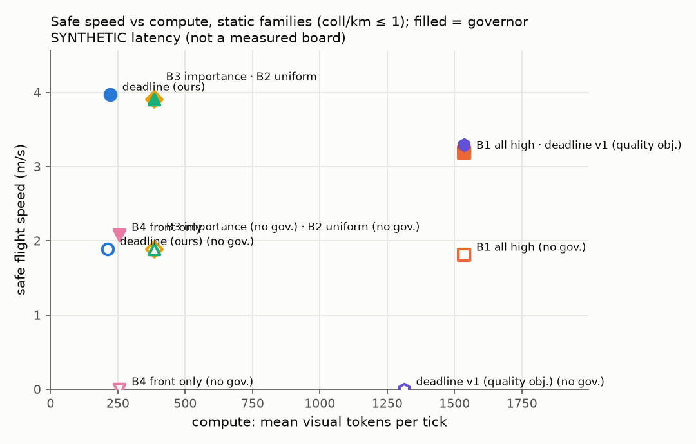
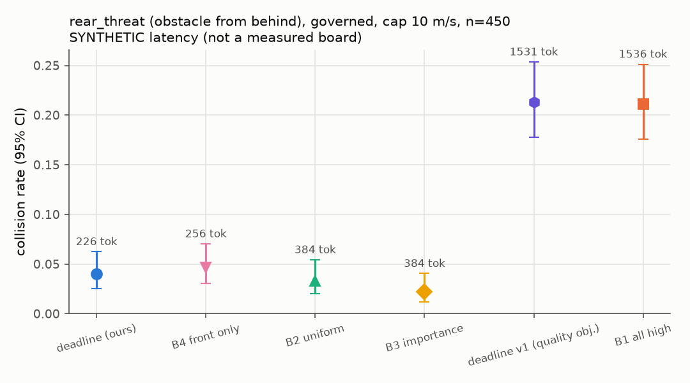
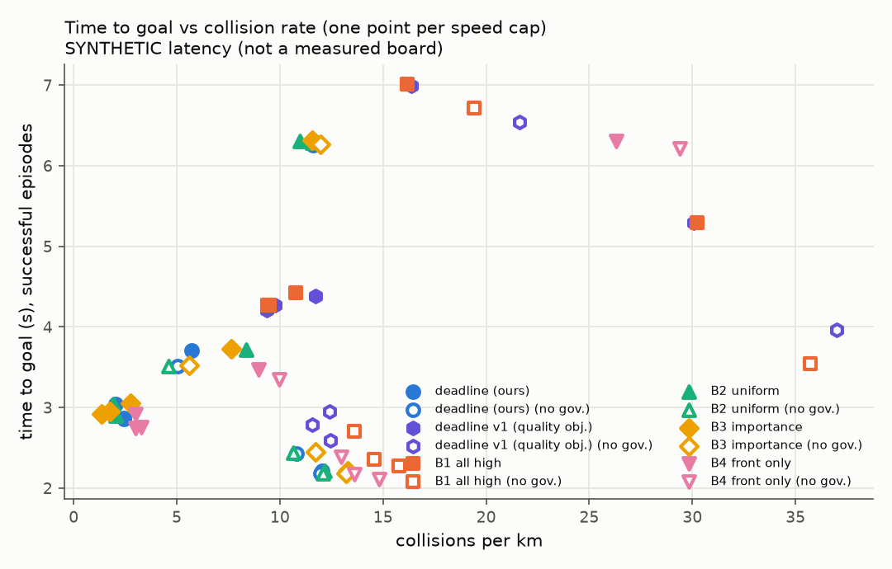

# DeadlineVLA evaluation report

> Latency comes from a SYNTHETIC board model, not a measured Jetson table.
> Policy is the 'surrogate' stand-in, not a VLA.

## Headline: tokens for equal safety and speed

Governed, speed cap 10 m/s, each method paired scene-by-scene against B2 `uniform_fixed`. Speed difference: mean per-scene difference with a 95% paired-bootstrap interval. Event rates: McNemar exact p on the discordant pairs.

**Static families (goal_nav, slalom, sparse_nav)**

| method | n | tokens/tick (vs B2) | speed m/s | Δspeed vs B2 [95% CI] | success | collision | p (collision) |
|---|---|---|---|---|---|---|---|
| all_high | 150 | 1536 (+300%) | 3.47 | -0.769 [-0.825, -0.711] | 0.913 | 0.000 | 1 |
| deadline | 150 | 225 (-41%) | 4.32 | +0.071 [+0.057, +0.086] | 1.000 | 0.000 | 1 |
| deadline_v1 | 150 | 1533 (+299%) | 3.47 | -0.776 [-0.829, -0.721] | 0.913 | 0.000 | 1 |
| front_only | 150 | 256 (-33%) | 3.86 | -0.379 [-0.586, -0.184] | 0.887 | 0.000 | 1 |
| importance | 150 | 384 (+0%) | 4.25 | +0.011 [-0.003, +0.025] | 1.000 | 0.000 | 1 |
| uniform_fixed | 150 | 384 (+0%) | 4.24 | +0.000 [+0.000, +0.000] | 1.000 | 0.000 | 1 |

> `deadline` vs B2 on static scenes: 41% fewer tokens per tick, success 1.000 vs 1.000, collisions 0.000 vs 0.000, speed +0.071 m/s [+0.057, +0.086].

**rear_threat**

| method | n | tokens/tick (vs B2) | speed m/s | Δspeed vs B2 [95% CI] | success | collision | p (collision) |
|---|---|---|---|---|---|---|---|
| all_high | 450 | 1536 (+300%) | 3.58 | -0.884 [-0.931, -0.836] | 0.749 | 0.211 | 3.06e-17 |
| deadline | 450 | 225 (-41%) | 4.53 | +0.067 [+0.050, +0.082] | 0.960 | 0.040 | 0.607 |
| deadline_v1 | 450 | 1533 (+299%) | 3.57 | -0.896 [-0.943, -0.848] | 0.740 | 0.213 | 1.7e-17 |
| front_only | 450 | 256 (-33%) | 4.45 | -0.014 [-0.077, +0.044] | 0.927 | 0.047 | 0.345 |
| importance | 450 | 384 (+0%) | 4.45 | -0.011 [-0.033, +0.011] | 0.976 | 0.022 | 0.227 |
| uniform_fixed | 450 | 384 (+0%) | 4.47 | +0.000 [+0.000, +0.000] | 0.967 | 0.033 | 1 |

Rates show the Wilson 95% interval in brackets.

## Safe speed per method

| method | governor | safe speed (m/s) | at cap | tokens/tick |
|---|---|---|---|---|
| all_high | False | 1.81 | 2 | 1.54e+03 |
| all_high | True | 3.19 | 8 | 1.54e+03 |
| deadline | False | 1.89 | 2 | 212 |
| deadline | True | 3.97 | 10 | 221 |
| deadline_v1 | False | 0 | - | 1.31e+03 |
| deadline_v1 | True | 3.3 | 8 | 1.54e+03 |
| front_only | False | 0 | - | 256 |
| front_only | True | 2.08 | 10 | 256 |
| importance | False | 1.89 | 2 | 384 |
| importance | True | 3.91 | 10 | 384 |
| uniform_fixed | False | 1.89 | 2 | 384 |
| uniform_fixed | True | 3.91 | 10 | 384 |

## Deadline violations and their causes (all caps pooled)

Rates are per moving tick: `doc` uses clearance along the velocity and the latency of the flown inference; `cmd` uses clearance along the command (what the governor judged); `age` uses the real information age; `rel` is the v3 relative deadline (any contact closing too fast for its clearance, over all ticks). Causes are fractions of the `doc` violations.

| method | governor | doc | cmd | age | rel | ungoverned | clearance_jump | direction_mismatch | dynamics_lag | latency_tail | latency_switch | staleness | other |
|---|---|---|---|---|---|---|---|---|---|---|---|---|---|
| all_high | True | 0.0128 | 0.018 | 0.25 | - | 0 | 0.269 | 0.0602 | 0.644 | 0.0276 | 0 | 0 | 0 |
| all_high | False | 0.184 | 0.174 | 0.258 | - | 0.999 | 4.84e-05 | 0.000145 | 0 | 0.00116 | 0 | 0 | 0 |
| deadline_v1 | True | 0.0128 | 0.0182 | 0.25 | - | 0 | 0.271 | 0.0616 | 0.634 | 0.0328 | 0.00113 | 0 | 0 |
| deadline_v1 | False | 0.158 | 0.149 | 0.229 | - | 0.997 | 0 | 0.00032 | 0 | 0.00102 | 0.00141 | 0 | 0 |
| deadline | True | 0.00243 | 0.00887 | 0.114 | - | 0 | 0.402 | 0.211 | 0.386 | 0 | 0 | 0 | 0 |
| deadline | False | 0.0784 | 0.0792 | 0.112 | - | 1 | 0 | 0 | 0 | 0 | 0 | 0 | 0 |
| front_only | True | 0.00584 | 0.0071 | 0.133 | - | 0 | 0.415 | 0.04 | 0.545 | 0 | 0 | 0 | 0 |
| front_only | False | 0.0873 | 0.0857 | 0.124 | - | 1 | 0 | 0 | 0 | 0 | 0 | 0 | 0 |
| importance | True | 0.0032 | 0.0112 | 0.0802 | - | 0 | 0.309 | 0.119 | 0.572 | 0 | 0 | 0 | 0 |
| importance | False | 0.0925 | 0.0917 | 0.118 | - | 1 | 0 | 0 | 0 | 0 | 0 | 0 | 0 |
| uniform_fixed | True | 0.00297 | 0.0111 | 0.0723 | - | 0 | 0.318 | 0.119 | 0.563 | 0 | 0 | 0 | 0 |
| uniform_fixed | False | 0.091 | 0.0922 | 0.113 | - | 1 | 0 | 0 | 0 | 0 | 0 | 0 | 0 |

## All cells (all families)

| method | governor | speed_cap | episodes | success_rate | collision_rate | collisions_per_km | time_to_goal | mean_speed | tokens_per_tick | violation_rate | mean_latency | mean_age |
|---|---|---|---|---|---|---|---|---|---|---|---|---|
| all_high | True | 2 | 600 | 0.83 [0.80, 0.86] | 0.17 [0.14, 0.20] | 16.2 | 7.01 | 1.7 | 1.54e+03 | 0.0137 | 0.462 | 0.716 |
| all_high | True | 4 | 600 | 0.56 [0.52, 0.59] | 0.41 [0.38, 0.45] | 30.2 | 5.29 | 2.77 | 1.54e+03 | 0.0122 | 0.463 | 0.716 |
| all_high | True | 6 | 600 | 0.77 [0.74, 0.80] | 0.18 [0.15, 0.21] | 10.7 | 4.43 | 3.28 | 1.54e+03 | 0.0118 | 0.463 | 0.716 |
| all_high | True | 8 | 600 | 0.78 [0.75, 0.81] | 0.16 [0.14, 0.20] | 9.48 | 4.27 | 3.38 | 1.54e+03 | 0.0139 | 0.462 | 0.715 |
| all_high | True | 10 | 600 | 0.79 [0.76, 0.82] | 0.16 [0.13, 0.19] | 9.4 | 4.27 | 3.41 | 1.54e+03 | 0.012 | 0.462 | 0.716 |
| all_high | False | 2 | 600 | 0.80 [0.76, 0.83] | 0.20 [0.17, 0.24] | 19.4 | 6.71 | 1.76 | 1.54e+03 | 0.0614 | 0.462 | 0.715 |
| all_high | False | 4 | 600 | 0.40 [0.36, 0.43] | 0.56 [0.52, 0.59] | 35.7 | 3.54 | 3.21 | 1.54e+03 | 0.153 | 0.463 | 0.715 |
| all_high | False | 6 | 600 | 0.72 [0.68, 0.75] | 0.23 [0.20, 0.27] | 13.6 | 2.7 | 4.12 | 1.54e+03 | 0.229 | 0.463 | 0.717 |
| all_high | False | 8 | 600 | 0.69 [0.66, 0.73] | 0.25 [0.21, 0.28] | 14.6 | 2.36 | 4.54 | 1.54e+03 | 0.277 | 0.461 | 0.714 |
| all_high | False | 10 | 600 | 0.69 [0.65, 0.73] | 0.24 [0.21, 0.28] | 15.8 | 2.28 | 4.72 | 1.54e+03 | 0.311 | 0.462 | 0.717 |
| deadline | True | 2 | 600 | 0.88 [0.85, 0.90] | 0.12 [0.10, 0.15] | 11.6 | 6.31 | 1.84 | 212 | 0.0013 | 0.123 | 0.25 |
| deadline | True | 4 | 600 | 0.93 [0.91, 0.95] | 0.07 [0.05, 0.09] | 5.72 | 3.71 | 3.23 | 219 | 0.000987 | 0.125 | 0.251 |
| deadline | True | 6 | 600 | 0.97 [0.96, 0.98] | 0.03 [0.02, 0.04] | 2.04 | 3.04 | 3.97 | 223 | 0.00301 | 0.126 | 0.251 |
| deadline | True | 8 | 600 | 0.97 [0.95, 0.98] | 0.03 [0.02, 0.05] | 2.45 | 2.87 | 4.2 | 225 | 0.00416 | 0.126 | 0.251 |
| deadline | True | 10 | 600 | 0.97 [0.95, 0.98] | 0.03 [0.02, 0.05] | 2.44 | 2.86 | 4.22 | 225 | 0.00437 | 0.126 | 0.251 |
| deadline | False | 2 | 600 | 0.88 [0.85, 0.90] | 0.12 [0.10, 0.15] | 11.6 | 6.25 | 1.86 | 212 | 0.00794 | 0.123 | 0.25 |
| deadline | False | 4 | 600 | 0.94 [0.92, 0.96] | 0.06 [0.04, 0.08] | 5.03 | 3.51 | 3.39 | 220 | 0.0491 | 0.125 | 0.251 |
| deadline | False | 6 | 600 | 0.88 [0.85, 0.91] | 0.12 [0.09, 0.15] | 10.8 | 2.43 | 4.44 | 229 | 0.127 | 0.128 | 0.251 |
| deadline | False | 8 | 600 | 0.87 [0.84, 0.89] | 0.13 [0.11, 0.16] | 12.1 | 2.21 | 4.95 | 232 | 0.173 | 0.128 | 0.251 |
| deadline | False | 10 | 600 | 0.87 [0.84, 0.89] | 0.13 [0.11, 0.16] | 12 | 2.18 | 5.06 | 233 | 0.184 | 0.128 | 0.252 |
| deadline_v1 | True | 2 | 600 | 0.83 [0.79, 0.85] | 0.17 [0.15, 0.21] | 16.4 | 6.99 | 1.71 | 1.53e+03 | 0.0127 | 0.459 | 0.713 |
| deadline_v1 | True | 4 | 600 | 0.55 [0.51, 0.59] | 0.42 [0.38, 0.46] | 30.1 | 5.3 | 2.78 | 1.53e+03 | 0.0123 | 0.459 | 0.713 |
| deadline_v1 | True | 6 | 600 | 0.78 [0.75, 0.81] | 0.18 [0.15, 0.22] | 11.7 | 4.39 | 3.23 | 1.53e+03 | 0.0132 | 0.46 | 0.714 |
| deadline_v1 | True | 8 | 600 | 0.76 [0.73, 0.79] | 0.17 [0.14, 0.20] | 9.35 | 4.21 | 3.43 | 1.53e+03 | 0.0123 | 0.459 | 0.714 |
| deadline_v1 | True | 10 | 600 | 0.78 [0.75, 0.81] | 0.16 [0.13, 0.19] | 9.77 | 4.27 | 3.39 | 1.53e+03 | 0.0139 | 0.458 | 0.714 |
| deadline_v1 | False | 2 | 600 | 0.78 [0.75, 0.81] | 0.22 [0.19, 0.25] | 21.6 | 6.54 | 1.75 | 1.51e+03 | 0.0552 | 0.442 | 0.696 |
| deadline_v1 | False | 4 | 600 | 0.49 [0.45, 0.53] | 0.48 [0.44, 0.52] | 37 | 3.97 | 3.12 | 1.45e+03 | 0.135 | 0.387 | 0.659 |
| deadline_v1 | False | 6 | 600 | 0.80 [0.77, 0.83] | 0.17 [0.15, 0.21] | 12.4 | 2.95 | 4.03 | 1.39e+03 | 0.206 | 0.342 | 0.624 |
| deadline_v1 | False | 8 | 600 | 0.79 [0.76, 0.82] | 0.17 [0.14, 0.20] | 11.6 | 2.78 | 4.43 | 1.35e+03 | 0.242 | 0.321 | 0.606 |
| deadline_v1 | False | 10 | 600 | 0.78 [0.75, 0.81] | 0.17 [0.14, 0.20] | 12.5 | 2.59 | 4.54 | 1.33e+03 | 0.261 | 0.308 | 0.591 |
| front_only | True | 2 | 600 | 0.69 [0.66, 0.73] | 0.25 [0.22, 0.29] | 26.3 | 6.31 | 1.43 | 256 | 0.011 | 0.108 | 0.234 |
| front_only | True | 4 | 600 | 0.85 [0.82, 0.88] | 0.10 [0.08, 0.13] | 8.95 | 3.47 | 2.35 | 256 | 0.00243 | 0.108 | 0.234 |
| front_only | True | 6 | 600 | 0.92 [0.90, 0.94] | 0.04 [0.02, 0.05] | 3.01 | 2.92 | 2.8 | 256 | 0.00342 | 0.108 | 0.235 |
| front_only | True | 8 | 600 | 0.91 [0.89, 0.93] | 0.04 [0.03, 0.06] | 3.29 | 2.75 | 2.82 | 256 | 0.00408 | 0.108 | 0.234 |
| front_only | True | 10 | 600 | 0.92 [0.89, 0.94] | 0.04 [0.02, 0.05] | 3 | 2.75 | 2.83 | 256 | 0.00418 | 0.108 | 0.234 |
| front_only | False | 2 | 600 | 0.71 [0.68, 0.75] | 0.28 [0.25, 0.32] | 29.4 | 6.22 | 1.85 | 256 | 0.028 | 0.108 | 0.235 |
| front_only | False | 4 | 600 | 0.89 [0.86, 0.91] | 0.11 [0.09, 0.14] | 9.98 | 3.35 | 3.41 | 256 | 0.0502 | 0.108 | 0.234 |
| front_only | False | 6 | 600 | 0.86 [0.83, 0.89] | 0.14 [0.11, 0.17] | 13 | 2.39 | 4.45 | 256 | 0.125 | 0.108 | 0.236 |
| front_only | False | 8 | 600 | 0.85 [0.82, 0.88] | 0.14 [0.12, 0.18] | 13.6 | 2.17 | 4.96 | 256 | 0.17 | 0.108 | 0.234 |
| front_only | False | 10 | 600 | 0.84 [0.81, 0.87] | 0.16 [0.13, 0.19] | 14.8 | 2.11 | 5.07 | 256 | 0.183 | 0.108 | 0.234 |
| importance | True | 2 | 600 | 0.87 [0.84, 0.90] | 0.12 [0.10, 0.15] | 11.6 | 6.32 | 1.83 | 384 | 0.00159 | 0.16 | 0.254 |
| importance | True | 4 | 600 | 0.91 [0.88, 0.93] | 0.09 [0.07, 0.12] | 7.62 | 3.73 | 3.19 | 384 | 0.00183 | 0.16 | 0.254 |
| importance | True | 6 | 600 | 0.97 [0.95, 0.98] | 0.03 [0.02, 0.05] | 2.74 | 3.05 | 3.92 | 384 | 0.00425 | 0.161 | 0.254 |
| importance | True | 8 | 600 | 0.98 [0.96, 0.99] | 0.02 [0.01, 0.04] | 1.76 | 2.95 | 4.05 | 384 | 0.00591 | 0.16 | 0.254 |
| importance | True | 10 | 600 | 0.98 [0.97, 0.99] | 0.02 [0.01, 0.03] | 1.35 | 2.93 | 4.08 | 384 | 0.00445 | 0.16 | 0.254 |
| importance | False | 2 | 600 | 0.87 [0.84, 0.89] | 0.13 [0.11, 0.16] | 12 | 6.26 | 1.85 | 384 | 0.0119 | 0.16 | 0.254 |
| importance | False | 4 | 600 | 0.93 [0.91, 0.95] | 0.07 [0.05, 0.09] | 5.58 | 3.52 | 3.38 | 384 | 0.0673 | 0.16 | 0.254 |
| importance | False | 6 | 600 | 0.87 [0.84, 0.90] | 0.13 [0.10, 0.16] | 11.7 | 2.45 | 4.43 | 384 | 0.147 | 0.161 | 0.255 |
| importance | False | 8 | 600 | 0.85 [0.82, 0.88] | 0.14 [0.12, 0.18] | 13.3 | 2.21 | 4.93 | 384 | 0.198 | 0.161 | 0.254 |
| importance | False | 10 | 600 | 0.85 [0.82, 0.88] | 0.14 [0.12, 0.18] | 13.2 | 2.19 | 5.05 | 384 | 0.207 | 0.161 | 0.255 |
| uniform_fixed | True | 2 | 600 | 0.88 [0.85, 0.91] | 0.12 [0.09, 0.15] | 11 | 6.31 | 1.84 | 384 | 0.00171 | 0.168 | 0.254 |
| uniform_fixed | True | 4 | 600 | 0.90 [0.88, 0.92] | 0.10 [0.08, 0.12] | 8.37 | 3.72 | 3.19 | 384 | 0.00184 | 0.168 | 0.254 |
| uniform_fixed | True | 6 | 600 | 0.98 [0.96, 0.99] | 0.02 [0.01, 0.04] | 1.92 | 3.04 | 3.92 | 384 | 0.00361 | 0.168 | 0.254 |
| uniform_fixed | True | 8 | 600 | 0.97 [0.96, 0.98] | 0.03 [0.02, 0.04] | 2.04 | 2.91 | 4.13 | 384 | 0.00409 | 0.168 | 0.254 |
| uniform_fixed | True | 10 | 600 | 0.97 [0.96, 0.98] | 0.03 [0.02, 0.04] | 2.04 | 2.9 | 4.16 | 384 | 0.00525 | 0.168 | 0.254 |
| uniform_fixed | False | 2 | 600 | 0.88 [0.85, 0.90] | 0.12 [0.10, 0.15] | 11.6 | 6.29 | 1.85 | 384 | 0.0104 | 0.168 | 0.254 |
| uniform_fixed | False | 4 | 600 | 0.94 [0.92, 0.96] | 0.06 [0.04, 0.08] | 4.6 | 3.51 | 3.39 | 384 | 0.0645 | 0.168 | 0.254 |
| uniform_fixed | False | 6 | 600 | 0.88 [0.86, 0.91] | 0.12 [0.09, 0.14] | 10.7 | 2.44 | 4.44 | 384 | 0.144 | 0.168 | 0.255 |
| uniform_fixed | False | 8 | 600 | 0.87 [0.84, 0.89] | 0.13 [0.11, 0.16] | 12.2 | 2.21 | 4.95 | 384 | 0.196 | 0.168 | 0.255 |
| uniform_fixed | False | 10 | 600 | 0.87 [0.84, 0.89] | 0.13 [0.11, 0.16] | 12.1 | 2.18 | 5.07 | 384 | 0.207 | 0.168 | 0.255 |

## Family: goal_nav

| method | governor | speed_cap | episodes | success_rate | collision_rate | collisions_per_km | time_to_goal | mean_speed | tokens_per_tick | violation_rate | mean_latency | mean_age |
|---|---|---|---|---|---|---|---|---|---|---|---|---|
| all_high | True | 2 | 50 | 1.00 [0.93, 1.00] | 0.00 [0.00, 0.07] | 0 | 6.5 | 1.72 | 1.54e+03 | 0.00135 | 0.463 | 0.716 |
| all_high | True | 4 | 50 | 0.98 [0.90, 1.00] | 0.00 [0.00, 0.07] | 0 | 4.64 | 2.72 | 1.54e+03 | 0.0141 | 0.465 | 0.721 |
| all_high | True | 6 | 50 | 0.98 [0.90, 1.00] | 0.00 [0.00, 0.07] | 0 | 4.99 | 3.18 | 1.54e+03 | 0.0122 | 0.463 | 0.716 |
| all_high | True | 8 | 50 | 0.94 [0.84, 0.98] | 0.00 [0.00, 0.07] | 0 | 4.73 | 3.23 | 1.54e+03 | 0.00349 | 0.46 | 0.714 |
| all_high | True | 10 | 50 | 0.96 [0.87, 0.99] | 0.00 [0.00, 0.07] | 0 | 4.73 | 3.22 | 1.54e+03 | 0.0129 | 0.463 | 0.718 |
| all_high | False | 2 | 50 | 0.96 [0.87, 0.99] | 0.04 [0.01, 0.13] | 3.64 | 6.21 | 1.77 | 1.54e+03 | 0.0273 | 0.463 | 0.716 |
| all_high | False | 4 | 50 | 0.76 [0.63, 0.86] | 0.24 [0.14, 0.37] | 20 | 3.48 | 3.12 | 1.54e+03 | 0.239 | 0.468 | 0.718 |
| all_high | False | 6 | 50 | 0.58 [0.44, 0.71] | 0.40 [0.28, 0.54] | 24.5 | 2.61 | 4.11 | 1.54e+03 | 0.324 | 0.463 | 0.711 |
| all_high | False | 8 | 50 | 0.60 [0.46, 0.72] | 0.30 [0.19, 0.44] | 13.3 | 2.36 | 4.55 | 1.54e+03 | 0.332 | 0.46 | 0.712 |
| all_high | False | 10 | 50 | 0.64 [0.50, 0.76] | 0.26 [0.16, 0.40] | 12.8 | 2.77 | 4.76 | 1.54e+03 | 0.386 | 0.462 | 0.721 |
| deadline | True | 2 | 50 | 1.00 [0.93, 1.00] | 0.00 [0.00, 0.07] | 0 | 5.83 | 1.87 | 216 | 0 | 0.125 | 0.25 |
| deadline | True | 4 | 50 | 1.00 [0.93, 1.00] | 0.00 [0.00, 0.07] | 0 | 3.47 | 3.2 | 225 | 0.00125 | 0.127 | 0.251 |
| deadline | True | 6 | 50 | 1.00 [0.93, 1.00] | 0.00 [0.00, 0.07] | 0 | 2.93 | 3.88 | 229 | 0.00451 | 0.128 | 0.252 |
| deadline | True | 8 | 50 | 1.00 [0.93, 1.00] | 0.00 [0.00, 0.07] | 0 | 2.83 | 4.04 | 229 | 0.00468 | 0.127 | 0.252 |
| deadline | True | 10 | 50 | 1.00 [0.93, 1.00] | 0.00 [0.00, 0.07] | 0 | 2.82 | 4.08 | 230 | 0.00706 | 0.128 | 0.251 |
| deadline | False | 2 | 50 | 1.00 [0.93, 1.00] | 0.00 [0.00, 0.07] | 0 | 5.82 | 1.87 | 216 | 0 | 0.125 | 0.25 |
| deadline | False | 4 | 50 | 0.92 [0.81, 0.97] | 0.08 [0.03, 0.19] | 7.52 | 3.15 | 3.37 | 227 | 0.0473 | 0.128 | 0.251 |
| deadline | False | 6 | 50 | 0.94 [0.84, 0.98] | 0.06 [0.02, 0.16] | 5.46 | 2.45 | 4.45 | 233 | 0.155 | 0.129 | 0.251 |
| deadline | False | 8 | 50 | 0.90 [0.79, 0.96] | 0.10 [0.04, 0.21] | 8.83 | 2.28 | 4.93 | 235 | 0.24 | 0.128 | 0.251 |
| deadline | False | 10 | 50 | 0.90 [0.79, 0.96] | 0.10 [0.04, 0.21] | 8.77 | 2.24 | 5.04 | 236 | 0.253 | 0.129 | 0.251 |
| deadline_v1 | True | 2 | 50 | 1.00 [0.93, 1.00] | 0.00 [0.00, 0.07] | 0 | 6.5 | 1.72 | 1.54e+03 | 0.00135 | 0.463 | 0.716 |
| deadline_v1 | True | 4 | 50 | 0.98 [0.90, 1.00] | 0.00 [0.00, 0.07] | 0 | 4.64 | 2.72 | 1.54e+03 | 0.0141 | 0.465 | 0.721 |
| deadline_v1 | True | 6 | 50 | 0.98 [0.90, 1.00] | 0.00 [0.00, 0.07] | 0 | 4.99 | 3.18 | 1.54e+03 | 0.0122 | 0.463 | 0.716 |
| deadline_v1 | True | 8 | 50 | 0.94 [0.84, 0.98] | 0.00 [0.00, 0.07] | 0 | 4.73 | 3.23 | 1.54e+03 | 0.00349 | 0.46 | 0.714 |
| deadline_v1 | True | 10 | 50 | 0.96 [0.87, 0.99] | 0.00 [0.00, 0.07] | 0 | 4.73 | 3.22 | 1.54e+03 | 0.0129 | 0.463 | 0.718 |
| deadline_v1 | False | 2 | 50 | 0.92 [0.81, 0.97] | 0.08 [0.03, 0.19] | 7.52 | 6.08 | 1.76 | 1.52e+03 | 0.03 | 0.449 | 0.709 |
| deadline_v1 | False | 4 | 50 | 0.90 [0.79, 0.96] | 0.10 [0.04, 0.21] | 9.04 | 3.62 | 3.08 | 1.43e+03 | 0.193 | 0.383 | 0.643 |
| deadline_v1 | False | 6 | 50 | 0.82 [0.69, 0.90] | 0.16 [0.08, 0.29] | 11.6 | 2.86 | 4.04 | 1.34e+03 | 0.27 | 0.319 | 0.602 |
| deadline_v1 | False | 8 | 50 | 0.78 [0.65, 0.87] | 0.18 [0.10, 0.31] | 11.3 | 3.25 | 4.38 | 1.3e+03 | 0.286 | 0.293 | 0.584 |
| deadline_v1 | False | 10 | 50 | 0.74 [0.60, 0.84] | 0.20 [0.11, 0.33] | 11.2 | 2.87 | 4.47 | 1.3e+03 | 0.273 | 0.291 | 0.593 |
| front_only | True | 2 | 50 | 0.72 [0.58, 0.83] | 0.00 [0.00, 0.07] | 0 | 5.65 | 0.718 | 256 | 0.00255 | 0.109 | 0.235 |
| front_only | True | 4 | 50 | 0.72 [0.58, 0.83] | 0.00 [0.00, 0.07] | 0 | 3.29 | 0.836 | 256 | 0.008 | 0.109 | 0.236 |
| front_only | True | 6 | 50 | 0.72 [0.58, 0.83] | 0.00 [0.00, 0.07] | 0 | 2.71 | 0.884 | 256 | 0.00686 | 0.109 | 0.236 |
| front_only | True | 8 | 50 | 0.72 [0.58, 0.83] | 0.00 [0.00, 0.07] | 0 | 2.6 | 0.899 | 256 | 0.00976 | 0.108 | 0.234 |
| front_only | True | 10 | 50 | 0.72 [0.58, 0.83] | 0.00 [0.00, 0.07] | 0 | 2.6 | 0.898 | 256 | 0.00898 | 0.108 | 0.236 |
| front_only | False | 2 | 50 | 0.74 [0.60, 0.84] | 0.26 [0.16, 0.40] | 27.7 | 5.57 | 1.85 | 256 | 0.0471 | 0.108 | 0.235 |
| front_only | False | 4 | 50 | 0.68 [0.54, 0.79] | 0.32 [0.21, 0.46] | 34.8 | 3.05 | 3.31 | 256 | 0.117 | 0.109 | 0.236 |
| front_only | False | 6 | 50 | 0.68 [0.54, 0.79] | 0.32 [0.21, 0.46] | 34.8 | 2.31 | 4.29 | 256 | 0.191 | 0.109 | 0.235 |
| front_only | False | 8 | 50 | 0.68 [0.54, 0.79] | 0.32 [0.21, 0.46] | 34.6 | 2.07 | 4.79 | 256 | 0.254 | 0.108 | 0.232 |
| front_only | False | 10 | 50 | 0.68 [0.54, 0.79] | 0.32 [0.21, 0.46] | 34.5 | 2.04 | 4.9 | 256 | 0.268 | 0.108 | 0.236 |
| importance | True | 2 | 50 | 1.00 [0.93, 1.00] | 0.00 [0.00, 0.07] | 0 | 5.88 | 1.86 | 384 | 0 | 0.161 | 0.254 |
| importance | True | 4 | 50 | 1.00 [0.93, 1.00] | 0.00 [0.00, 0.07] | 0 | 3.48 | 3.19 | 384 | 0.00187 | 0.163 | 0.257 |
| importance | True | 6 | 50 | 1.00 [0.93, 1.00] | 0.00 [0.00, 0.07] | 0 | 2.91 | 3.83 | 384 | 0.00227 | 0.163 | 0.256 |
| importance | True | 8 | 50 | 1.00 [0.93, 1.00] | 0.00 [0.00, 0.07] | 0 | 2.88 | 3.99 | 384 | 0.00383 | 0.161 | 0.253 |
| importance | True | 10 | 50 | 1.00 [0.93, 1.00] | 0.00 [0.00, 0.07] | 0 | 2.88 | 3.99 | 384 | 0.0046 | 0.162 | 0.254 |
| importance | False | 2 | 50 | 1.00 [0.93, 1.00] | 0.00 [0.00, 0.07] | 0 | 5.87 | 1.86 | 384 | 0.00249 | 0.161 | 0.254 |
| importance | False | 4 | 50 | 0.92 [0.81, 0.97] | 0.08 [0.03, 0.19] | 7.5 | 3.17 | 3.37 | 384 | 0.0725 | 0.162 | 0.256 |
| importance | False | 6 | 50 | 0.92 [0.81, 0.97] | 0.08 [0.03, 0.19] | 7.18 | 2.5 | 4.41 | 384 | 0.183 | 0.162 | 0.256 |
| importance | False | 8 | 50 | 0.88 [0.76, 0.94] | 0.12 [0.06, 0.24] | 10.6 | 2.29 | 4.91 | 384 | 0.274 | 0.161 | 0.254 |
| importance | False | 10 | 50 | 0.90 [0.79, 0.96] | 0.10 [0.04, 0.21] | 8.58 | 2.33 | 4.98 | 384 | 0.283 | 0.161 | 0.256 |
| uniform_fixed | True | 2 | 50 | 1.00 [0.93, 1.00] | 0.00 [0.00, 0.07] | 0 | 5.83 | 1.86 | 384 | 0 | 0.168 | 0.254 |
| uniform_fixed | True | 4 | 50 | 1.00 [0.93, 1.00] | 0.00 [0.00, 0.07] | 0 | 3.43 | 3.19 | 384 | 0.00189 | 0.169 | 0.257 |
| uniform_fixed | True | 6 | 50 | 1.00 [0.93, 1.00] | 0.00 [0.00, 0.07] | 0 | 2.89 | 3.83 | 384 | 0.00609 | 0.169 | 0.256 |
| uniform_fixed | True | 8 | 50 | 1.00 [0.93, 1.00] | 0.00 [0.00, 0.07] | 0 | 2.83 | 4 | 384 | 0.00312 | 0.167 | 0.253 |
| uniform_fixed | True | 10 | 50 | 1.00 [0.93, 1.00] | 0.00 [0.00, 0.07] | 0 | 2.81 | 4.01 | 384 | 0.00235 | 0.168 | 0.254 |
| uniform_fixed | False | 2 | 50 | 1.00 [0.93, 1.00] | 0.00 [0.00, 0.07] | 0 | 5.83 | 1.87 | 384 | 0.000359 | 0.168 | 0.254 |
| uniform_fixed | False | 4 | 50 | 0.92 [0.81, 0.97] | 0.08 [0.03, 0.19] | 7.52 | 3.15 | 3.37 | 384 | 0.0665 | 0.169 | 0.257 |
| uniform_fixed | False | 6 | 50 | 0.94 [0.84, 0.98] | 0.06 [0.02, 0.16] | 5.43 | 2.47 | 4.43 | 384 | 0.181 | 0.169 | 0.255 |
| uniform_fixed | False | 8 | 50 | 0.90 [0.79, 0.96] | 0.10 [0.04, 0.21] | 8.84 | 2.28 | 4.94 | 384 | 0.277 | 0.167 | 0.254 |
| uniform_fixed | False | 10 | 50 | 0.92 [0.81, 0.97] | 0.08 [0.03, 0.19] | 7.02 | 2.24 | 5.05 | 384 | 0.292 | 0.168 | 0.256 |

## Family: rear_threat

| method | governor | speed_cap | episodes | success_rate | collision_rate | collisions_per_km | time_to_goal | mean_speed | tokens_per_tick | violation_rate | mean_latency | mean_age |
|---|---|---|---|---|---|---|---|---|---|---|---|---|
| all_high | True | 2 | 450 | 0.77 [0.73, 0.81] | 0.23 [0.19, 0.27] | 24.5 | 6.5 | 1.68 | 1.54e+03 | 0.0191 | 0.462 | 0.716 |
| all_high | True | 4 | 450 | 0.42 [0.37, 0.46] | 0.55 [0.51, 0.60] | 46.1 | 4.59 | 2.82 | 1.54e+03 | 0.0131 | 0.462 | 0.715 |
| all_high | True | 6 | 450 | 0.72 [0.67, 0.76] | 0.24 [0.20, 0.28] | 16.5 | 3.8 | 3.36 | 1.54e+03 | 0.013 | 0.462 | 0.716 |
| all_high | True | 8 | 450 | 0.74 [0.70, 0.78] | 0.22 [0.18, 0.26] | 14.5 | 3.72 | 3.5 | 1.54e+03 | 0.0152 | 0.462 | 0.715 |
| all_high | True | 10 | 450 | 0.75 [0.71, 0.79] | 0.21 [0.18, 0.25] | 14.3 | 3.71 | 3.55 | 1.54e+03 | 0.0134 | 0.462 | 0.716 |
| all_high | False | 2 | 450 | 0.74 [0.69, 0.77] | 0.26 [0.23, 0.31] | 29.2 | 6.18 | 1.73 | 1.54e+03 | 0.0641 | 0.462 | 0.716 |
| all_high | False | 4 | 450 | 0.33 [0.29, 0.38] | 0.60 [0.55, 0.64] | 34.8 | 3.57 | 3.25 | 1.54e+03 | 0.134 | 0.462 | 0.715 |
| all_high | False | 6 | 450 | 0.79 [0.75, 0.82] | 0.15 [0.12, 0.19] | 8.26 | 2.7 | 4.15 | 1.54e+03 | 0.205 | 0.462 | 0.717 |
| all_high | False | 8 | 450 | 0.76 [0.72, 0.80] | 0.18 [0.15, 0.22] | 10.6 | 2.36 | 4.56 | 1.54e+03 | 0.259 | 0.462 | 0.715 |
| all_high | False | 10 | 450 | 0.75 [0.71, 0.79] | 0.18 [0.15, 0.22] | 11.4 | 2.24 | 4.73 | 1.54e+03 | 0.29 | 0.462 | 0.717 |
| deadline | True | 2 | 450 | 0.83 [0.80, 0.86] | 0.17 [0.14, 0.20] | 16.9 | 6 | 1.82 | 211 | 0.00188 | 0.123 | 0.25 |
| deadline | True | 4 | 450 | 0.91 [0.88, 0.93] | 0.09 [0.07, 0.12] | 8.19 | 3.48 | 3.21 | 219 | 0.00127 | 0.125 | 0.251 |
| deadline | True | 6 | 450 | 0.97 [0.95, 0.98] | 0.03 [0.02, 0.05] | 2.95 | 2.74 | 4.05 | 224 | 0.00287 | 0.126 | 0.251 |
| deadline | True | 8 | 450 | 0.96 [0.94, 0.97] | 0.04 [0.03, 0.06] | 3.55 | 2.53 | 4.33 | 226 | 0.00399 | 0.127 | 0.251 |
| deadline | True | 10 | 450 | 0.96 [0.94, 0.97] | 0.04 [0.03, 0.06] | 3.54 | 2.53 | 4.35 | 226 | 0.00322 | 0.127 | 0.251 |
| deadline | False | 2 | 450 | 0.83 [0.80, 0.86] | 0.17 [0.14, 0.20] | 16.9 | 5.93 | 1.84 | 212 | 0.0115 | 0.123 | 0.25 |
| deadline | False | 4 | 450 | 0.93 [0.90, 0.95] | 0.07 [0.05, 0.10] | 6.39 | 3.3 | 3.35 | 220 | 0.0349 | 0.125 | 0.251 |
| deadline | False | 6 | 450 | 0.96 [0.93, 0.97] | 0.04 [0.03, 0.07] | 4.04 | 2.42 | 4.45 | 227 | 0.095 | 0.127 | 0.251 |
| deadline | False | 8 | 450 | 0.95 [0.92, 0.96] | 0.05 [0.04, 0.08] | 4.79 | 2.21 | 4.96 | 231 | 0.148 | 0.128 | 0.251 |
| deadline | False | 10 | 450 | 0.94 [0.92, 0.96] | 0.06 [0.04, 0.08] | 4.96 | 2.18 | 5.07 | 231 | 0.162 | 0.128 | 0.251 |
| deadline_v1 | True | 2 | 450 | 0.77 [0.73, 0.81] | 0.23 [0.19, 0.27] | 24.9 | 6.47 | 1.68 | 1.53e+03 | 0.0171 | 0.457 | 0.711 |
| deadline_v1 | True | 4 | 450 | 0.41 [0.36, 0.45] | 0.56 [0.51, 0.61] | 45.5 | 4.7 | 2.83 | 1.53e+03 | 0.0121 | 0.457 | 0.711 |
| deadline_v1 | True | 6 | 450 | 0.73 [0.69, 0.77] | 0.24 [0.21, 0.29] | 18.6 | 3.74 | 3.31 | 1.53e+03 | 0.0124 | 0.457 | 0.712 |
| deadline_v1 | True | 8 | 450 | 0.73 [0.69, 0.77] | 0.22 [0.19, 0.27] | 15.1 | 3.71 | 3.52 | 1.53e+03 | 0.0133 | 0.458 | 0.712 |
| deadline_v1 | True | 10 | 450 | 0.74 [0.70, 0.78] | 0.21 [0.18, 0.25] | 14.7 | 3.7 | 3.53 | 1.53e+03 | 0.0147 | 0.457 | 0.712 |
| deadline_v1 | False | 2 | 450 | 0.75 [0.70, 0.78] | 0.25 [0.22, 0.30] | 27.9 | 6.18 | 1.73 | 1.51e+03 | 0.0541 | 0.443 | 0.695 |
| deadline_v1 | False | 4 | 450 | 0.45 [0.40, 0.49] | 0.52 [0.47, 0.57] | 38.3 | 4.07 | 3.13 | 1.46e+03 | 0.11 | 0.404 | 0.669 |
| deadline_v1 | False | 6 | 450 | 0.87 [0.83, 0.89] | 0.10 [0.08, 0.13] | 6.91 | 2.96 | 4.05 | 1.41e+03 | 0.188 | 0.36 | 0.636 |
| deadline_v1 | False | 8 | 450 | 0.86 [0.83, 0.89] | 0.09 [0.07, 0.12] | 6.26 | 2.76 | 4.45 | 1.37e+03 | 0.228 | 0.331 | 0.614 |
| deadline_v1 | False | 10 | 450 | 0.86 [0.82, 0.89] | 0.10 [0.07, 0.13] | 6.91 | 2.58 | 4.55 | 1.34e+03 | 0.252 | 0.313 | 0.595 |
| front_only | True | 2 | 450 | 0.63 [0.59, 0.67] | 0.33 [0.29, 0.38] | 39.3 | 5.92 | 1.52 | 256 | 0.0158 | 0.108 | 0.234 |
| front_only | True | 4 | 450 | 0.84 [0.80, 0.87] | 0.13 [0.11, 0.17] | 12.7 | 3.17 | 2.68 | 256 | 0.00235 | 0.108 | 0.234 |
| front_only | True | 6 | 450 | 0.93 [0.91, 0.95] | 0.05 [0.03, 0.07] | 4.33 | 2.59 | 3.36 | 256 | 0.00133 | 0.108 | 0.235 |
| front_only | True | 8 | 450 | 0.92 [0.89, 0.94] | 0.05 [0.03, 0.08] | 4.73 | 2.4 | 3.36 | 256 | 0.00254 | 0.108 | 0.234 |
| front_only | True | 10 | 450 | 0.93 [0.90, 0.95] | 0.05 [0.03, 0.07] | 4.33 | 2.4 | 3.36 | 256 | 0.00277 | 0.108 | 0.234 |
| front_only | False | 2 | 450 | 0.66 [0.61, 0.70] | 0.34 [0.30, 0.39] | 39.7 | 5.83 | 1.83 | 256 | 0.0351 | 0.108 | 0.234 |
| front_only | False | 4 | 450 | 0.89 [0.86, 0.92] | 0.11 [0.08, 0.14] | 10.2 | 3.11 | 3.39 | 256 | 0.0336 | 0.108 | 0.234 |
| front_only | False | 6 | 450 | 0.97 [0.95, 0.98] | 0.03 [0.02, 0.05] | 3.06 | 2.4 | 4.48 | 256 | 0.0928 | 0.108 | 0.236 |
| front_only | False | 8 | 450 | 0.96 [0.93, 0.97] | 0.04 [0.03, 0.07] | 3.82 | 2.18 | 4.99 | 256 | 0.144 | 0.108 | 0.234 |
| front_only | False | 10 | 450 | 0.95 [0.92, 0.96] | 0.05 [0.04, 0.08] | 4.85 | 2.12 | 5.1 | 256 | 0.16 | 0.108 | 0.234 |
| importance | True | 2 | 450 | 0.83 [0.79, 0.86] | 0.17 [0.14, 0.20] | 16.8 | 6.01 | 1.81 | 384 | 0.00229 | 0.16 | 0.254 |
| importance | True | 4 | 450 | 0.88 [0.85, 0.91] | 0.12 [0.09, 0.15] | 11 | 3.48 | 3.17 | 384 | 0.00178 | 0.161 | 0.254 |
| importance | True | 6 | 450 | 0.96 [0.93, 0.97] | 0.04 [0.03, 0.07] | 3.96 | 2.76 | 3.99 | 384 | 0.00383 | 0.162 | 0.255 |
| importance | True | 8 | 450 | 0.97 [0.95, 0.98] | 0.03 [0.02, 0.05] | 2.54 | 2.64 | 4.12 | 384 | 0.00522 | 0.161 | 0.254 |
| importance | True | 10 | 450 | 0.98 [0.96, 0.99] | 0.02 [0.01, 0.04] | 1.95 | 2.62 | 4.16 | 384 | 0.00405 | 0.161 | 0.254 |
| importance | False | 2 | 450 | 0.82 [0.78, 0.85] | 0.17 [0.14, 0.21] | 17.4 | 5.93 | 1.83 | 384 | 0.0169 | 0.16 | 0.254 |
| importance | False | 4 | 450 | 0.92 [0.89, 0.94] | 0.08 [0.06, 0.11] | 7.19 | 3.3 | 3.35 | 384 | 0.0525 | 0.161 | 0.254 |
| importance | False | 6 | 450 | 0.94 [0.92, 0.96] | 0.06 [0.04, 0.08] | 5.06 | 2.44 | 4.44 | 384 | 0.117 | 0.162 | 0.254 |
| importance | False | 8 | 450 | 0.93 [0.90, 0.95] | 0.07 [0.05, 0.10] | 6.21 | 2.21 | 4.95 | 384 | 0.173 | 0.162 | 0.254 |
| importance | False | 10 | 450 | 0.93 [0.90, 0.95] | 0.07 [0.05, 0.10] | 6.59 | 2.17 | 5.06 | 384 | 0.185 | 0.162 | 0.255 |
| uniform_fixed | True | 2 | 450 | 0.84 [0.81, 0.87] | 0.16 [0.13, 0.19] | 15.9 | 6.01 | 1.82 | 384 | 0.00247 | 0.168 | 0.254 |
| uniform_fixed | True | 4 | 450 | 0.87 [0.83, 0.90] | 0.13 [0.10, 0.17] | 12 | 3.48 | 3.17 | 384 | 0.00186 | 0.168 | 0.254 |
| uniform_fixed | True | 6 | 450 | 0.97 [0.95, 0.98] | 0.03 [0.02, 0.05] | 2.77 | 2.75 | 4 | 384 | 0.00339 | 0.168 | 0.254 |
| uniform_fixed | True | 8 | 450 | 0.97 [0.95, 0.98] | 0.03 [0.02, 0.05] | 2.94 | 2.61 | 4.23 | 384 | 0.00386 | 0.168 | 0.255 |
| uniform_fixed | True | 10 | 450 | 0.97 [0.95, 0.98] | 0.03 [0.02, 0.05] | 2.93 | 2.6 | 4.27 | 384 | 0.00503 | 0.168 | 0.254 |
| uniform_fixed | False | 2 | 450 | 0.83 [0.80, 0.86] | 0.17 [0.14, 0.20] | 16.8 | 5.97 | 1.84 | 384 | 0.015 | 0.168 | 0.254 |
| uniform_fixed | False | 4 | 450 | 0.94 [0.91, 0.95] | 0.06 [0.05, 0.09] | 5.78 | 3.3 | 3.35 | 384 | 0.047 | 0.168 | 0.254 |
| uniform_fixed | False | 6 | 450 | 0.96 [0.93, 0.97] | 0.04 [0.03, 0.07] | 3.83 | 2.43 | 4.45 | 384 | 0.113 | 0.168 | 0.255 |
| uniform_fixed | False | 8 | 450 | 0.94 [0.92, 0.96] | 0.06 [0.04, 0.08] | 4.97 | 2.21 | 4.96 | 384 | 0.169 | 0.168 | 0.255 |
| uniform_fixed | False | 10 | 450 | 0.94 [0.91, 0.96] | 0.06 [0.04, 0.09] | 5.34 | 2.18 | 5.07 | 384 | 0.183 | 0.168 | 0.255 |

## Family: slalom

| method | governor | speed_cap | episodes | success_rate | collision_rate | collisions_per_km | time_to_goal | mean_speed | tokens_per_tick | violation_rate | mean_latency | mean_age |
|---|---|---|---|---|---|---|---|---|---|---|---|---|
| all_high | True | 2 | 50 | 1.00 [0.93, 1.00] | 0.00 [0.00, 0.07] | 0 | 11.9 | 1.75 | 1.54e+03 | 0.00602 | 0.462 | 0.716 |
| all_high | True | 4 | 50 | 0.92 [0.81, 0.97] | 0.00 [0.00, 0.07] | 0 | 10.6 | 2.56 | 1.54e+03 | 0.0112 | 0.463 | 0.715 |
| all_high | True | 6 | 50 | 0.82 [0.69, 0.90] | 0.00 [0.00, 0.07] | 0 | 9.97 | 2.95 | 1.54e+03 | 0.00938 | 0.462 | 0.716 |
| all_high | True | 8 | 50 | 0.82 [0.69, 0.90] | 0.00 [0.00, 0.07] | 0 | 9.76 | 2.9 | 1.54e+03 | 0.0169 | 0.462 | 0.716 |
| all_high | True | 10 | 50 | 0.82 [0.69, 0.90] | 0.00 [0.00, 0.07] | 0 | 9.96 | 2.9 | 1.54e+03 | 0.00989 | 0.462 | 0.718 |
| all_high | False | 2 | 50 | 1.00 [0.93, 1.00] | 0.00 [0.00, 0.07] | 0 | 11.3 | 1.86 | 1.54e+03 | 0.0985 | 0.461 | 0.713 |
| all_high | False | 4 | 50 | 0.00 [0.00, 0.07] | 1.00 [0.93, 1.00] | 120 | - | 2.88 | 1.54e+03 | 0.546 | 0.463 | 0.717 |
| all_high | False | 6 | 50 | 0.02 [0.00, 0.10] | 0.98 [0.90, 1.00] | 113 | 3.68 | 3.67 | 1.54e+03 | 0.733 | 0.463 | 0.715 |
| all_high | False | 8 | 50 | 0.04 [0.01, 0.13] | 0.96 [0.87, 0.99] | 113 | 3.15 | 4.05 | 1.54e+03 | 0.729 | 0.461 | 0.722 |
| all_high | False | 10 | 50 | 0.04 [0.01, 0.13] | 0.96 [0.87, 0.99] | 113 | 2.8 | 4.26 | 1.54e+03 | 0.706 | 0.461 | 0.713 |
| deadline | True | 2 | 50 | 1.00 [0.93, 1.00] | 0.00 [0.00, 0.07] | 0 | 9.55 | 1.92 | 206 | 0 | 0.121 | 0.25 |
| deadline | True | 4 | 50 | 1.00 [0.93, 1.00] | 0.00 [0.00, 0.07] | 0 | 6.34 | 3.26 | 211 | 0 | 0.123 | 0.25 |
| deadline | True | 6 | 50 | 1.00 [0.93, 1.00] | 0.00 [0.00, 0.07] | 0 | 6.32 | 3.56 | 213 | 0.00396 | 0.123 | 0.25 |
| deadline | True | 8 | 50 | 1.00 [0.93, 1.00] | 0.00 [0.00, 0.07] | 0 | 6.36 | 3.6 | 213 | 0.00589 | 0.124 | 0.25 |
| deadline | True | 10 | 50 | 1.00 [0.93, 1.00] | 0.00 [0.00, 0.07] | 0 | 6.36 | 3.6 | 213 | 0.00819 | 0.124 | 0.251 |
| deadline | False | 2 | 50 | 1.00 [0.93, 1.00] | 0.00 [0.00, 0.07] | 0 | 9.54 | 1.92 | 207 | 0 | 0.122 | 0.25 |
| deadline | False | 4 | 50 | 1.00 [0.93, 1.00] | 0.00 [0.00, 0.07] | 0 | 5.91 | 3.57 | 212 | 0.138 | 0.123 | 0.25 |
| deadline | False | 6 | 50 | 0.04 [0.01, 0.13] | 0.96 [0.87, 0.99] | 92.1 | 3.49 | 4.32 | 229 | 0.495 | 0.127 | 0.251 |
| deadline | False | 8 | 50 | 0.00 [0.00, 0.07] | 1.00 [0.93, 1.00] | 121 | - | 4.67 | 240 | 0.551 | 0.131 | 0.252 |
| deadline | False | 10 | 50 | 0.02 [0.00, 0.10] | 0.98 [0.90, 1.00] | 117 | 2.7 | 4.84 | 242 | 0.527 | 0.131 | 0.254 |
| deadline_v1 | True | 2 | 50 | 1.00 [0.93, 1.00] | 0.00 [0.00, 0.07] | 0 | 11.9 | 1.75 | 1.54e+03 | 0.00777 | 0.462 | 0.716 |
| deadline_v1 | True | 4 | 50 | 0.90 [0.79, 0.96] | 0.00 [0.00, 0.07] | 0 | 10.2 | 2.57 | 1.54e+03 | 0.0146 | 0.462 | 0.716 |
| deadline_v1 | True | 6 | 50 | 0.84 [0.71, 0.92] | 0.00 [0.00, 0.07] | 0 | 9.92 | 2.9 | 1.54e+03 | 0.0167 | 0.462 | 0.717 |
| deadline_v1 | True | 8 | 50 | 0.70 [0.56, 0.81] | 0.00 [0.00, 0.07] | 0 | 9.97 | 3.13 | 1.54e+03 | 0.0146 | 0.462 | 0.717 |
| deadline_v1 | True | 10 | 50 | 0.82 [0.69, 0.90] | 0.00 [0.00, 0.07] | 0 | 9.98 | 2.83 | 1.54e+03 | 0.0144 | 0.462 | 0.717 |
| deadline_v1 | False | 2 | 50 | 0.74 [0.60, 0.84] | 0.26 [0.16, 0.40] | 14.7 | 10.9 | 1.84 | 1.48e+03 | 0.107 | 0.423 | 0.68 |
| deadline_v1 | False | 4 | 50 | 0.00 [0.00, 0.07] | 0.98 [0.90, 1.00] | 90.7 | - | 3 | 1.19e+03 | 0.449 | 0.238 | 0.529 |
| deadline_v1 | False | 6 | 50 | 0.02 [0.00, 0.10] | 0.98 [0.90, 1.00] | 113 | 3.78 | 3.62 | 1.02e+03 | 0.528 | 0.174 | 0.381 |
| deadline_v1 | False | 8 | 50 | 0.02 [0.00, 0.10] | 0.96 [0.87, 0.99] | 111 | 3.14 | 4.05 | 1.11e+03 | 0.576 | 0.196 | 0.419 |
| deadline_v1 | False | 10 | 50 | 0.02 [0.00, 0.10] | 0.96 [0.87, 0.99] | 111 | 2.98 | 4.21 | 1.16e+03 | 0.557 | 0.213 | 0.438 |
| front_only | True | 2 | 50 | 1.00 [0.93, 1.00] | 0.00 [0.00, 0.07] | 0 | 9.44 | 1.92 | 256 | 0 | 0.108 | 0.233 |
| front_only | True | 4 | 50 | 1.00 [0.93, 1.00] | 0.00 [0.00, 0.07] | 0 | 6.1 | 3.29 | 256 | 0 | 0.109 | 0.236 |
| front_only | True | 6 | 50 | 1.00 [0.93, 1.00] | 0.00 [0.00, 0.07] | 0 | 6.28 | 3.58 | 256 | 0.00929 | 0.108 | 0.235 |
| front_only | True | 8 | 50 | 1.00 [0.93, 1.00] | 0.00 [0.00, 0.07] | 0 | 6.27 | 3.63 | 256 | 0.00763 | 0.108 | 0.235 |
| front_only | True | 10 | 50 | 1.00 [0.93, 1.00] | 0.00 [0.00, 0.07] | 0 | 6.3 | 3.62 | 256 | 0.00728 | 0.108 | 0.234 |
| front_only | False | 2 | 50 | 1.00 [0.93, 1.00] | 0.00 [0.00, 0.07] | 0 | 9.44 | 1.92 | 256 | 0 | 0.108 | 0.235 |
| front_only | False | 4 | 50 | 1.00 [0.93, 1.00] | 0.00 [0.00, 0.07] | 0 | 5.66 | 3.58 | 256 | 0.112 | 0.108 | 0.232 |
| front_only | False | 6 | 50 | 0.04 [0.01, 0.13] | 0.96 [0.87, 0.99] | 94 | 3.47 | 4.34 | 256 | 0.45 | 0.108 | 0.231 |
| front_only | False | 8 | 50 | 0.04 [0.01, 0.13] | 0.96 [0.87, 0.99] | 111 | 3.95 | 4.72 | 256 | 0.51 | 0.108 | 0.236 |
| front_only | False | 10 | 50 | 0.00 [0.00, 0.07] | 1.00 [0.93, 1.00] | 120 | - | 4.89 | 256 | 0.514 | 0.108 | 0.231 |
| importance | True | 2 | 50 | 1.00 [0.93, 1.00] | 0.00 [0.00, 0.07] | 0 | 9.54 | 1.92 | 384 | 0 | 0.153 | 0.253 |
| importance | True | 4 | 50 | 1.00 [0.93, 1.00] | 0.00 [0.00, 0.07] | 0 | 6.43 | 3.2 | 384 | 0.00291 | 0.153 | 0.253 |
| importance | True | 6 | 50 | 1.00 [0.93, 1.00] | 0.00 [0.00, 0.07] | 0 | 6.29 | 3.51 | 384 | 0.0083 | 0.153 | 0.253 |
| importance | True | 8 | 50 | 1.00 [0.93, 1.00] | 0.00 [0.00, 0.07] | 0 | 6.31 | 3.54 | 384 | 0.0099 | 0.154 | 0.254 |
| importance | True | 10 | 50 | 1.00 [0.93, 1.00] | 0.00 [0.00, 0.07] | 0 | 6.32 | 3.54 | 384 | 0.00725 | 0.153 | 0.254 |
| importance | False | 2 | 50 | 1.00 [0.93, 1.00] | 0.00 [0.00, 0.07] | 0 | 9.55 | 1.92 | 384 | 0 | 0.153 | 0.253 |
| importance | False | 4 | 50 | 1.00 [0.93, 1.00] | 0.00 [0.00, 0.07] | 0 | 5.96 | 3.56 | 384 | 0.162 | 0.154 | 0.254 |
| importance | False | 6 | 50 | 0.04 [0.01, 0.13] | 0.96 [0.87, 0.99] | 94.3 | 3.52 | 4.29 | 384 | 0.507 | 0.15 | 0.255 |
| importance | False | 8 | 50 | 0.00 [0.00, 0.07] | 1.00 [0.93, 1.00] | 121 | - | 4.67 | 384 | 0.58 | 0.15 | 0.255 |
| importance | False | 10 | 50 | 0.02 [0.00, 0.10] | 0.98 [0.90, 1.00] | 116 | 2.7 | 4.85 | 384 | 0.553 | 0.15 | 0.255 |
| uniform_fixed | True | 2 | 50 | 1.00 [0.93, 1.00] | 0.00 [0.00, 0.07] | 0 | 9.55 | 1.92 | 384 | 0 | 0.167 | 0.254 |
| uniform_fixed | True | 4 | 50 | 1.00 [0.93, 1.00] | 0.00 [0.00, 0.07] | 0 | 6.38 | 3.2 | 384 | 0.00261 | 0.168 | 0.254 |
| uniform_fixed | True | 6 | 50 | 1.00 [0.93, 1.00] | 0.00 [0.00, 0.07] | 0 | 6.21 | 3.49 | 384 | 0.00437 | 0.168 | 0.253 |
| uniform_fixed | True | 8 | 50 | 1.00 [0.93, 1.00] | 0.00 [0.00, 0.07] | 0 | 6.2 | 3.54 | 384 | 0.00573 | 0.168 | 0.254 |
| uniform_fixed | True | 10 | 50 | 1.00 [0.93, 1.00] | 0.00 [0.00, 0.07] | 0 | 6.23 | 3.52 | 384 | 0.00905 | 0.168 | 0.255 |
| uniform_fixed | False | 2 | 50 | 1.00 [0.93, 1.00] | 0.00 [0.00, 0.07] | 0 | 9.55 | 1.92 | 384 | 0 | 0.168 | 0.254 |
| uniform_fixed | False | 4 | 50 | 1.00 [0.93, 1.00] | 0.00 [0.00, 0.07] | 0 | 5.96 | 3.57 | 384 | 0.172 | 0.168 | 0.254 |
| uniform_fixed | False | 6 | 50 | 0.04 [0.01, 0.13] | 0.96 [0.87, 0.99] | 96.3 | 3.49 | 4.27 | 384 | 0.514 | 0.168 | 0.255 |
| uniform_fixed | False | 8 | 50 | 0.00 [0.00, 0.07] | 1.00 [0.93, 1.00] | 121 | - | 4.68 | 384 | 0.601 | 0.168 | 0.255 |
| uniform_fixed | False | 10 | 50 | 0.02 [0.00, 0.10] | 0.98 [0.90, 1.00] | 116 | 2.7 | 4.86 | 384 | 0.577 | 0.168 | 0.257 |

## Family: sparse_nav

| method | governor | speed_cap | episodes | success_rate | collision_rate | collisions_per_km | time_to_goal | mean_speed | tokens_per_tick | violation_rate | mean_latency | mean_age |
|---|---|---|---|---|---|---|---|---|---|---|---|---|
| all_high | True | 2 | 50 | 1.00 [0.93, 1.00] | 0.00 [0.00, 0.07] | 0 | 6.19 | 1.77 | 1.54e+03 | 0 | 0.463 | 0.714 |
| all_high | True | 4 | 50 | 1.00 [0.93, 1.00] | 0.00 [0.00, 0.07] | 0 | 3.66 | 3.01 | 1.54e+03 | 0.00324 | 0.466 | 0.722 |
| all_high | True | 6 | 50 | 1.00 [0.93, 1.00] | 0.00 [0.00, 0.07] | 0 | 3.43 | 3.76 | 1.54e+03 | 0.00767 | 0.467 | 0.72 |
| all_high | True | 8 | 50 | 0.92 [0.81, 0.97] | 0.00 [0.00, 0.07] | 0 | 2.87 | 4.02 | 1.54e+03 | 0.00633 | 0.461 | 0.712 |
| all_high | True | 10 | 50 | 0.96 [0.87, 0.99] | 0.00 [0.00, 0.07] | 0 | 2.93 | 4.15 | 1.54e+03 | 0.0041 | 0.46 | 0.714 |
| all_high | False | 2 | 50 | 1.00 [0.93, 1.00] | 0.00 [0.00, 0.07] | 0 | 6.16 | 1.78 | 1.54e+03 | 0.00429 | 0.463 | 0.713 |
| all_high | False | 4 | 50 | 0.98 [0.90, 1.00] | 0.02 [0.00, 0.10] | 1.81 | 3.52 | 3.1 | 1.54e+03 | 0.0405 | 0.463 | 0.721 |
| all_high | False | 6 | 50 | 0.94 [0.84, 0.98] | 0.04 [0.01, 0.13] | 2.91 | 2.73 | 4.08 | 1.54e+03 | 0.106 | 0.467 | 0.728 |
| all_high | False | 8 | 50 | 0.86 [0.74, 0.93] | 0.06 [0.02, 0.16] | 3.53 | 2.31 | 4.59 | 1.54e+03 | 0.155 | 0.459 | 0.711 |
| all_high | False | 10 | 50 | 0.86 [0.74, 0.93] | 0.08 [0.03, 0.19] | 5.46 | 2.21 | 4.86 | 1.54e+03 | 0.179 | 0.462 | 0.717 |
| deadline | True | 2 | 50 | 1.00 [0.93, 1.00] | 0.00 [0.00, 0.07] | 0 | 5.84 | 1.87 | 217 | 0 | 0.125 | 0.251 |
| deadline | True | 4 | 50 | 1.00 [0.93, 1.00] | 0.00 [0.00, 0.07] | 0 | 3.23 | 3.37 | 227 | 0 | 0.127 | 0.251 |
| deadline | True | 6 | 50 | 1.00 [0.93, 1.00] | 0.00 [0.00, 0.07] | 0 | 2.5 | 4.37 | 233 | 0 | 0.129 | 0.251 |
| deadline | True | 8 | 50 | 1.00 [0.93, 1.00] | 0.00 [0.00, 0.07] | 0 | 2.27 | 4.81 | 235 | 0 | 0.129 | 0.251 |
| deadline | True | 10 | 50 | 1.00 [0.93, 1.00] | 0.00 [0.00, 0.07] | 0 | 2.24 | 4.89 | 236 | 0.00102 | 0.129 | 0.252 |
| deadline | False | 2 | 50 | 1.00 [0.93, 1.00] | 0.00 [0.00, 0.07] | 0 | 5.84 | 1.87 | 217 | 0 | 0.125 | 0.251 |
| deadline | False | 4 | 50 | 1.00 [0.93, 1.00] | 0.00 [0.00, 0.07] | 0 | 3.2 | 3.4 | 228 | 0.0109 | 0.128 | 0.251 |
| deadline | False | 6 | 50 | 1.00 [0.93, 1.00] | 0.00 [0.00, 0.07] | 0 | 2.42 | 4.5 | 234 | 0.035 | 0.129 | 0.252 |
| deadline | False | 8 | 50 | 1.00 [0.93, 1.00] | 0.00 [0.00, 0.07] | 0 | 2.16 | 5.07 | 237 | 0.0493 | 0.129 | 0.251 |
| deadline | False | 10 | 50 | 1.00 [0.93, 1.00] | 0.00 [0.00, 0.07] | 0 | 2.13 | 5.19 | 238 | 0.0598 | 0.129 | 0.252 |
| deadline_v1 | True | 2 | 50 | 1.00 [0.93, 1.00] | 0.00 [0.00, 0.07] | 0 | 6.19 | 1.77 | 1.54e+03 | 0 | 0.463 | 0.714 |
| deadline_v1 | True | 4 | 50 | 1.00 [0.93, 1.00] | 0.00 [0.00, 0.07] | 0 | 3.66 | 3.01 | 1.54e+03 | 0.00324 | 0.466 | 0.722 |
| deadline_v1 | True | 6 | 50 | 1.00 [0.93, 1.00] | 0.00 [0.00, 0.07] | 0 | 3.43 | 3.76 | 1.54e+03 | 0.00767 | 0.467 | 0.72 |
| deadline_v1 | True | 8 | 50 | 0.92 [0.81, 0.97] | 0.00 [0.00, 0.07] | 0 | 2.87 | 4.02 | 1.54e+03 | 0.00633 | 0.461 | 0.712 |
| deadline_v1 | True | 10 | 50 | 0.96 [0.87, 0.99] | 0.00 [0.00, 0.07] | 0 | 2.93 | 4.15 | 1.54e+03 | 0.0041 | 0.46 | 0.714 |
| deadline_v1 | False | 2 | 50 | 1.00 [0.93, 1.00] | 0.00 [0.00, 0.07] | 0 | 6.15 | 1.78 | 1.53e+03 | 0.00429 | 0.462 | 0.714 |
| deadline_v1 | False | 4 | 50 | 0.98 [0.90, 1.00] | 0.02 [0.00, 0.10] | 1.64 | 3.87 | 3.13 | 1.51e+03 | 0.0503 | 0.441 | 0.695 |
| deadline_v1 | False | 6 | 50 | 0.98 [0.90, 1.00] | 0.02 [0.00, 0.10] | 1.66 | 2.94 | 4.05 | 1.48e+03 | 0.0956 | 0.417 | 0.683 |
| deadline_v1 | False | 8 | 50 | 0.94 [0.84, 0.98] | 0.02 [0.00, 0.10] | 1.4 | 2.54 | 4.53 | 1.45e+03 | 0.134 | 0.398 | 0.661 |
| deadline_v1 | False | 10 | 50 | 0.92 [0.81, 0.97] | 0.04 [0.01, 0.13] | 2.77 | 2.4 | 4.7 | 1.43e+03 | 0.159 | 0.379 | 0.643 |
| front_only | True | 2 | 50 | 0.94 [0.84, 0.98] | 0.00 [0.00, 0.07] | 0 | 5.79 | 1.43 | 256 | 0.00187 | 0.108 | 0.236 |
| front_only | True | 4 | 50 | 0.94 [0.84, 0.98] | 0.00 [0.00, 0.07] | 0 | 3.2 | 2.16 | 256 | 0.00279 | 0.108 | 0.233 |
| front_only | True | 6 | 50 | 0.94 [0.84, 0.98] | 0.00 [0.00, 0.07] | 0 | 2.48 | 2.54 | 256 | 0.00363 | 0.109 | 0.236 |
| front_only | True | 8 | 50 | 0.94 [0.84, 0.98] | 0.00 [0.00, 0.07] | 0 | 2.25 | 2.68 | 256 | 0.00202 | 0.108 | 0.232 |
| front_only | True | 10 | 50 | 0.94 [0.84, 0.98] | 0.00 [0.00, 0.07] | 0 | 2.2 | 2.69 | 256 | 0.00312 | 0.108 | 0.235 |
| front_only | False | 2 | 50 | 0.94 [0.84, 0.98] | 0.06 [0.02, 0.16] | 5.71 | 5.77 | 1.87 | 256 | 0.00714 | 0.109 | 0.236 |
| front_only | False | 4 | 50 | 0.94 [0.84, 0.98] | 0.06 [0.02, 0.16] | 5.68 | 3.15 | 3.39 | 256 | 0.0228 | 0.109 | 0.236 |
| front_only | False | 6 | 50 | 0.92 [0.81, 0.97] | 0.08 [0.03, 0.19] | 7.67 | 2.38 | 4.46 | 256 | 0.0441 | 0.109 | 0.237 |
| front_only | False | 8 | 50 | 0.92 [0.81, 0.97] | 0.08 [0.03, 0.19] | 7.63 | 2.13 | 4.98 | 256 | 0.0575 | 0.108 | 0.235 |
| front_only | False | 10 | 50 | 0.92 [0.81, 0.97] | 0.08 [0.03, 0.19] | 7.57 | 2.1 | 5.09 | 256 | 0.0666 | 0.108 | 0.233 |
| importance | True | 2 | 50 | 1.00 [0.93, 1.00] | 0.00 [0.00, 0.07] | 0 | 5.84 | 1.87 | 384 | 0 | 0.163 | 0.255 |
| importance | True | 4 | 50 | 1.00 [0.93, 1.00] | 0.00 [0.00, 0.07] | 0 | 3.24 | 3.36 | 384 | 0 | 0.163 | 0.255 |
| importance | True | 6 | 50 | 1.00 [0.93, 1.00] | 0.00 [0.00, 0.07] | 0 | 2.51 | 4.35 | 384 | 0 | 0.164 | 0.255 |
| importance | True | 8 | 50 | 1.00 [0.93, 1.00] | 0.00 [0.00, 0.07] | 0 | 2.29 | 4.78 | 384 | 0.00394 | 0.163 | 0.256 |
| importance | True | 10 | 50 | 1.00 [0.93, 1.00] | 0.00 [0.00, 0.07] | 0 | 2.25 | 4.86 | 384 | 0 | 0.163 | 0.255 |
| importance | False | 2 | 50 | 1.00 [0.93, 1.00] | 0.00 [0.00, 0.07] | 0 | 5.84 | 1.87 | 384 | 0 | 0.163 | 0.255 |
| importance | False | 4 | 50 | 1.00 [0.93, 1.00] | 0.00 [0.00, 0.07] | 0 | 3.2 | 3.4 | 384 | 0.0157 | 0.163 | 0.255 |
| importance | False | 6 | 50 | 1.00 [0.93, 1.00] | 0.00 [0.00, 0.07] | 0 | 2.43 | 4.5 | 384 | 0.0405 | 0.164 | 0.255 |
| importance | False | 8 | 50 | 1.00 [0.93, 1.00] | 0.00 [0.00, 0.07] | 0 | 2.18 | 5.05 | 384 | 0.0596 | 0.163 | 0.255 |
| importance | False | 10 | 50 | 1.00 [0.93, 1.00] | 0.00 [0.00, 0.07] | 0 | 2.16 | 5.17 | 384 | 0.0653 | 0.163 | 0.254 |
| uniform_fixed | True | 2 | 50 | 1.00 [0.93, 1.00] | 0.00 [0.00, 0.07] | 0 | 5.84 | 1.87 | 384 | 0 | 0.169 | 0.255 |
| uniform_fixed | True | 4 | 50 | 1.00 [0.93, 1.00] | 0.00 [0.00, 0.07] | 0 | 3.24 | 3.35 | 384 | 0 | 0.168 | 0.254 |
| uniform_fixed | True | 6 | 50 | 1.00 [0.93, 1.00] | 0.00 [0.00, 0.07] | 0 | 2.52 | 4.34 | 384 | 0.000883 | 0.168 | 0.254 |
| uniform_fixed | True | 8 | 50 | 1.00 [0.93, 1.00] | 0.00 [0.00, 0.07] | 0 | 2.3 | 4.76 | 384 | 0.00295 | 0.168 | 0.254 |
| uniform_fixed | True | 10 | 50 | 1.00 [0.93, 1.00] | 0.00 [0.00, 0.07] | 0 | 2.26 | 4.83 | 384 | 0 | 0.168 | 0.255 |
| uniform_fixed | False | 2 | 50 | 1.00 [0.93, 1.00] | 0.00 [0.00, 0.07] | 0 | 5.84 | 1.87 | 384 | 0 | 0.169 | 0.255 |
| uniform_fixed | False | 4 | 50 | 1.00 [0.93, 1.00] | 0.00 [0.00, 0.07] | 0 | 3.2 | 3.39 | 384 | 0.015 | 0.168 | 0.254 |
| uniform_fixed | False | 6 | 50 | 1.00 [0.93, 1.00] | 0.00 [0.00, 0.07] | 0 | 2.43 | 4.49 | 384 | 0.0415 | 0.169 | 0.255 |
| uniform_fixed | False | 8 | 50 | 1.00 [0.93, 1.00] | 0.00 [0.00, 0.07] | 0 | 2.16 | 5.07 | 384 | 0.0609 | 0.168 | 0.255 |
| uniform_fixed | False | 10 | 50 | 1.00 [0.93, 1.00] | 0.00 [0.00, 0.07] | 0 | 2.14 | 5.19 | 384 | 0.0683 | 0.167 | 0.254 |

## Family: static

| method | governor | speed_cap | episodes | success_rate | collision_rate | collisions_per_km | time_to_goal | mean_speed | tokens_per_tick | violation_rate | mean_latency | mean_age |
|---|---|---|---|---|---|---|---|---|---|---|---|---|
| all_high | True | 2 | 150 | 1.00 [0.98, 1.00] | 0.00 [0.00, 0.02] | 0 | 8.19 | 1.75 | 1.54e+03 | 0.00333 | 0.463 | 0.716 |
| all_high | True | 4 | 150 | 0.97 [0.92, 0.99] | 0.00 [0.00, 0.02] | 0 | 6.21 | 2.67 | 1.54e+03 | 0.0106 | 0.464 | 0.718 |
| all_high | True | 6 | 150 | 0.93 [0.88, 0.96] | 0.00 [0.00, 0.02] | 0 | 5.89 | 3.13 | 1.54e+03 | 0.00982 | 0.463 | 0.716 |
| all_high | True | 8 | 150 | 0.89 [0.83, 0.93] | 0.00 [0.00, 0.02] | 0 | 5.63 | 3.19 | 1.54e+03 | 0.0118 | 0.461 | 0.715 |
| all_high | True | 10 | 150 | 0.91 [0.86, 0.95] | 0.00 [0.00, 0.02] | 0 | 5.66 | 3.18 | 1.54e+03 | 0.00975 | 0.462 | 0.717 |
| all_high | False | 2 | 150 | 0.99 [0.95, 1.00] | 0.01 [0.00, 0.05] | 0.926 | 7.92 | 1.81 | 1.54e+03 | 0.0563 | 0.462 | 0.714 |
| all_high | False | 4 | 150 | 0.58 [0.50, 0.66] | 0.42 [0.34, 0.50] | 40.1 | 3.5 | 3.05 | 1.54e+03 | 0.252 | 0.465 | 0.719 |
| all_high | False | 6 | 150 | 0.51 [0.43, 0.59] | 0.47 [0.40, 0.55] | 36.7 | 2.69 | 3.99 | 1.54e+03 | 0.338 | 0.464 | 0.717 |
| all_high | False | 8 | 150 | 0.50 [0.42, 0.58] | 0.44 [0.36, 0.52] | 27.4 | 2.35 | 4.47 | 1.54e+03 | 0.335 | 0.46 | 0.713 |
| all_high | False | 10 | 150 | 0.51 [0.43, 0.59] | 0.43 [0.36, 0.51] | 29.9 | 2.46 | 4.69 | 1.54e+03 | 0.378 | 0.462 | 0.718 |
| deadline | True | 2 | 150 | 1.00 [0.98, 1.00] | 0.00 [0.00, 0.02] | 0 | 7.07 | 1.89 | 212 | 0 | 0.123 | 0.25 |
| deadline | True | 4 | 150 | 1.00 [0.98, 1.00] | 0.00 [0.00, 0.02] | 0 | 4.34 | 3.27 | 219 | 0.000327 | 0.125 | 0.25 |
| deadline | True | 6 | 150 | 1.00 [0.98, 1.00] | 0.00 [0.00, 0.02] | 0 | 3.92 | 3.82 | 221 | 0.00328 | 0.126 | 0.251 |
| deadline | True | 8 | 150 | 1.00 [0.98, 1.00] | 0.00 [0.00, 0.02] | 0 | 3.82 | 3.95 | 221 | 0.00449 | 0.126 | 0.251 |
| deadline | True | 10 | 150 | 1.00 [0.98, 1.00] | 0.00 [0.00, 0.02] | 0 | 3.8 | 3.97 | 221 | 0.00659 | 0.126 | 0.251 |
| deadline | False | 2 | 150 | 1.00 [0.98, 1.00] | 0.00 [0.00, 0.02] | 0 | 7.07 | 1.89 | 212 | 0 | 0.123 | 0.25 |
| deadline | False | 4 | 150 | 0.97 [0.93, 0.99] | 0.03 [0.01, 0.07] | 1.86 | 4.11 | 3.47 | 220 | 0.0827 | 0.125 | 0.25 |
| deadline | False | 6 | 150 | 0.66 [0.58, 0.73] | 0.34 [0.27, 0.42] | 31.3 | 2.46 | 4.42 | 232 | 0.226 | 0.129 | 0.251 |
| deadline | False | 8 | 150 | 0.63 [0.55, 0.71] | 0.37 [0.29, 0.45] | 35.6 | 2.22 | 4.9 | 237 | 0.255 | 0.129 | 0.251 |
| deadline | False | 10 | 150 | 0.64 [0.56, 0.71] | 0.36 [0.29, 0.44] | 34.6 | 2.19 | 5.04 | 238 | 0.256 | 0.13 | 0.252 |
| deadline_v1 | True | 2 | 150 | 1.00 [0.98, 1.00] | 0.00 [0.00, 0.02] | 0 | 8.2 | 1.75 | 1.54e+03 | 0.0042 | 0.463 | 0.716 |
| deadline_v1 | True | 4 | 150 | 0.96 [0.92, 0.98] | 0.00 [0.00, 0.02] | 0 | 6.05 | 2.68 | 1.54e+03 | 0.0127 | 0.464 | 0.718 |
| deadline_v1 | True | 6 | 150 | 0.94 [0.89, 0.97] | 0.00 [0.00, 0.02] | 0 | 5.9 | 3.1 | 1.54e+03 | 0.0144 | 0.463 | 0.717 |
| deadline_v1 | True | 8 | 150 | 0.85 [0.79, 0.90] | 0.00 [0.00, 0.02] | 0 | 5.5 | 3.3 | 1.54e+03 | 0.0109 | 0.462 | 0.716 |
| deadline_v1 | True | 10 | 150 | 0.91 [0.86, 0.95] | 0.00 [0.00, 0.02] | 0 | 5.67 | 3.16 | 1.54e+03 | 0.0125 | 0.462 | 0.717 |
| deadline_v1 | False | 2 | 150 | 0.89 [0.83, 0.93] | 0.11 [0.07, 0.17] | 8.63 | 7.44 | 1.8 | 1.51e+03 | 0.0575 | 0.441 | 0.697 |
| deadline_v1 | False | 4 | 150 | 0.63 [0.55, 0.70] | 0.37 [0.29, 0.45] | 32.3 | 3.75 | 3.07 | 1.38e+03 | 0.225 | 0.338 | 0.624 |
| deadline_v1 | False | 6 | 150 | 0.61 [0.53, 0.68] | 0.39 [0.31, 0.47] | 33.6 | 2.91 | 3.93 | 1.3e+03 | 0.276 | 0.286 | 0.573 |
| deadline_v1 | False | 8 | 150 | 0.58 [0.50, 0.66] | 0.39 [0.31, 0.47] | 29.9 | 2.86 | 4.35 | 1.31e+03 | 0.293 | 0.291 | 0.577 |
| deadline_v1 | False | 10 | 150 | 0.56 [0.48, 0.64] | 0.40 [0.33, 0.48] | 29.3 | 2.61 | 4.49 | 1.31e+03 | 0.289 | 0.294 | 0.58 |
| front_only | True | 2 | 150 | 0.89 [0.83, 0.93] | 0.00 [0.00, 0.02] | 0 | 7.13 | 1.28 | 256 | 0.00114 | 0.108 | 0.235 |
| front_only | True | 4 | 150 | 0.89 [0.83, 0.93] | 0.00 [0.00, 0.02] | 0 | 4.31 | 1.82 | 256 | 0.00261 | 0.109 | 0.236 |
| front_only | True | 6 | 150 | 0.89 [0.83, 0.93] | 0.00 [0.00, 0.02] | 0 | 3.97 | 2.03 | 256 | 0.00757 | 0.108 | 0.235 |
| front_only | True | 8 | 150 | 0.89 [0.83, 0.93] | 0.00 [0.00, 0.02] | 0 | 3.86 | 2.08 | 256 | 0.00702 | 0.108 | 0.234 |
| front_only | True | 10 | 150 | 0.89 [0.83, 0.93] | 0.00 [0.00, 0.02] | 0 | 3.85 | 2.08 | 256 | 0.00687 | 0.108 | 0.235 |
| front_only | False | 2 | 150 | 0.89 [0.83, 0.93] | 0.11 [0.07, 0.17] | 8.4 | 7.08 | 1.89 | 256 | 0.0136 | 0.108 | 0.235 |
| front_only | False | 4 | 150 | 0.87 [0.81, 0.92] | 0.13 [0.08, 0.19] | 9.45 | 4.08 | 3.46 | 256 | 0.09 | 0.108 | 0.234 |
| front_only | False | 6 | 150 | 0.55 [0.47, 0.62] | 0.45 [0.38, 0.53] | 45.6 | 2.38 | 4.36 | 256 | 0.23 | 0.108 | 0.234 |
| front_only | False | 8 | 150 | 0.55 [0.47, 0.62] | 0.45 [0.38, 0.53] | 48 | 2.15 | 4.84 | 256 | 0.26 | 0.108 | 0.234 |
| front_only | False | 10 | 150 | 0.53 [0.45, 0.61] | 0.47 [0.39, 0.55] | 49.7 | 2.07 | 4.97 | 256 | 0.264 | 0.108 | 0.234 |
| importance | True | 2 | 150 | 1.00 [0.98, 1.00] | 0.00 [0.00, 0.02] | 0 | 7.09 | 1.89 | 384 | 0 | 0.158 | 0.254 |
| importance | True | 4 | 150 | 1.00 [0.98, 1.00] | 0.00 [0.00, 0.02] | 0 | 4.38 | 3.23 | 384 | 0.00194 | 0.158 | 0.255 |
| importance | True | 6 | 150 | 1.00 [0.98, 1.00] | 0.00 [0.00, 0.02] | 0 | 3.9 | 3.77 | 384 | 0.00513 | 0.158 | 0.254 |
| importance | True | 8 | 150 | 1.00 [0.98, 1.00] | 0.00 [0.00, 0.02] | 0 | 3.82 | 3.9 | 384 | 0.00729 | 0.158 | 0.254 |
| importance | True | 10 | 150 | 1.00 [0.98, 1.00] | 0.00 [0.00, 0.02] | 0 | 3.82 | 3.91 | 384 | 0.00525 | 0.157 | 0.254 |
| importance | False | 2 | 150 | 1.00 [0.98, 1.00] | 0.00 [0.00, 0.02] | 0 | 7.08 | 1.89 | 384 | 0.000684 | 0.158 | 0.254 |
| importance | False | 4 | 150 | 0.97 [0.93, 0.99] | 0.03 [0.01, 0.07] | 1.85 | 4.14 | 3.47 | 384 | 0.102 | 0.159 | 0.255 |
| importance | False | 6 | 150 | 0.65 [0.57, 0.72] | 0.35 [0.28, 0.43] | 32 | 2.48 | 4.4 | 384 | 0.238 | 0.159 | 0.255 |
| importance | False | 8 | 150 | 0.63 [0.55, 0.70] | 0.37 [0.30, 0.45] | 36.2 | 2.23 | 4.89 | 384 | 0.279 | 0.159 | 0.254 |
| importance | False | 10 | 150 | 0.64 [0.56, 0.71] | 0.36 [0.29, 0.44] | 34.3 | 2.25 | 5.01 | 384 | 0.276 | 0.159 | 0.255 |
| uniform_fixed | True | 2 | 150 | 1.00 [0.98, 1.00] | 0.00 [0.00, 0.02] | 0 | 7.08 | 1.89 | 384 | 0 | 0.168 | 0.254 |
| uniform_fixed | True | 4 | 150 | 1.00 [0.98, 1.00] | 0.00 [0.00, 0.02] | 0 | 4.35 | 3.24 | 384 | 0.00179 | 0.168 | 0.255 |
| uniform_fixed | True | 6 | 150 | 1.00 [0.98, 1.00] | 0.00 [0.00, 0.02] | 0 | 3.88 | 3.76 | 384 | 0.00406 | 0.168 | 0.254 |
| uniform_fixed | True | 8 | 150 | 1.00 [0.98, 1.00] | 0.00 [0.00, 0.02] | 0 | 3.77 | 3.9 | 384 | 0.00455 | 0.168 | 0.254 |
| uniform_fixed | True | 10 | 150 | 1.00 [0.98, 1.00] | 0.00 [0.00, 0.02] | 0 | 3.77 | 3.91 | 384 | 0.00571 | 0.168 | 0.255 |
| uniform_fixed | False | 2 | 150 | 1.00 [0.98, 1.00] | 0.00 [0.00, 0.02] | 0 | 7.07 | 1.89 | 384 | 9.78e-05 | 0.168 | 0.254 |
| uniform_fixed | False | 4 | 150 | 0.97 [0.93, 0.99] | 0.03 [0.01, 0.07] | 1.85 | 4.13 | 3.47 | 384 | 0.106 | 0.168 | 0.255 |
| uniform_fixed | False | 6 | 150 | 0.66 [0.58, 0.73] | 0.34 [0.27, 0.42] | 31.7 | 2.47 | 4.4 | 384 | 0.238 | 0.169 | 0.255 |
| uniform_fixed | False | 8 | 150 | 0.63 [0.55, 0.71] | 0.37 [0.29, 0.45] | 35.6 | 2.22 | 4.91 | 384 | 0.287 | 0.168 | 0.255 |
| uniform_fixed | False | 10 | 150 | 0.65 [0.57, 0.72] | 0.35 [0.28, 0.43] | 34 | 2.19 | 5.05 | 384 | 0.287 | 0.168 | 0.255 |
